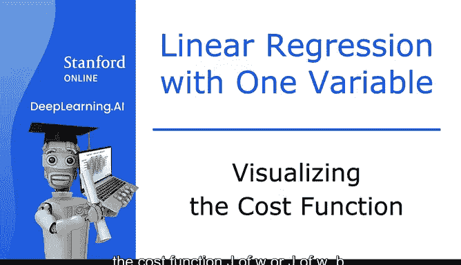
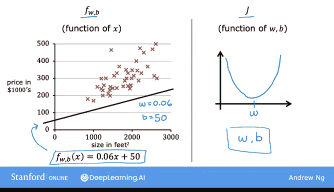
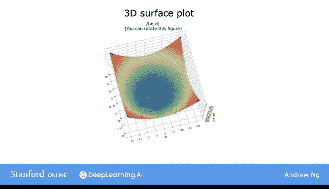
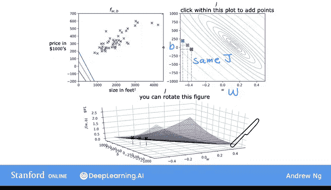

# 吴恩达《机器学习》｜machine-learning（中英字幕-deepseek翻译） - P13：13_01_05_可视化成本函数.zh_en - GPT中英字幕课程资源 - BV1MN4y1S7DE

In the last video， you saw one visualization of the cost function J ofW or J ofWB。

Let's look at some further richer visualizations so you can get an even better intuition about what the cost function is doing。

Here is what we've seen so far。 There's the model。The model parameters is W andB。

 the cost function J of W andB， as well as the goal of linear regression。

 which is to minimize the cost function J of W andB over parameters W andB。

In the last video we had temporarily set B to0 in order to simplify the visualizations。

 but now let's go back to the original model with both parameters W and B without setting B to be equal to0。

 same as last time we want to get a visual understanding of the model function F of x shown here on the left。

And how it relates to the cost function J of WB shown here on the right。

Here's a training set of house， sizes and prices。Let's say pick one possible function of x like this one here I've set W to 0。

06 and B to 50， so F of x is 0。06 times x plus 50。Note that this is not a particularly good model for this training set。

 is actually a pretty bad model， It seems to consistently underestimate housing prices。

 Given these values for W and B， let's look at what the cost function J of W and B may look like。

 Re what we saw last time was when you had only W。Because we temporarily set B to 0 to simplify things。

 back then， we had come up with a plot of the cost function that looked like this as a function of W only。

So when we had only one gram to deview， the cost function had this U shaped curve。

 shaped a bit like a soup bowl that sounds delicious。Now。

 in this housing crisis example that we have on this slide， we have two parameters， W and B。

 and so the plot becomes a little more complex。

It turns out that the cost function also has a similar shape， like a soup bowl。

 except in three dimensions instead of two。In fact， depending on your training set。

 the cost function will look something like this to me， this looks like a soup bowl。

 maybe because I'm a little bit hungry or maybe to you it looks like a curved dinner plate or a hammock actually that sounds relaxing too and there's your coconut drink。

Maybe when you're done with this course， you should treat yourself to a vacation and relax in a hammock like this What you see here is a 3D surface plot where the axes are labeled W and B。

So as you vary W and B， which are the two parameters of the model。

 you get different values for the cost function J of W and B。

This is a lot like the U shaped curve you saw in the last video。

 except instead of having one parameter W as input in the J， you now have two parameters。

 W and B as inputs into this soup bowl or this hammock shaped function J。

And I just want to point out that any single point on this surface represents a particular choice of W and B。

For example， if w was minus 10 and B was minus 15， then the height of the surface above this point is the value of J when。

W is-10， and B is-15。 Now， in order to look even more closely at specific points。

 there's another way of plotting the cost function J that would be useful for visualization。

 which is rather than using these leading surface plots， I'd like to take this exact same function J。

 So I'm not changing the function J at all。 and plotted using something called a contour plot。

 And if you' have ever seen a topographical map showing how high different mountains are。

 the contours in a topographical map are basically horizontal slices of the landscape of say a mountain。

 this image is of Mount Fuji in Japan。 I still remember my family visiting Mount Fuji when I was a teenager these beautiful sight。

😊。

And if you fly directly above the mountain， that's what this contour map looks like。

 It shows all the points that are the same height for different heights。

At the bottom of this slide is a 3D surface plot of the cost function J。

 I know it doesn't look very bow shaped， but it is actually a bow just very stretched out。

 which is why it looks like that in an optional lab that is surely to follow you'd be able to see this in 3D and spin around the surface yourself and' look more obviously bow shaped there。

Next， here on the upper right is a contour plot of this exact same cost function as that shown at the bottom。

The two axes on this contour plot are B on the verax and W on the horizontal axis。

 what each of these ovals also call ellipses shows is the set points on the 3D surface which are at the exact same height。

 In other words， the set points which have the same value for the cost function J。

So to get a contour plot， you take the 3D surface at the bottom and you use a knife。

To slice it horizontally。You take horizontal slices of that 3D surface and get all the points that are at the same height。

Therefore， each horizontal slice ends up being shown as one of these ellipses or one of these ovals。

So concretely， if you take that point and that point and that point。

All of these three points have the same value for the cost function chain。

Even though they have different values for W and B。And in the figure on the upper left。

 you see also that these three points correspond to different functions， F。

 all three of which are actually pretty bad for predicting housing prices in this case。Now。

 the bottom of the boat， where the cost function J is at a minimum is this point right here at the center of this concentric ovals。

If you haven't seen Contour plot much before， I'd like you to imagine， if you will。

 that you are flying high up above the bow in an aeroplane or in a rocket ship。

And you're looking straight down at it。 So that is as if you set a computer monitor flat on your desk。

 facing up。And the bow shape is coming directly out of your screen rising above your desk。

 Imagine that the bow shape grows out of your computer screen line flat。Like that。

So that each of these ovals have the same height above your screen and the minimum of the bow is right down there in the center of the smallest oval。

So it turns out that the Con plots are a convenient way to visualize the 3D cost function J。

 but in a way that's plotted in just 2D。In this video you saw how the 3D bow shapeped surface plot can also be visualized as a contour plot。

 using this visualization2 in the next video， let's visualize some specific choices of W&B in a linear Russian model so to can see how these different choices affect the straight line you're fitting to the data。

 let's go on to the next video。