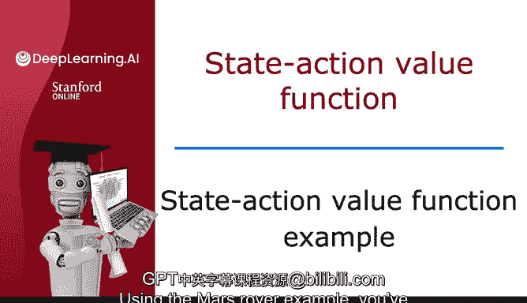
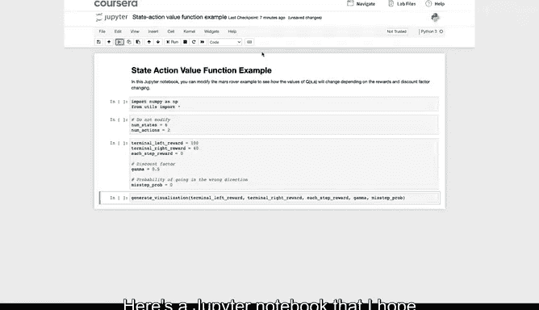
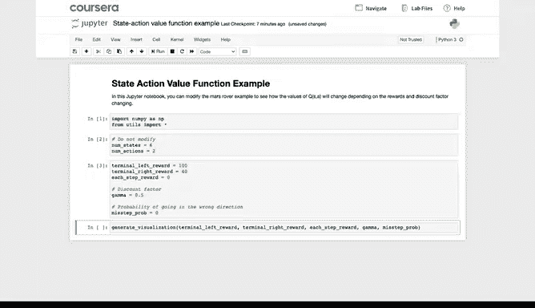
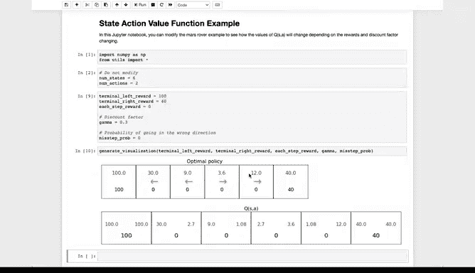

# 吴恩达《机器学习》｜machine-learning（中英字幕-deepseek翻译） - P140：35_03_02_状态-动作价值函数示例.zh_en - GPT中英字幕课程资源 - BV1MN4y1S7DE

Using the Mars Rover example， you're seeing what the values of QSA are like in order to keep honing our intuition about reinforcement learning problems and how the values of QSA change depending on the problem will provided an optional lab that lets you play around modify the Mars Rover example and see for yourself how Q ofSA will change Let's take a look here's a Jupyter notebook that I hope you play with after watching this video I'm going to run these hopeer functions now notice here that this specifies the number of states that are two actions so I wouldn't change these and this specifies the terminal left and the terminal right rewards which has been 140 and then zero was a reward of the intermediate states the discount factor gamlers 0。

5 and let's ignore the misstep probability for now we'll talk about that in the later video and with these value。

If you run this code， this will compute and visualize the optimal policy as well as the Q function Q of SA。

 you learn later about how to develop a learning algorithm to estimate or compute Q of SA yourself So for now don't worry about what code we have written to compute Q of SA but you see that the values here。

 Q of SA are the values we saw in the lecture。 Now here's where the fun starts。

 Let's change around some of the values and see how these things change。

 I'm going to update the terminal right reward to a much smaller value， say is only 10。

If I now rerun the code， look at how Q of SA changes， it now thinks that if you're in state5。

Then if you go left and behave optimally， you get 6。25。

 whereas if you go right and then behave optimally after that， you get a return of only five。

 so now when the reward at the right is so small there's only 10。

 even when you're so close to it you're rather go left all the way and in fact the optimal policy is now to go left from every single state。

Let's make some other changes， I'm going to change the terminal right reward back to 40。

 but let me change the discount factor to 0。9。With a discount factor that's closer to one。

 this makes the mouses Rover less impatient， is willing to take longer to hold out for a higher reward because rewards in the future are not multiplied by 0。

5 to some high power is multiplied by 0。9 to some high power and so is willing to be more patients because rewards in the future are not discounted or multiplied by as small a number as when the discount was 0。

5。So let's rerun the code。And now you see this is Q of SA for the different states。

 and now for state 5 going left actually gives you a higher reward of 65。61 compared to 36。

Notice by the way， that 36 is 0。9 times this terminal reward of 40， so these numbers make sense。

 but when a small patient is willing to go to the left even when you're in stage 5。

Now let's change gammer to a much smaller number like 0。3。

 So this very heavily discounted reward in the future， this makes it incredibly impatient。

 so let me rerun this code and now the behavior has changed notice that now in state4。

Is not going to have the patience to go for the larger 100 reward because the discount factor gama is now so small is 0。

3 it would rather go for the reward of 40 even though it's a much smaller reward is closer and that's whether we choose to do so I hope that you can get a sense by playing around with these numbers yourself and running this code。

 how the values of Q of SA change as was how the optimal return。

 which you notice is the larger of these two numbers QSA how that changes as was how the optimal policy also changes So I hope you go and play with the optimal lab and change the reward function and change the discount factor gammer and try a different values and see for yourself how the values of Q of SA change how the optimal return from different states change and how the optimal policy changes depending。

on these different values and by doing so， I hope that will sharpen your intuition about how these different quantities are affected depending on the rewards and so on in the reinforcement learning application。

After you play through the lab， wed then be ready to come back and talk about what's probably the single most important equation in reinforcement learning。

 which is something called the Belelman equation， so I hope you have fun playing with the optional lab and after that let's come back to talk about Belman equations。

