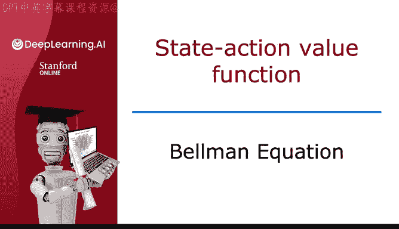
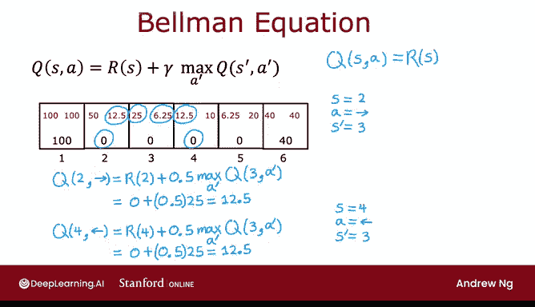
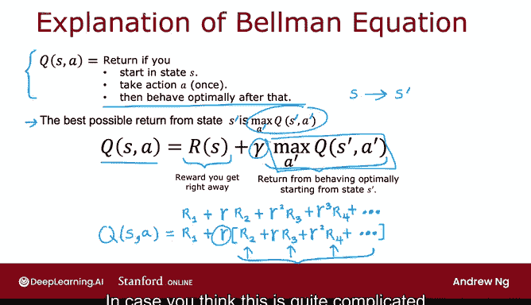
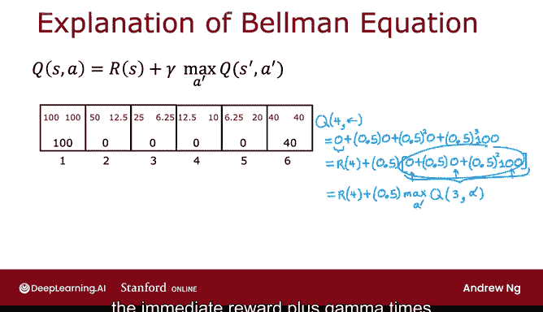

# 吴恩达《机器学习》｜machine-learning（中英字幕-deepseek翻译） - P141：36_03_03_贝尔曼方程.zh_en - GPT中英字幕课程资源 - BV1MN4y1S7DE

Let me summarize where we are。If you can compute the state action value function Q of SA。

 then it gives you a way to pick a good action from every say。

 just pick the action A that gives you the largest value of Q of SA。

 So the question is how do you compute these values Q of SA In reinforcement learning there's a key equation called the Belllman equation that will help us compute the state action value function Let's take a look at what is this equation。

As a reminder， this is the definition of Q of SA return if we start and say this。

 take the action A once and then behave optimally after that。

In order to describe the Bellllman equation， I'm going to use the following notation。

I'm going to use S to denote the current state next I'm going to use r of s to denote the reward of the current state。

 So for our little MDP example， we would have that R of1 state 1 is 100。

 the reward of state2 is0 and so on and the reward of state6 is 40。

I'm going to use the alphabet a to denote the current action。

 so the action that you take in the state S。After you take the action A you get to some new state。

 for example， if you're in state4 and you take the action left， then you get to state3。

 and so I'm going to use as prime to denote the state you get to after taking that action A from the current state S。

I'm also going to use a prime to denote the action that you might take in state S prime。

 the new state that you got to， the notation convention， by the way。

 is that SA correspond to the current state in action， and when we add the prime。

 that's the next state and the next action， the Belel equation is the following， it says that Q of S。

That is the return under the set of assumptions that's equal to。

R of S says a reward you get for being in that state plus the discount factor gamma times max over all possible actions。

 a prime of Q of S prime， the new state you just got to， and then of a prime。

There's a lot going on in this equation， so let's first take a look at some examples that will come back to see why this equation might make sense。

 let's look at an example， let's look at Q of state2 and action right and apply government equation to this to see what value it gives us。

So if the current state is state two and the action is to go right。

Then the next day you get to after going right as prime will be the state3。

 So the beel equation says Q of two right is。R of S so this r of state2。

 which is just a reward 0 plus the discount factor gammer， which we've set to 0。

5 in this example times max of the Q values in state s prime in state 3 so this is going to be the max of 25 and 6。

25 since this is max over a prime of Q of s prime comma a prime and this is taking the larger of 25 or 6。

25 because those are the two choices for state 3 and this turns out to be equal to 0 plus 0。

5 times 25 which is equal to 12。5 which fortunately is Q of 2 and then the action right Let's look at just one more example let me take state。

4 and see what is Q of state4 if you decide to go left in this case。

 the current state is4 current action is to go left。 and so the next state。

 if you can start from4 and go left， you end up also at state three。 So S prime is3 again。

The Belium equation will say this is equal to r of s， so R of state 4， which is 0 plus 0。

5 to discount factor gamma。Of max of a prime， ofq of s prime， that is to state3 again， comma a prime。

So once again， the Q values for state3 are 25 and 6。

25 and the larger of these is 25 and so this works out to be r of 40 plus 0。

5 times 25 which is again equal to 12。5 so that's why Q of4 with the action left is also equal to 12。

5 just one note if you're in a terminal state then beman equation simplifies to Q of SA equals to r of S because there's no state S prime and so that second term would go away which is why Q of SA in the terminal states is just 100100 or 4040 if you wish feel free to post a video and apply the Belman equation to any other state action。

In this NTP and check for yourself if this math works out。

Just to recap， this is how we had defined Q of SA， and we saw earlier that the best possible return from any state S is max over a Q of SA。

In fact， just to rename S and A， it turns out that the best possible term from a state S prime is max over S prime of a prime。

 right I didn't really do anything other than rename Ss prime and A to a prime。

 but this will make some of the intuitions a little bit easier later。

But for any say S prime like state3， the best possible return from say state3 is the max of all possible actions of Q of S prime a prime。

So here again is the developmentel equation and the intuition that this captures is。

If you're starting from state S and you're going to take action A and then act optimally after that。

 then you're going to see some sequence of rewards over time in particular。

 the return will be computed from the reward at the first step。Plus。

 gamma times rewarded the second step， plus gamma squared times rewarded the third step and so on。

 plus dot dot dot until you get the terminal state。

 And what Belman equation says is this sequence of。Re wars what the discount factors？

Can be broken down into two components。First， this R of S that's the reward you get right away in the reinforcement learning literature。

 this is sometimes also called the immediate reward。

 but that's what R1 is is the reward you get for starting out in some status The second term then is the following。

After you start in state S and take action A， you get to some new state S prime。

 the definition of Q of S assumes we're going to behave optimally after that so after we get to S prime we're going to behave optimally and get the best possible return from the state S prime and so what this is max over a prime of Q of s prime a prime。

 this is the return from behaving optimally starting from the state S prime that's exactly what we had written up here is the best possible return for when you start from state S prime。

Another way of phrasing this is this total return down here is also equal to r1 plus。

 and then I'm going to factor our gamma and math is gamma times r2 plus and then of gamma squared is just gamma times r3 plus gamma squared times r4 plus dot dot dot notice that if you were starting from state S prime。

The sequence of reward you get will be R2， then R3， then r4， and so on。And that's why this。

Expression here， that's the total return。 if you were to start from stay as prime。

And if you were to behave optimally， then this expression should be the best possible return for starting from state S prime。

 which is why this sequence of this was equals。That max of a prime of Q of s prime a prime。

 and they were also left over with this extra discount factor yamma there， which is whyq of S。

Is also equal to this expression over here。In case you think this is quite complicated and you aren't following all the details。

 don't worry about it。

So long as you apply to this equation， you will manage to get the right results。

 but the high level intuition I hope you take away is that the total return you get in the reinforcement learning problem has two parts the first part is this reward that you get right away。

And then the second part is gammer times the return you get starting from the next day as prime。

And as these two components together， R of S plus gamma times return from the next state that is equal to the total return from the current state S that is the essence of the Belman equation。

 So just to relate this band to our earlier example Q of four。Left。

 that's the total return for starting state 4 and going left。

So if you were to go left and state four through rewards you get are0 and state 4，0 and state3。

0 and state2 and then 100， which is why the total return is this 0。5 squared plus 05 cubed。

 which was 12。5 and what beman equation is saying is that we can break this up into two pieces。

There is the zero， which is R of the state4。And then plus。0。5 times this other sequence， 0 plus 0。5。

0 plus 0。5 squared times 100。But if you look at what this sequence is。

 this is really the optimal return from the next state S prime that you got to after taking the action left from state 4。

 so that's why this is equal to the reward 4 plus 0。5。Times the optimal return from state three。

 because if you were to start from state three， the reward you get would be zero， followed by zero。

 followed by 100 so this。It's optimal return from state three。

And that's why this is just r of 4 plus 0。5 max of a primeq of say3 a prime。

I know the Belman equation is a somewhat complicated equation。

 breaking down your total returns into the reward you getting right away。

 the immediate reward plus gamma times the returns from the next state S prime if it kind of makes sense to you but not fully is okay。

 don't worry about it， you can still apply Belman's equations to get your reinforcement learning algorithm to work correctly。

But I hope that at least a high level intuition of why breaking down the rewards into what you get right away。

 plus what you get in the future， I hope that makes sense。

Before moving on to develop a reinforcement learning algorithm。

 we have coming up makes an optional video on stochastic Markoff decision processes or on reinforcement learning applications where the actions you take can have a slightly random effect take a look at the optional video if you wish and then after that will start to develop a reinforcement learning algorithm。

