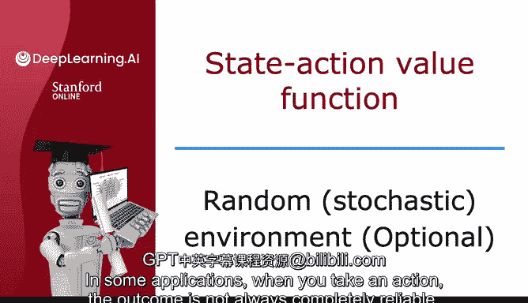
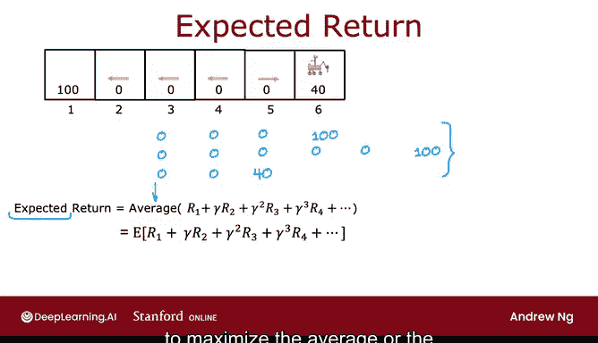
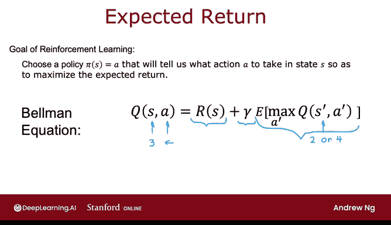
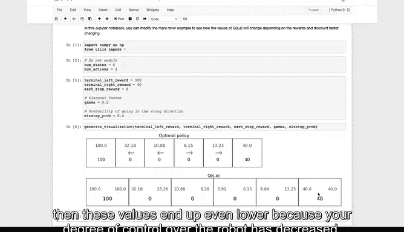

# 吴恩达《机器学习》｜machine-learning（中英字幕-deepseek翻译） - P142：37_03_04_随机环境（可选）.zh_en - GPT中英字幕课程资源 - BV1MN4y1S7DE

In some applications when you take an action， the outcome is not always completely reliable。

 for example， if you command your mas Rover to go left。

 maybe there's a little bit of a rockl or maybe the floors really slippery and so it slips and goes in the wrong direction in practice many robots don't always manage to do exactly what you tell them because of wind blowing and off course or the real slipping or something else so there's a generalization of the reinforcement learning framework we've talked about so far which models random or stochastic environments in this optional video we'll talk about how these reinforcement learning problems work。

Continuing with our simplified Mars Rover example， let's say you take the action and command it to go left。

Most of the time they'll succeed， but what if 10% of the time or 0。1 at the time。

 it actually ends up accidentally slipping and going in the opposite direction。

So if you command it to go left， it has a 90% chance with a 0。

9 chance of correctly going in the left direction， but the 0。

1 chance of actually heading to the right so that it has a 9% chance of ending up in state three in this example and a 10% chance of ending up in state five。

Conversely， if you were to commander to go right and take the action right， it has a 0。

9 chance of ending up in state 5 and a 0。1 chance of ending up in state  three。

 this would be an example of a stochastic environment。

Let's see what happens in this reinforcement learning problem。

Let's say you use this policy shown here where you go left in states2。

3 and4 and go right or try to go right in state5 if you were to start in state 4 and you were to follow this policy then the actual sequence of states you visit maybe random for example。

 in state four you will go left and maybe you're a little bit lucky and it actually gets to state three and then you tell to go left again and maybe it actually gets there you tell to go left again and it gets to that state if this is what happens you end up with the sequence of rewards 000100 but if you were to try this exact same policy a second time maybe you're a little less lucky the second time you start here until to go left and say it succeeds so get zero from state 4 zero from state3 here。

Td to go left， but you got unlucky this time and the robot slips and ends up heading back to state four instead。

And then you taught to go left， then left， then left and eventually gets to that reward of 100。

 In that case， this will be。The sequence of rewards you observe because went from four to three back to four。

 three， two， then one， or is even possible if you turn it from stay four to go left following the policy。

 you may get unlucky even on the first step and you end up going to stay five because it' slipped。

And then stay five， you command it to go right and it succeeds as you end up here。

 and in this case the sequence of rewards you see would be 0040 because you went from4 to five and then state six We had previously written out the return as this sum of discounter rewards。

But when the reinforcement learning problem is s chaastic。

 there isn't one sequence of rewards that you see for sure instead you see the sequence of different rewards。

So in a stochastic reinforcement learning problem what we're interested in is not maximizing the return because that's a random number what we're interested in is maximizing the average value of the sum of discounted rewards and by average value I mean if you were to take your policy and try it out a thousand times or 10 thousand times or a million times you get lots of different reward sequences like that and if you were to take the average over all of these different sequences。

Of sum of this counterres then that's what we call the expected return in statistics the term expected is just another way of saying average but what this means is we want to maximize what we expect to get on average in terms of the sum of this counterrewards the mathematical notation for this is the right is as E E says the expected value of R1 plus gamma r2 plus and so on So the job of reinforcement learning algorithm is to choose a policy pi to maximize the average or the expected some of this counterrewards so to summarize when you have a stoastic reinforcement learning problem or a stoastic markoff decision process the goal is to choose a policy to test what action a to take in state S so as to maximize the expected return。

The last way that this changes what we've talked about is it modifies Belman equation a little bit。

 So here's Belman equation exactly as we've written down。

 but the difference now is that when you take the action A and state S the next state S prime you get to is random when you're in state V and you try to go left the next state S prime it could be the state2 or it could be the state4 So S prime is now random which is why we also put an average operator or an expected operator here So we say that the total return from state S taking action A once in a behaving optimally is equal to the reward you get right away also called the immediate reward plus the discount factor gamma plus what you expect to get on average of the future returns if you want to sharpen your intuition about what。

Happens with these stochastic reinforcement learning problems you go back to the optional lab that I had shown you just now where this parameter misstep pro or misstep probability is the probability of yourmas rover going in the opposite direction then you had commanded it to so if we set misstep pro to be 0。

1 and we execute the notebook and so these numbers up here are the optimal return。

If you were to take the best possible actions， take this auto policy， but the robot were to。

Step in the wrong direction， 10% of the time， and these are the Q values for this stochastic MDP。

Notice that these values are now a little bit lower because you can't control the robot as well as before。

 the Q values as well as the optimal returns have gone down a bit。 And in fact。

 if you were to increase the misstep probability， say 40% of the time。

 the robot doesn't even go in the direction you commanded it to only 60% of the time it goes where you told it to then these values end up even lower because your degree of control over the robot has decreased。

 So encourage you to play with the optional lab and change the value of the misstep probability and see how that affects the optimal return or the optimal expected return as well as the Q values Q of SA。

Now in everything we've done so far we've been using this Markoff decision process。

 this Mars Rover with just six states for many practical applications the number of states will be much larger and the next video will take the reinforcement learning or Markoff decision process framework with talked about so far and generalize it to this much richer and maybe even more interesting set of problems with much larger and the particular with continuous states faces。

 let's take a look at that in the next video。