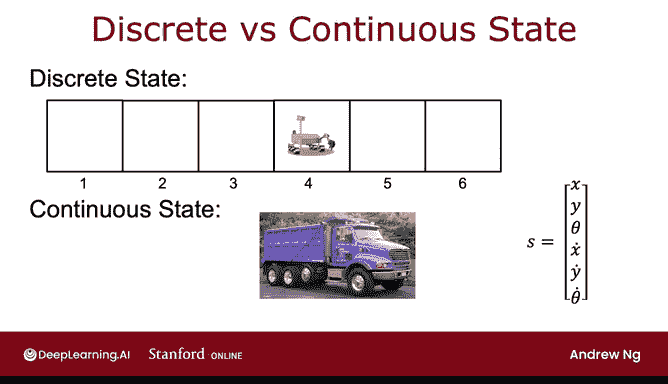

# 吴恩达《机器学习》｜machine-learning（中英字幕-deepseek翻译） - P143：38_03_01_连续状态空间应用示例.zh_en - GPT中英字幕课程资源 - BV1MN4y1S7DE

Many robotic control applications， including the Lunar Laer application that you work on in the practice lab have continuous state spaces。

 let's take a look at what that means and how to generalize the concept we've talked about to these continuous state spaces to simplify Mars Rover example we use and use a discrete set of states and what that means is that simplify Mar Rover could only be in one of six possible positions。

But most robots can be in more than one of six or any discrete number of positions。

 instead they can be in any of a very large number of continuous value positions。For example。

 if the mo rover could be anywhere on a line so its position was indicated by a number ranging from 0 to 6 kilometers where any number in between is valid that would be an example of a continuous state space because the position would be represented by a number such as that is 2。

7 kilometers along or 4。8 kilometers or any other number between 0 and6。

 let's look at another example， I'm going to use for this example。

 the application of controlling a car or a truck here's a toy car， actually a toy truck。

 this one belongs to my daughter if you're building a self-driving car or a self-driving truck and you want to control this to drive smoothly then the state of this truck might include a few numbers such as this exposition is Y position maybe its orientation what way is it。

提星。Assuming the trap stay on the drown， you probably don't need to worry about how tall it is。

 how high up it is， but so state would include x y and its angle theta。

 as well as maybe as speed and x direction， the speed in y direction and how quickly this turning。

 is it turning at one degree per second， is it turning at 30 degrees per second。

 or is it turning really quickly at 90 degrees per second？

So for a truck or a car the state might include not just one number like how many kilometers it is along on this line。

 but it might include six numbers， is x position， is y position， its orientation。

 which I'm going to denote using Greek alphabet theta， as well as is velocity in the x direction。

 which I'm going to denote using x dot， so that means how quickly is this x coordinate changing。

Y dot， how quickly is the y coordinate changing， and then finally theta dot。

 which is how quickly is the angle of the car changing？Whereas for the six state Mars Rover example。

 the state was just one of six possible numbers it could be 1，2，3，4。

5 or6 for the car the state would comprise this vector of six numbers and any of these numbers can take on any value within its valid range for example。

 theta should range between zero and360 degrees Let's look at another example。

 what if your building of reinforcement learning algorithm to control an autonomous helicopter how would you characterize the position of a helicopter to illustrate that have we we here a small toy helicopter so the position of the helicopter would include is x position such as how far north or south is the helicopter is Y position maybe how far on the eastwes axis is the helicopter and then also Z the height of the helicopter above ground。

But other than the position， the helicopter also has an orientation and conventionally one way to capture this orientation is with three additional numbers。

 one of which captures the row of the helicopter， is it rolling to the left or the right。

 the pitch is it pitching forward or pitching up pitching back and then finally the yore which is what' the compas orientation is it facing is it facing north or east or south or west。

 so to summarize the state of the helicopter includes is position in the say north south direction。

 is position in the eastwet direction， Y is high above ground and also the row。The pitch。

And then also， the yourre。Of the helicopter， to write this down。

 the state therefore includes the position X， Y， Z。And then。The row， pitch。

 and yourre denoted with Greek alphabets。Phi theta and omega。

 but to control the helicopter we also need to know is speed in the x direction in the y direction and in the z direction as well as is rate of turning also called the angular velocity So how fast is this row changing and how fast is this pitch changing and how fast is is your changing So this is actually the state used to control autonomous helicopters is this list of 12 numbers that is input to a policy and the job of a policy is to look at these 12 numbers and the s what an appropriate action to take the helicopter So in a continuous state reinforcement learning problem or a continuous state markoff decision process continuous state MTP。

The state of the problem isn't just one of a small number of possible discrete values like a number from one to six instead it's a vector of numbers any of which could take any of a large number of values in the practice lab for this week。

 you get to implement for yourself， a reinforcement learning algorithm applied to a simulated lunar lander application landing something on the moon in simulation。

Let's take a look on the next video at what that application entails since therell be another continuous state application。

