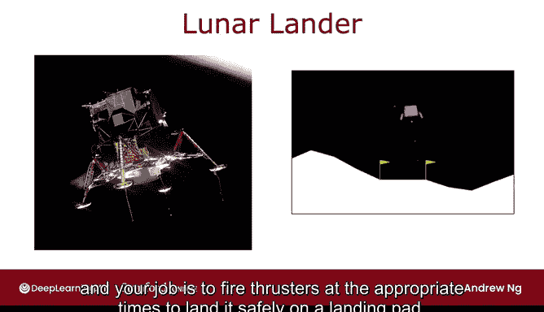
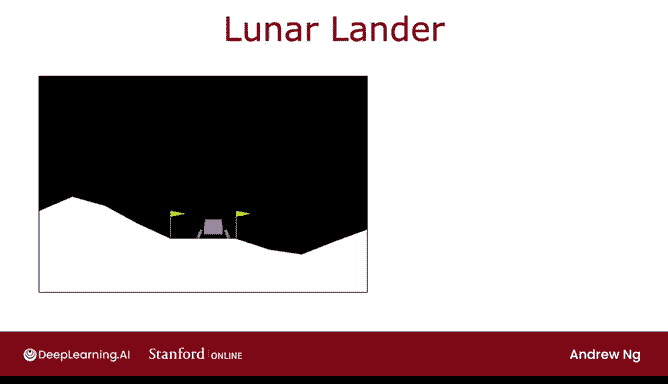
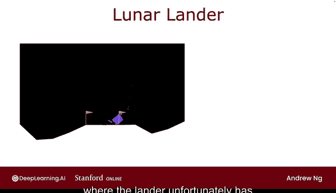
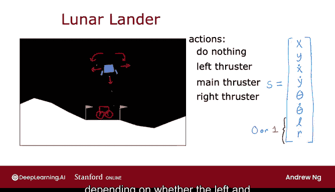
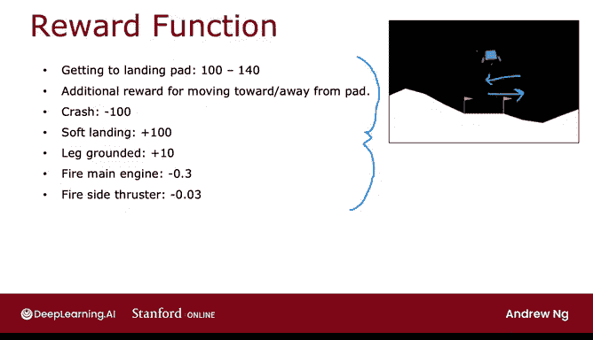
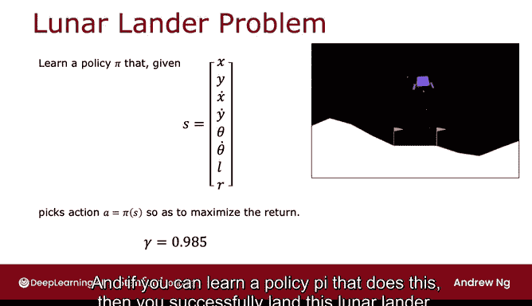

# 吴恩达《机器学习》｜machine-learning（中英字幕-deepseek翻译） - P144：39_03_02_月球着陆器.zh_en - GPT中英字幕课程资源 - BV1MN4y1S7DE

The lunar lander lets you land a simulated vehicle on the moon It's like a funder video game that's been used by a lot of reinforcement learning researchers let's look at what it is in this application you're in command of a lunar lander that is rapidly approaching the surface of the moon and your job is the fire thrustes at the appropriate times to land it safely on a landing pad to give you a sense of what it looks like。

 this is the lunar lander landing successfully and as firing thrustes downward and to the left right to position itself to land between these two yellow flags or if the reinforcement learning algorithms policy does not do well。

 then this is what it might look like where the lander unfortunately has crashed on the surface of the moon。

In this application you have four possible actions on every time step。

 you could either do nothing in which case the forces of inertia and gravity pull you toward the surface of the moon or you can fire a left thruster when you see a little red dot come out on the left。

 that's firing the left thruster， they'll tend to push the lunar lander to the right or you can fire the main engine that's thrusting down the bottom here or you can fire the right thruster and that's firing the right thruster which will push you to the left。

And your job is to keep on picking actions over time so as to land the lunar Lada safely between these two flags here on the landing pad in order to give the actions a shorter name。

 I'm sometimes going to call the actions nothing meaning do nothing or left meaning far the left thruster or main meaning by the main engine downward or right。

 so I'm going to call the actions nothing left main and right for short later in this video。

 how will the state face of this MTTP， the states are is position X and y so how far to the left or right and how high up is it。

 as well as velocity x dot Y dot， how fast is it moving in the horizontal and vertical directions and then also is angle so how far is the lunar Lada tilted to the left or tilted to the right is angular velocity theta dot and then finally because a small difference in positioning。

It makes a big difference in whether or not it's landed。

 we're going to have two other variables in the state vector， which we call L and R。

 which corresponds to whether the left leg is grounded。

 meaning whether or not the left leg is sitting on the ground as well as R。

 which corresponds to whether or not the right leg is sitting on the ground。

 so whereas x Y x dot y dot theta theta dot are numbers L and R will be binaryvalued and can take on only values0 or1 depending on whether the left and right legs are touching the ground。

Finally， here's the reward function for the lunar lander if it manages to get to the landing pad then it receives a reward between 100 and 140 depending on how well its flown and gotten to the center of the landing pad we also give it an additional reward for moving toward or away from the pad so if it moves closer to the pad it receives a positive reward and it moves away and drifts away it receives a negative reward。

If it crashes， it gets a large negative 100 reward， if it achieves a soft landing。

 that is a landing that's not a crash， it gets a plus 100 reward for each leg the left leg or the right leg that it gets grounded it receives a plus 10 reward and finally to encourage it not to waste too much fuel and fire thrustsses unnecessarily every time it fires the main engine。

 we give it a negative 0。3 reward and every time it fires the left or the right side thrusters we give it a negative 0。

03 reward notice that this is a moderately complex reward function。

 the designers of the lunar lander application actually put some thought into exactly what behavior you want and codified it in the reward function to incentivize more of the behaviors you want and fewer of the behaviors like crashing that you don't want。

You find when you're building your own reinforcement learning application。

 itll usually take some thought to specify exactly what you want or don't want and to codify that in the reward function。

 but specifying the reward function should still turn out to be much easier than specifying the exact right action to take from every single state which is much harder for this in many other reinforcement learning applications so the lunar Laer problem is as follows our goal is the learner policy pi that when given a state S as written here picks an action a equals pi of S。

So as to maximize the return， the sum of discount rewards。And usually for the lunar lander。

 we use a fairly large value for cameram， we use a value of cameram that's equal to 0。985。

 so pretty close to one。And if you can learn a policy pie that does this。

 then you successfully land this lunar Lander， exciting application and we're now finally ready to develop a learning algorithm which will turn out to use deep learning on neural networks to come up with a policy to land the lunar lander let's go on into the next video where we'll start to learn about deep reinforcement learning。

