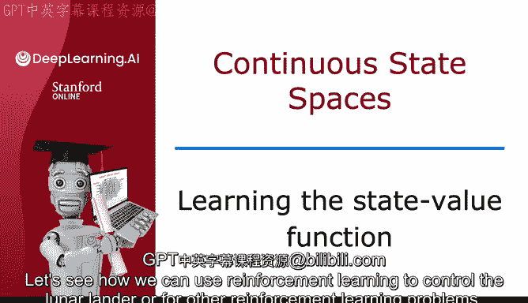
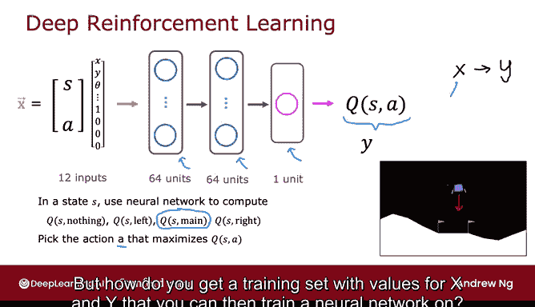
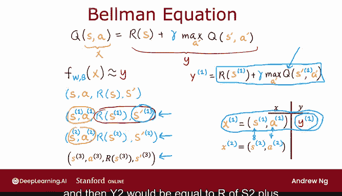
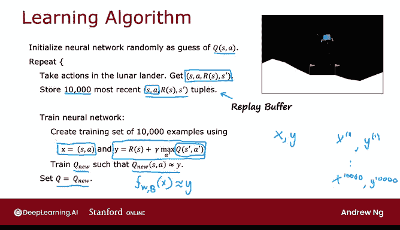

# 吴恩达《机器学习》｜machine-learning（中英字幕-deepseek翻译） - P145：40_03_03_学习状态价值函数.zh_en - GPT中英字幕课程资源 - BV1MN4y1S7DE

Let's see how we can use reinforcement learning to control the lunar Laer or for other reinforcement learning problems the key idea is that we're going to train a neural network to compute or to approximate the state action value function Q of SA and that in turn will let us pick good actions let's see how it works the heart of the learning algorithm is we're going to train a neural network that inputs the current state and the current action and computes or approximates Q of SA in particular for the lunar Laer we're going to take the state S and any action A and put them together concretely the state was that list of eight numbers that we saw previously。

So youd have x Y x dot y dot theta theta dot and an LR for whether the lakes are grounded。

 so that's a list of eight numbers to describe the state then finally we have four possible actions nothing left main or main engine and right and we can encode any of those four actions using a one hot feature vector so if action were the first action we may encode it using1000 or if it was the second action to find the left thruster we may encode it as0100 so this list of 12 numbers eight numbers for the state and then four numbers one hot encoding of the action is the input we have to the neural network and I'm going to call this X well then take these 12 numbers and feed them to a neural network with say。

4 units in the first hidden layer， 64 units and the second hidden layer。

 and then a single output in the output layer。And the job of the neural network is the output Q of S the state action value function for the lunar lander given the input S and A and because we'll be using neural network training algorithms in a little bit。

 I'm also going to refer to this value Q of SA as the target value Y that will train the neural network to approximate notice that I did say reinforcement learning is different from supervised learning but what we're going to do is not input the state and have an output in action。

What we're going to do is input the state action pair and have it try to output Q of S A and using a neural network inside your enforcement learning algorithm this way will turn out to work pretty well。

 We'll see the details in a little bit。So don't worry about it if it doesn't make sense yet。

But if you can train a neural network with appropriate choices of parameters in hidden layers and in the Op layer to give you a good estimates of Q of SA。

 then whenever your lunar lander is in some state S。

You can then use the neural network to compute Q of SA for all four actions。

 you can compute Q of S nothing， Q of S left Q of S main， Q of S right。

 and then finally whichever of these has the highest value。

 you would pick the corresponding action A。So for example， if out of these four values。

 Q of S main is largest， then you would decide to go and fire the main engine of the lunar lander。

So the question becomes how do you train a neural network to output Q of S It turns out the approach will be to use Belman's equations to create a training set with lots of examples X and Y and then we'll use supervised learning exactly as you learned in the second course when we talked about neural networkss to learn using supervised learning。

 a mapping from X to Y that is a mapping from the state action pair to this target value Q of SA。

 but how do you get a training set with values for X and Y that you can then train a neural network on。

 let's take a look。

So here's the Belman equation， Q ofSA equals R of S plus gamma max of a prime Q of S prime a prime。

 so the right hand side is what you want Q ofSA to be equal to。

 so I'm going to call this value on the right hand side Y。And the input to the neural network is。

A state and inaction， so I'm going to call that。X。And the job of a neural network is to input X that is input a state action pair and try to accurately predict what would be the value on the right So in supervised learning we were training a neural network to learn a function F which depends on a bunch of parameters W and B the parameters in the various layers of the neural network and it was a job of the neural network to input X and hopefully I'll put something close to the target value Y So the question is how can we come up with a training set were values X and y for a neural network to learn from Here's what we're going to do we're going to use the lunar lander and just try taking different actions in it if we don't have a good policy yet。

 we'll take actions randomly farther left faster farther right faster。

the main engine do nothing and by just trying out different things in the Lunar Lander simulator will'll observe a lot of examples of when we're in some state and we took some action。

 maybe a good action， maybe a terrible action either way。

And then we got some rewards R of us for being in that state， and as a result of our action。

 we got to some new state as prime。As you take different actions in the Lunar lander。

 you see these SAR of SS prime and we call them tuples in Python code many times， for example。

 maybe one time you're in some state S and just to give this an index I'm going call this S1 and you happen to take some action A1。

 this could be nothing left main faster there or right。

As a result of which you got some reward and you wound up at some state S prime1 and maybe a different time。

 you're in some other state S2， you took some other action it could be good action could be bad action could be any of the four actions and you got the reward and then you wound up with S prime2 and so on multiple times and maybe you've done this 10000 times or even more than 10000 times So you would have to save the way with not just S1 A1 and so on。

 but up to S 10000 a 10000。 It turns out that each of these list of four elements。

 each of these tuples will be enough to create a single training example X1 Y1 in particular here's how you do it There are four elements in this first tuple The first two will be used to compute X1 and the second two would be used to。

It's Y1。In particular， X1 is just going to be。S1。A1， put together。S1 would be8 numbers。

 the state of the lunar lander， a1 would be four numbers。

 the one hot encoding of whatever action this was， and y1 would be computed using the right hand side of the Bellman equation in particular the Belman equation says when you input S1a1。

You want Q of S1a1 to be this righthand side to be equal to r of S1 plus gamma max over a prime of Q of S1 prime a prime and notice that these two elements of the tuple on the right。

 give you enough information to compute this you know what is r of S1 that's what you've saved the away here。

 plus the discount factor gamma times max over all actions a prime of Q of s prime1 that's the state you got to in this example and then take the max over all possible actions a prime and so I'm going to call this Y1。

And when you compute this， this will be some number like 12。5 or 17 or 0。5 or somebody the number。

 and we'll save that number here as y1 so that this pair x1Y1 becomes the first trading example in this little data we're computing。

Now you may be wondering， wait， where does Q of S prime a prime or Q of S prime 1 a prime come from Well。

 initially we don't know what is the Q function， but it turns out that when you don't know what is the Q function。

 you can start off with taking a totally random guess for what is the Q function and we'll see on the next slide that the algorithm will work nonetheless but in every step Q here is just going to be some guess that would get better over time。

 it turns out of what is the actual Q function let's look at the second example if you had a second experience where youre in state S2 took action A2 got that reward and then got to that state。

 then we would create a second training example in this dataset x2 where the input is now S2 a2 so the first two elements go to computing the input X and then y2 will be equal to R。

Of S plus gamma max of a prime Q of S prime 2。A prime and whatever this number， Y2。

 we put this over here in our small but growing training set。

And so on and so forth until maybe you end up with 10，000。Training examples with these X Y pairs。

And what we'll see later is that we'll actually take this training set where the x's are inputs with12 features and the Y's are just numbers and well train a neural network with say the me squared error loss to try to predict y as a function of the input X。

So what I describe here is just one piece of the learning algorithm we'll use。

 let's put it all together on the next slide and see how it all comes together into a single algorithm。

So let's take a look at what the full algorithm for learning the Q function is like。First。

 we're going to take our neural network and initialize all the parameters of the neural network randomly。

Initially we have no idea what is the Q function， so let's just pick totally random values of the weights and we'll pretend that this neural network is our initial random guess for the Q function。

This is a little bit like when you are training linear regression and you initialize all the parameters randomly and then use gradient descent to improve the parameters initializing randomly for now is fine but what's important is whether the algorithm can slowly improve the parameters to get to a better estimate Next we will repeatedly do the following。

We will take actions in the Lunar lander， so fly around randomly， take some good actions。

 take some bad actions， it's okay either way， but you get lots of these topples of when it was in some state you took them actually。

 got to reward R of us and you got to some state as prime and what we will do is store the 10。

000 most recent examples of these topples。As you run this algorithm， you will see many。

 many steps in the Lunar Lander， maybe hundreds of thousands of steps。

 but to make sure we don't end up using excessive computer memory。

 common practice is to just remember the 10，000 most recent such tuples that we saw taking actions in the MDP。

This technique of storing the most recent examples only is sometimes called the replay buffer in a reinforcement learning algorithm。

 so for now we're just flying the lunarlander randomly。

 sometimes crashing sometimes not and getting these tuples as experience for our learning algorithm。

Occasionally， then we will train the neural network in order to train the neural network。

 Here's what we do。 We'll look at these 10000 most recent topples we have saved and create。

A training set of 10，000 examples， so training set needs lots of pairs of X and Y。

And for our training examples， X will be the SA from this part of to topple。

 so there'll be a list of 12 numbers， the eight numbers for the state and the four numbers for the 1 hot encoding of the action。

 and the target value that we want the neural network to try to predict will be y equals R of S plus gamma max of a prime Q of S prime a prime。

How do we get to this value of Q well initially is this neural network that we had randomly initialized。

 so it may not be a very good guess， but as a guess， after creating these 10，000 training examples。

 we'll have training examples x1， y1 through x10，000 y10，000。And so we're train a neural network。

And I'm going to call the new neural network Q new， such that Q new of SA。

Learns to approximate Y so this is exactly training that neural network。

To output F we parameters W and B to input X to try to approximate to target value Y Now this neural network should be a slightly better estimate of what the Q function or the state action value function should be and so what we'll do is we're going to take Q and set it to this new neural network that we had just learned。

Many of the ideas in this algorithm are due to min at all。

 and it turns out that if you run this algorithm where you start with a really random guess of the Q function。

 but use beman's equations to repeatedly try to improve the estimates of the Q function then by doing this over and over。

 take a loss of actions， trading a model that will improve your guess for the Q function and so for the next model you train you now have a slightly better estimate of what is the Q function。

 and then the next model you train will be even better and when you update Q equals Q new。

 then for the next time you train a model， Q of S prime a prime will be an even better estimate and so as you run this algorithm on every iteration Q of S prime a prime hopefully becomes an even better estimate of the Q function so that when you run the algorithm long enough this will actually become a pretty good estimate of。

The true value of Q of SA。So that you can then use this to pick hopefully good actions for the MTP。

The algorithm you just saw is sometimes called the DQN algorithm， which stands for deep Q network。

 because you are using deep learning， a neural network to train a model to learn the Q function。

 So hence DQN or deep Q network DQ using a neural network And if you use the algorithm as I described it。

 it will kind of work okay on the lunar lander。 Maybe itll take a long time to converge maybe it won't land perfectly。

 but it'll sort of work。But it turns out that with a couple refinements to the algorithm。

 it could work much better， so in the next few videos。

 let's take a look at some refinements to the algorithm that you just saw。

