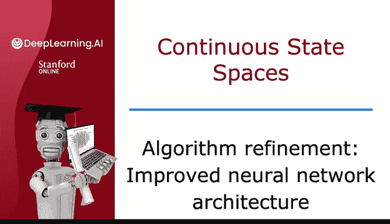
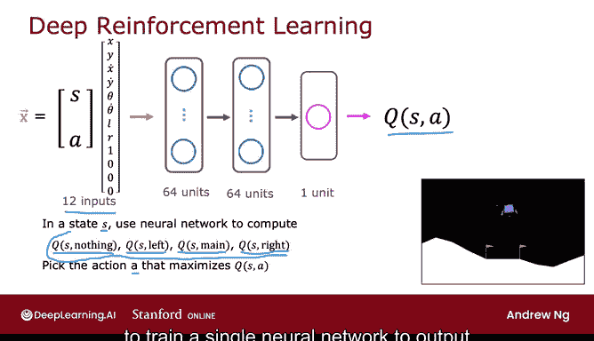
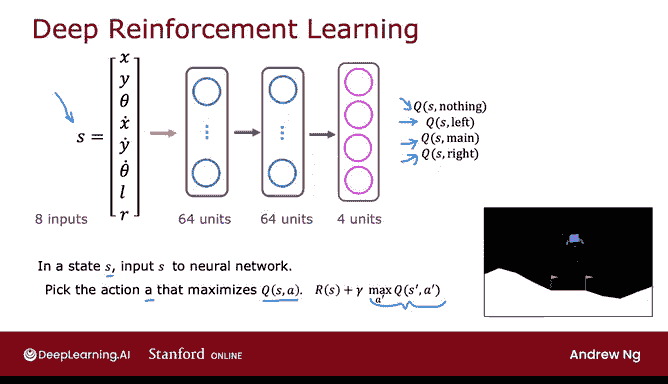

# 吴恩达《机器学习》｜machine-learning（中英字幕-deepseek翻译） - P146：41_03_04_算法改进：优化的神经网络架构.zh_en - GPT中英字幕课程资源 - BV1MN4y1S7DE

In the last video we saw a neural network architecture that would input the state in action and attempt to output the Q function Q of SA。

 It turns out that there's a change to neural network architecture that make this algorithm much more efficient。

 so most implementations of DQN actually used this more efficient architecture that we'll see in this video。

 Let's take a look。

This was the neural network architectureure we saw previously where it would input 12 numbers and output Q of SA whenever we are in some state S we would have to carry out inference in the neural network separately four times to compute to these four values so as to pick the action A that gives us the largest Q value This is inefficient because we have to carry out inference four times from every single state instead it turns out to be more efficient to train a single neural network to output all four of these values simultaneously。

This is what it looks like here's a modified neural network architecture。😊。

Where the input is eight numbers。Presponding to the state of the lunar Laer。

 it then goes through the neural network with 64 units and first hidden layer。

64 units in the second hidden layer。 and now the output unit has four output units and the job of the neural network is to have the four output units output Q of S nothing Q of S left Q of S main and Q of S right。

 So the job of the neural network is to compute simultaneously the Q value for all four possible actions for when we are in the state S。

 So this turns out to be more efficient because given a state S we can run inference just once and get all four of these values and then very quickly pick the action A that maximizes Q of S And you notice also in Belman's equations there's a step in which we have to compute max over a prime。

2 of S prime a prime。 this is multipied by gammer， and then it was plus R of S up here。

This neural network also makes it much more efficient to compute this because we're getting Q of S prime a prime for all actions a prime at the same time。

 so you can then just pick the max to compute this value for the right hand side of Belvin's equations This change to the neural network architecture makes the R much more efficient and so we will be using this architecture in the practice lab。

Next， there's one other idea that'll help the album a lot。

 which is something called an Epsilon greedy policy。

 which affects how you choose actions even while you're still learning。

 let's take a look at the next video and what that means。

