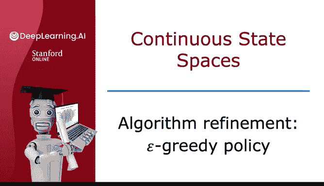
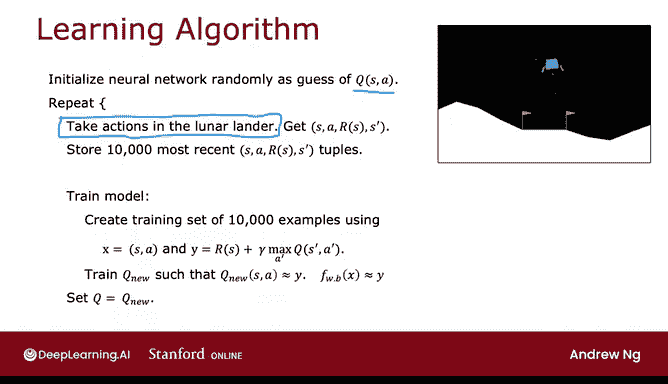
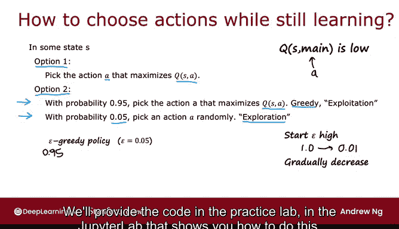

# 吴恩达《机器学习》｜machine-learning（中英字幕-deepseek翻译） - P147：42_03_05_算法改进：贪婪策略.zh_en - GPT中英字幕课程资源 - BV1MN4y1S7DE

In the learning algorithm that we developed， even while you're still learning how to approximate Q of SA。

 you need to take some actions in the Lunar Lander。

 So how do you pick those actions while you're still learning the most common way to do so is to use something called an epsilon greedy policy Let's take a look at how that works here's the algorithm that you saw earlier one of the steps in the algorithm is to take actions in the Lunar Lander So when the learning algorithm is still running we don't really know what's the best actions to take in every state that we did we already be done learning。

But even while we're still learning then don't have a very good estimate of Q of SA yet how do we take actions in this step of the learning algorithm let's look at some options when you're in some state we might not want to take actions totally a random because that will often be a bad action。

So one natural option would be to pick whenever in state S， pick an action A that maximizes Q of SA。

 so we may say even if Q of SA is not a great estimate of the Q function。

 let's just do our best and use our current guesser Q of SA and pick the action A that maximizes it。

 it turns out this may work okay。But isn't the best option Instead， here's what is commonly done。

 Here's option2， which is most of the time， let's say with probability 0。95。

 pick the action that maximizes Q of SA。 So most of the time we'll try to pick a good action using a current guess of Q of SA but the small fraction of the time。

 let's say 5% of the time we' pick an action a randomly Why do we want to occasionally pick an action randomly Well here's why。

Suppose to some strange reason that Q of SA was initialized randomly so that the learning algorithm thinks that firing the main thruster is never a good idea。

 maybe the neural network parameters will initialized so that of S main is always very low。

 if that's the case， then the neural network because it's trying to pick the action A that maximizes Q of SA。

 it will never， ever try firing the main thruster， and because it never。

 ever tries firing the main thruster， it will never learn that firing the main thruster is actually sometimes a good idea。

And so because of the random initialization， if the neural network somehow initially gets stuck in his mind that something's a bad idea。

 just by chance， then option one means that it will never try out those actions and discover that maybe it's actually a good idea to take that action like fire the main thrust is sometimes。

 so under option two on every step we have some small probability of trying out different actions。

So that the neural network can learn to overcome its own possible preconceptions about what might be a bad idea that turns out not to be the case this idea of picking actions randomly is sometimes called an exploration step because we're going to try out something that may not be the best idea。

 but we're going to just try out some action in some circumstance explore and learn more about an action in the circumstance where we may not have as much experience before。

 taking an action that maximizes two of SA sometimes this is called a greedy。Action。

 because we try to actually maximize our return by picking this or in the reinforcement learning literature。

 sometimes you also hear this as an exploitation step。 I know that exploitation is not a good thing。

 Nobody should ever exploit anyone else。But historically。

 this was the term user reinforcement learning to say let's exploit everything we've learned to do the best we can so in the reinforcement learning literature。

 sometimes you hear people talk about the exploration versus exploitation and trade off。

 which refers to how often do you take actions randomly or take actions that may not be the best in order to learn more versus。

Trying to maximize your return by， say， taking the action that maximizes Q of S。

 this approach that is option2 has a name is called an epsilon greedy policy where here epsilon is 0。

05 is the probability of picking an action randomly。 And does is the most common way to make your。

Refor to learning algorithm， explore a little bit even whilst' occasionally or maybe most of the time taking greedy actions and by the way。

 a lot of people have commented that the name epsilon greedy policy is confusing because you're actually being greedy 95% of the time。

 not 5% of the time so maybe one minus epsilon greedy policy because it's 95% greedy。

5% exploring that's actually a more accurate description of the algorithm but for historical reasons the name epsilon greedy policy is what has stuck And so this is the name that people use to refer to the policy that explores actually epsilon fraction of the time rather than is greedy epsilon fraction of the time。

Lastly， one of the trick that's sometimes user reinforcement learning is to start off Epsilon high。

 so initially you are taking random actions a lot of the time and then gradually decrease it。

So that over time you are less likely to take actions randomly and more likely to use your improving estimate of the Q function to pick good actions so for example。

 in the lu Laer exercise you might start off with epsilon very。

 very high maybe even epsilon equals 1。0 so you're just picking actions completely a random initially and then gradually decrease it all the way down to say 0。

01 so that eventually you're taking greedy actions 99% of the time and acting randomly only a very small 1% of the time If this seems complicated don't worry about it we provide the code in the practice lab in a Jupyter lab that shows you how to do this。

If you were to implement the algorithm， as we've described it with the more efficient neural network architecture and with an epsilon greedy exploration policy。

 you find that it work pretty well on the Lunar lander。

One of the things that I've noticed for reinforcement learning algorithm is that compared to supervised learning。

 they're more finicky in terms of the choice of hyper parameters， so for example。

 in supervised learning if you set the learning rate a little bit too small， you know。

 then maybe the algorithm will take longer to learn。

 maybe it takes three times as long the train which is annoying but maybe not that bad。

Whereas in reinforcement learning find that if you set the value of epsilon not quite as well or set other parameters。

 not quite as well， it doesn't take three times as long to learn。

 it may take 10 times or 1 hundred times as long to learn and so reinforcement learning algorithm。

 I think because they're less mature and supervised learning algorithms are much more finicky to little choices of parameters like that and it actually sometimes takes is frankly more frustrating to tune these parameters for reinforcement learning algorithm compared to a supervised learning algorithm。

But again， if you're worried about the practice lab， the program exercise。

 we give you a sense of good parameters you use in the program exercise so that you should be do that and successfully land the lunar Laer。

 hopefully without too many problems in the next optional video I want to describe a couple more algorithm refinements。

 mini batching and also using soft updates even without these additional refinements。

 the algorithm will work okay but these are additional refinements that make the algorithm run much faster and it's okay if you skip this video we provided everything you need in the practice lab to hopefully successfully completed。

 but if you're interested in learning about more of these details of two neighbor reinforcement learning algorithms then come with me and let's see in the next video mini batching and soft updates。

