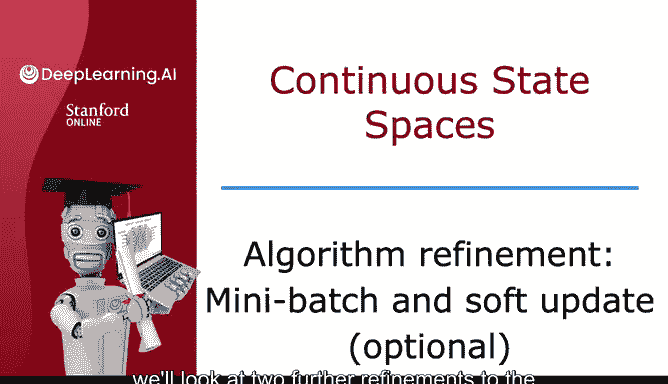
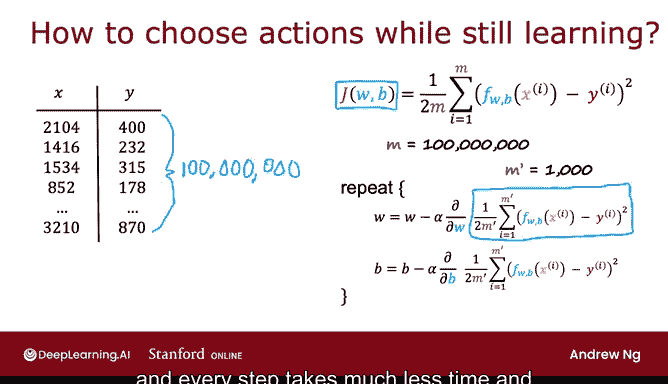
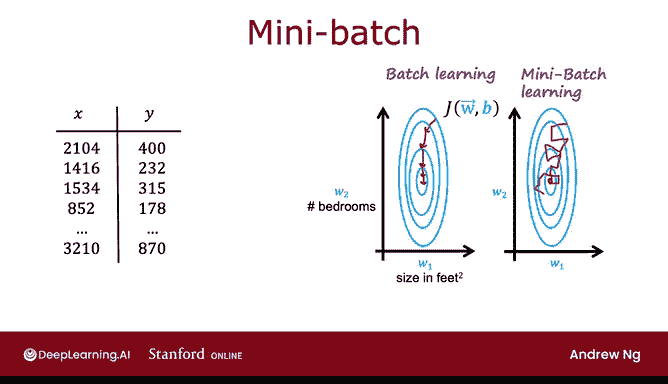
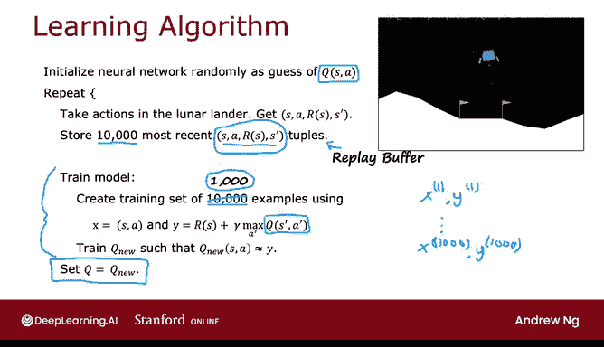
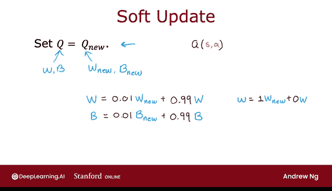

# 吴恩达《机器学习》｜machine-learning（中英字幕-deepseek翻译） - P148：43_03_06_算法改进：小批量与软更新（可选）.zh_en - GPT中英字幕课程资源 - BV1MN4y1S7DE

In this video we'll look at two further refinements to the reinforcement learning algorithm you've seen The first idea is called using mini batches and this turns out to be an idea that can both speed up your reinforcement learning algorithm and is also applicable to supervise learning and can help you speed up your supervised learning algorithm as well。

 like training a neural network or training a linear regression or logistic regression model。

The second idea we'll look at is soft updates， which it turns out will help your reinforcement learning algorithm do a better job to converge to a good solution Let's take a look at mini batches and soft updates to understand mini batches let's just look at supervised learning to start Here's the data sets of housing sizes and prices that you had seen way back in the first course of this specialization on using linear regression to predict housing prices。

There we had come up with this cost function for the parameters W and B。

 it was one of a 2M sum of the prediction minus the actual value y squared。

 and the gradient descent algorithm was to repeatedly update W as w minus the learning rate alpha times the partial derivative respect to W of the cost J of WB。

And similarly to update B as follows， let me just take this definition of J of WB and substitute it。

And here。Now when we looked at this example way back。

 when we're starting to talk about linear regression and supervised learning。

 the training set size M was pretty small， I think we had 47 training examples。

But what if you have a very， very large trading set， say M equals 100 million。

 There are many countries， including the United States with over 100 million housing units and so a national senses will give you a data that is this order magnitude of size The problem with this algorithm when your data set is this big。

 is that every single step of gradient descent requires computing this average over 100 million examples and this turns out to be very slow Every step of gradient descent means you would compute this sum or this average over 100 million examples。

 then you take one tiny gradient descent step and you go back and have to scan over your entire 100 million example data set again to compute the derivative on the next step that you take another tiny gradient descent step and so on and so on。

So when the training set size is very large， this gradient descent algorithm turns out to be quite slow the idea of mini batch gradient descent is。

To not use all 100 million training examples on every single iteration through this loop。

 instead we may pick a smaller number， let me call it M prime equals， say 1000。And on every step。

 instead of using all00 million examples， we will pick some subset of 1000 or M prime examples。

 And so this in the turn， becomes one over two M prime some over some M prime examples。

And so now each iteration through great incent requires us looking only at  a0 rather than 100 million examples。

 and every step takes much less time and just leads to a more efficient algorithm。

What minibarian descent does is on the first iteration through the algorithm。

 maybe it looks at that subset of the data on the next iteration。

 maybe it looks at that subset of the data and so on for the third iteration and so on。

 so that every iteration is looking at just a subset of the data。

 so each iteration runs much more quickly。To see why this might be a reasonable algorithm here's the housing dataset and if on the first iteration we were to look at just say five examples。

 this is not the whole data but is slightly representative of the straight line you might want to fit in the end and so taking one gradient in descent step to make the algorithm better fit these five examples is okay but then on the next iteration you take a different five examples like that shown here you take one gradient in descent step using these five examples and on the next iteration you use a different five examples and so on and so forth you can scan through this list of examples from top to bottom that would be one way another way would be if on every single iteration you just pick a totally different five examples to use so you might remember with bash gradient in descent if these are the contours of the cost function J then。

Draade and descent would say start here and take a step， take a step， take a step， take a step。

 take a step so every step of gradient descent causes the parameters to reliably get closer to the global minimum of the cost function here in the middle In contrast。

 mini batch gradient descent or a mini batch learning algorithm will do something like this if you start here then the first iteration uses just five examples so it'll kind of head in the right direction but maybe not the best gradient descent direction then the next iteration you may do that the next iteration that and that that and sometimes just by chance the five examples you chose maybe an unlucky choice and even head in the wrong direction away from the global minimum。

And so on and so forth but on average minibash gradient and descent will tend toward the global minimum。

 not reliably and somewhat noisily， but every iteration is much more computationally inexpensive and so minibash learning or mini batch gradient and descent turns out to be much faster algorithm when you have a very large training set So in fact for supervised learning when you have a very large training set。

 mini batchsh learning or miniba gradient descent or minibash version with other optimization algorithms like Adamom is used more common than batchsh gradient and descent going back to our reinforcement learning algorithm。

 this is the algorithm that we had seen previously。

So the mini badge version of this would be even if you have storeded the 10，000 most recent。

Tups in the replay buffer what you might choose to do is not use all 10000 every time you train a model instead what you might do is just take the subset so you might choose just 1000 examples of these SR of as prime tuples and use it to create just 1000 training examples to train the neural network and it turns out that this will make each iteration of training a model a little bit more noisy but much faster and this will overall tend to speed up this reinforcement learning algorithm so that's how mini batching can speed out both a supervised learning algorithm like linear regression as well as this reinforcement learning algorithm where you might use a mini batch size of say1000 examples even if you st away 10。

000 of these tus in your replay buffer。There's one other refinement to the algorithm that can make it converge more reliably。

 which is Ive written out this step here of setq equalsq new。

But it turns out that this can make a very abrupt change to Q if you train a new neural network Q new。

 maybe just by chance is not a very good neural network。

 maybe it's even a little bit worse than the old one， then you just overwrote your Q function。

With a potentially worse noisy neural network， so the soft update method helps to prevent Q new from through just one unlucky step getting worse in particular。

 the neural network Q will have some parameters W and B。

 all the parameters for all the layers of the neural network。

And when you train the new neural network， you get some parameters， W new and be new。

 So in the original algorithm as the strive on that slide。

 you would set W to be equal to W new and B equals。Be new， right， That's what set Q equal Q means。

With the soft update， what we do is instead set w equals 0。01 times wnu plus 0。

99 times w In other words， we're going to make w to be 99% the O version of W plus1% of the new version Wnu So this is called a soft update because whenever we train a new neural network Wnu。

 we're only going to accept a little bit of the new value and similarly B equals 001 times b new plus 0。

99 times B these numbers 0。01 and 0。99， these are hyperpar that you could set but it controls how aggressively you move W to W new and these two numbers are expected to add up to1 one extreme would be if you were to set w equals1 times Wnu plus 0 times W。

In which case， you're back to the original algorithm up here， where you're just copying W new onto W。

 but the soft update allows you to make a more gradual change to Q or to the neural network parameters W and B that affect your current guess for the Q function Q of SA。

And it turns out that using the soft update method causes the reinforcement learning algorithm to converge more reliably。

 it makes it less likely that your reinforcement learning algorithm will oscillate or diverge or have other undesirable properties and so with these two finalr refinements to the algorithm。

 mini batching which actually applies very well to supervised learning as well not just reinforcement learning as well as the idea of soft updates。

 you should be get your learning algorithm to work really well on the lunar Laer。

The Luna Lander is actually a decently complex， decently challenging application and so that you can get it to work and land safely on the moon。

 I think that's actually really cool and I hope you enjoy playing with the practice La。

Now we've talked a lot about reinforcement learning before we wrap up I'd like to share you my thoughts on the state of reinforcement learning so that as you go out and build applications using different machine learning techniques be supervised and supervised reinforcement learning techniques that you have a framework for understanding where reinforcement learning fits in to the world of machine learning today。

 so let's go take a look at that in the next video。

