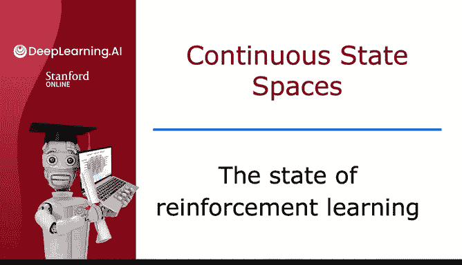
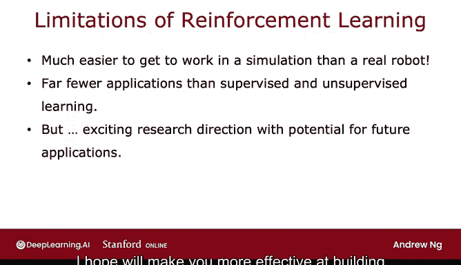

# 吴恩达《机器学习》｜machine-learning（中英字幕-deepseek翻译） - P149：44_03_07_强化学习现状.zh_en - GPT中英字幕课程资源 - BV1MN4y1S7DE

Reinforcement learning is an exciting set of technologies。

 in fact when I was working on my PhD thesis， reinforcement learning was a subject of my thesis。

 so I was since still excited about these ideas。

Despite all the research momentum and excitement behind reinforcement learning though。

 I think there is a bit or maybe sometimes a lot of hype around it。

 so what I hope to do is share with you a practical sense of where reinforcement learning is today in terms of this utility for applications。

😊，One of the reasons for some of the hype about reinforcement learning is it turns out many of the research publications have been on simulated environments and having worked in both simulations and on real robots myself。

 I can tell you that it's much easier to get a reinforcement learning algorithm to work in a simulation or in a video game than in a real robot。

So a lot of developers have commented that even after they got it to work in simulation。

 it turned out to be surprisingly challenging to get something to work in a real world or on a real robot。

And so if you apply these algorithms to a rural application this is one limitation that I hope you pay attention to to make sure what you do does work on the raw application Second。

 despite all the media coverage about reinforcement learning。

 today there are far fewer applications of reinforcement learning than supervised and unsupervised learning so if you are building a practical application the odds that you will find supervised learning unsupervised learning useful or the right to for the job is much higher than the odds that you would end up using reinforcement learning。

I have used reinforcement learning a few times myself， especially on robotic control applications。

 but in my day to day applied work， I end up using supervised and unsupervised learning much more。

There is a lot of exciting research in reinforcement learning right now。

 and I think the potential of reinforcement learning for future applications is very large and reinforcement learning still remains one of the major pillars of machine learning and so having it as a framework as you develop your own machine learning algorithms。

 I hope will make you more effective at building working machine learning systems as well So I hope you've enjoyed this week's materials on reinforcement learning and specifically I hope you have fun getting the lunar Laer to land for yourself。

 I hope will be a satisfying experience when you implement an algorithm and then see that Lunar Laer land safely on the moon because of COke that you wrote that brings us to the end of this specialization let's go on to the last video where we wrap up。

