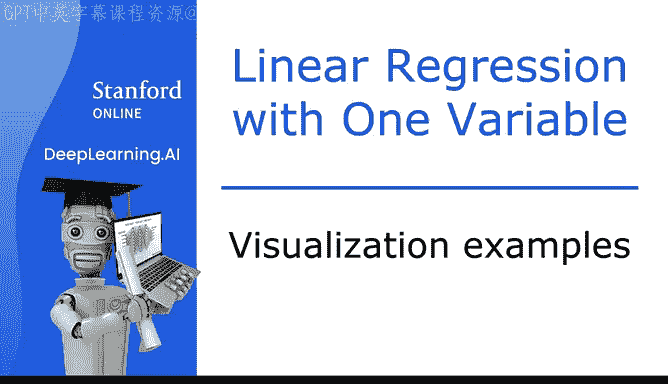
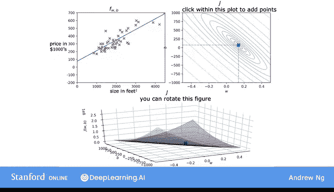
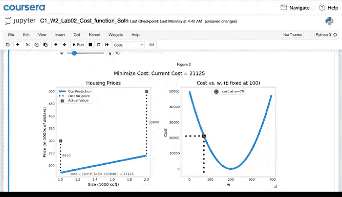
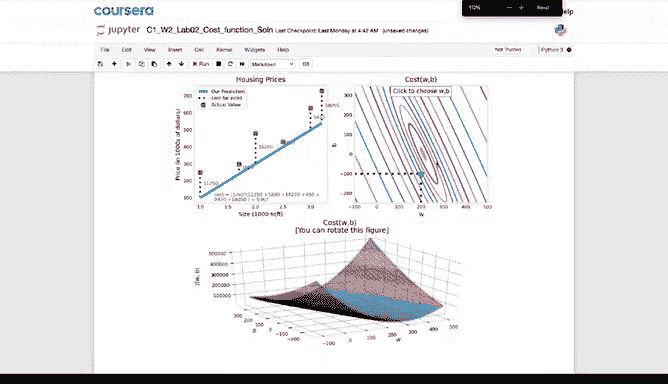
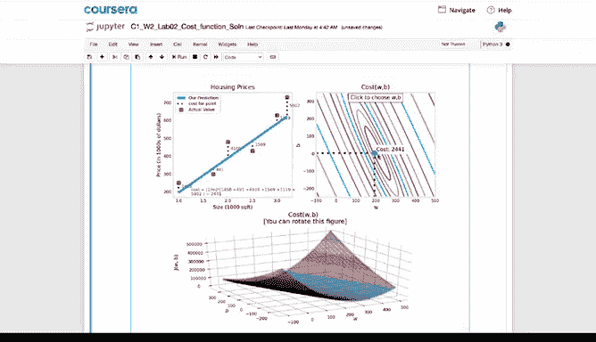
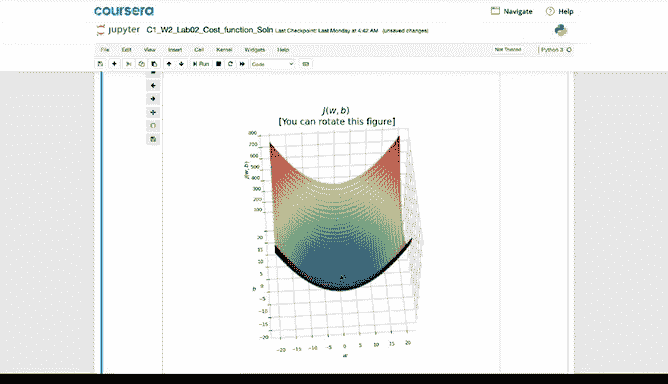

# 吴恩达《机器学习》｜machine-learning（中英字幕-deepseek翻译） - P14：14_01_06_可视化示例.zh_en - GPT中英字幕课程资源 - BV1MN4y1S7DE

Let's look at some more visualizations of WNV。Here's one example。Over here。

 you have a particular point on the graph J For this point， W equals about negative 。

15 and b equals about 800， so this point corresponds to one pair of values for W and B that yield a particular cost J。

And in fact， this bi pair of values for W and B corresponds to this function， F of x。

 which is this line you can see on the left。This line intersects the vertical axis at 800 because B equals 800 and the slope of the line is negative 0。

15 because w equals negative 0。15。Now， if you look at the data points in the training set。

 you may notice that this line is not a good fit to the data。For this function， F of x。

 with these values of W and B， many of the predictions for the value of y are quite far from the actual target value of y that is in the training data。

Because this line is not a good fit， if you look at the graph of J。

 the cost of this line is alt here， which is pretty far from the minimum。

Its a pretty high cost because this choice of Wnb is just not that good a fit to the training set。

Now let's look at another example with a different choice of W andB。

Now here is another function that is， you know still not a great fit for the data。

 but maybe slightly less bad。 So this point here represents the cause for this book repair of W and B that creates that line。

The value of w is equal to zero and the value of B is about 360。

This pair of parameters corresponds to this function。

 which is a flat line because f of x equals0 times x plus360， I hope that makes sense。

Let's look at yet another example。Here's one more choice for W and B。 and with these values。

 you end up with this line F of x， again， not a great fit to the data is actually further away from the minimum compared to the previous example。

And remember that the minimum is at the center of that smallest ellipse。Last example。

 if you look at F of x on the left， this looks like a pretty good fit to the training set you can see on the right。

 this point representing the cost is very close to the center of the small ellipse。

 is not quite exactly the minimum but is pretty close。For this value of W and B。

 you get this line F of x。

You can see that if you measure the vertical distances between the data points and the predicted values on the straight line。

 you get the error for each data point， the sum of squared errors for all of these data points is pretty close to the minimum possible sum of squared errors among all possible straight line fits。

I hope that by looking at these figures， you can get a better sense of how different choices of the parameters affect the line F of x and how this corresponds to different values for the cost J。

And hopefully， you can see how the better fit lines correspond to points on the graph of J that are closer to the minimum possible cost for this co function J of W and B。

In the optional lab that follows this video， you get to run some code and remember all the code is given。

 so you just need to hit shift enter to run it and take look at it。

And the lab will show you how the cost function is implemented in code。

And given a small training set and different choices for the parameters。

 you'll be able to see how the cause varies depending on how well the model fits the data。

In the optional lab， you also can play with an interactive contour plot Check this out。

 you can use your mouse cursor to click anywhere on the contour plot and you will see the straight line defined by the values you chose for the parameters WnB。

You see a dot appear also on the 3D surface plot showing the cost。Finally。

 the optional lab also has a 3D surface plot that you can manually rotate and spin around using your mouse cursor to take a better look at what the cost function looks like。

I hope you enjoy playing with the optional lab。Now in linear regression。

 rather than having to manually try to read the consolet plot for the best value for W&B。

 which isn't really a good procedure and also won't work once we get to more complex machine learning models。

 what you really want is an efficient algorithm that you can write in code for automatically finding the values of parameters W&B that give you the best fit line that minimizes the cost function J。

There is an algorithm for doing this called gradient descent。

This algorithm is one of the most important algorithms in machine learning。

Graing descent and variations on gradient in descent are used to train not just linear regression。

 but some of the biggest and most complex models in all of AI。

So let's go to the next video to dive into this really important algorithm called gradient descent。

