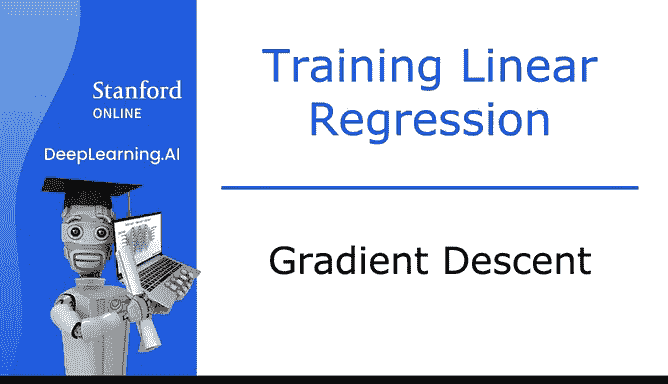
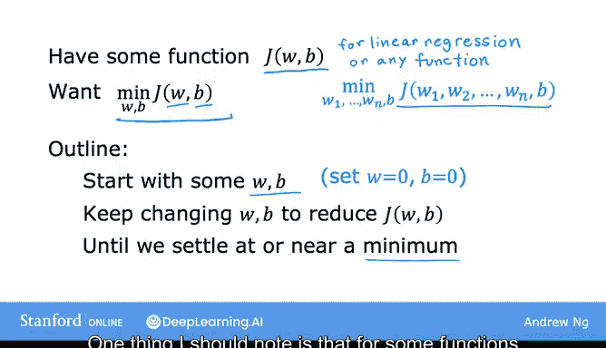

# 吴恩达《机器学习》｜machine-learning（中英字幕-deepseek翻译） - P15：15_01_01_梯度下降法.zh_en - GPT中英字幕课程资源 - BV1MN4y1S7DE

Welcome back In the last video we saw visualizations of the cost function J and how you can try different choices that the parameters W and B as you a cost value that gets you。

It would be nice if we had the more systematic way to find the values of W and B that result in the smallest possible cause J of WB。

It turns out there's an algorithm called gradient descent that you can use to do that gradient descent is used all over the place in machine learning。

 not just for linear regression， but for training， for example。

 some of the most advanced neural network models also called deep learning models。

Deep learning models are something you learn about in the second course。

So learning this two of gradient descent will set up with one of the most important building blocks in machine learning here's an overview of what we'll do with gradient descent。

You have the cost function J of WB right here that you want to minimize。

In the example we've seen so far， this is a cost function for linear regression。

 but it turns out that gradient descent is an algorithm that you can use to try to minimize any function。

 not just a cost function for linear regression。Just to make this discussion on gradient descent more general。

 it turns out that gradient descent applies to more general functions。

 including other cost functions that work with models that have more than two parameters。

So for instance， if you have a cost function J as a function of W1 W2 up to WN and B。

Your objective is to minimize J over the parameters W1 to WN and B In other words。

 you want to pick values for W1 through WN and B that gives you the smallest possible value of J。

It turns out that gradient descent is an algorithm that you can apply to try to minimize this cost function J as well。

What you're going to do is just start off with some initial guesses or W and B in linear regression it won't matter too much what the initial values are。

 so a common choice is to set them both to0 so for example you can set W to0 and b to0 as the initial guess with the gradient descent algorithm what you're going to do is you'll keep on changing the parameters W and B a bit every time to try to reduce the cost J of WB until hopefully J settles at or near a minimum。

One thing I should note is that for some functions J that may not be a bow shape or hammer shape。

 it is possible for there to be more than one possible minimum。

Let's take a look at an example of a more complex surface plot J to see what gradient descent is doing。

This function is not a squared error cost function for linear regression with the squared error cost function。

 you always end up with a bow shape or hammock shape。

But this is the type of cost function you might get if you're training a neural network model。

 notice the axes。That is W and B on the bottom axes。For different values of W and B。

 you get different points on the surface J of WB， where the height of the surface at some point is the value of the cost function。

Now， let's imagine that this surface plot is actually a view of a slightly hilly outdoor park or a golf course where the high points are hills and the low points are valleys like so。

And I'd like you to imagine， if you will， that you're physically standing at this point on the hill。

 And if it helps you to relax， imagine that his loss of really nice green grass and butterflies and flowerss is a really nice hill。

And you go is to start up here。And get to the bottom of one of these valleys as efficiently as possible。

So what the gradient descent algorithm does is you're going to spin around 360 degrees and look around an oso。

 If I were to take a tiny little baby step in one direction。

 and I want to go downhill as quickly as possible toward one of these valleys。

 What direction do I choose to take that baby step。 Well。

 if you want to walk down this hill as efficiently as possible。

 it turns out that if you're standing at this point in the hill and you look around。

 you may notice that the best direction to take your next step downhill is roughly that direction。

 mathematicalally， this is the direction of steepest descent。

And it means that when you take a tiny baby little step。

 this takes you downhill faster than a tiny little baby step you could have taken in any other direction。

So after taking this first step， you're now at this point on the hill over here。

Now let's repeat the process， standing at this new point。

 you're going to again spin around 360 degrees and ask yourself。

 in what direction would I take the next little baby step in order to move downhill？

And if you do that and take another step， you end up moving a bit in that direction and you can keep going。

From this new point， you can again look around and decide what direction would take you downhill most quickly。

Take another step， another step， and so on until you find yourself at the bottom of this valley at this local minimum right here。

What you just did was go through multiple steps of gradient descent。

It turns out gradient descent has an interesting prop。

Remember that you can choose a starting point at the surface by choosing starting values with parameters W and B When you performed gradient descent a moment ago。

 you had started at this point over here， right？Now， imagine if you try gradient descent again。

 but this time you choose a different starting point by choosing parameters that place your starting point just a couple steps to the right over here。

If you then repeat the gradient in descent process， which means you look around。

 take a little step in the direction of the steep as ascent。So you end up here。

 then you again look around， take another step and so on。

 and if you were to run gradient descent the second time。

 starting just a couple steps to the right of where we did it the first time。

Then you end up in a totally different valley。 This different minimum over here on the right。

The bottoms of both the first and the second valuess are called local minima。

 because if you start going down the first valley， gradient descent won't lead you to the second value。

 and the same is true if you started going down the second value。

 you would stay in that second minimum and not find your way into the first local minimum。

So this is an interesting property of the great Incent algorithm。

 and youll see more about this later。So in this video。

 you saw how gradient descent helps you go downhill In the next video。

 let's look at the mathematical expressions that you can implement to make gradient descent work Let's go on to the next video。

