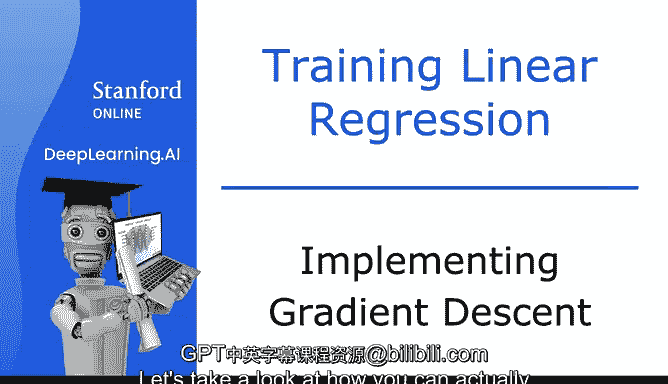
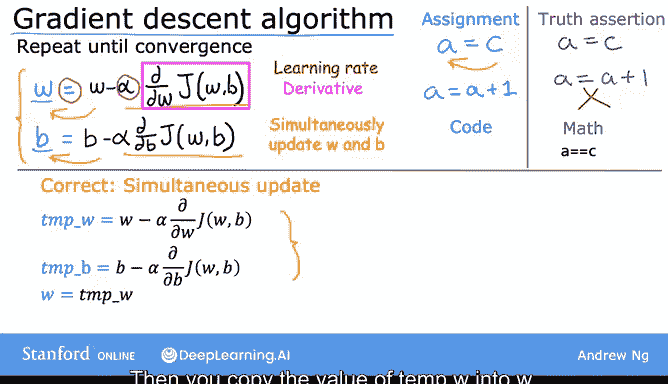

# 吴恩达《机器学习》｜machine-learning（中英字幕-deepseek翻译） - P16：16_01_02_实现梯度下降法.zh_en - GPT中英字幕课程资源 - BV1MN4y1S7DE

Let's take a look at how you can actually implement the gradient descent algorithm。

 let me write down the gradient descent algorithm。

Herear is on each step。W， the parameter is updated to the old value of w minus alpha times this term d over dw of the cost J of WB。

So what this expression is saying is update your parameter w by taking the current value of W and adjusting it a small amount。

 which is this expression on the right， minus alpha times this term over here， okay。

So if you feel like there's a lot going on in this equation it's okay， don't worry about it。

 we'll unpack it together。First， this equal notation here。

 notice I say we're assigning W a value using this equal sign。

 so in this context this equal sign is the assignment operator。Specifically in this context。

 if you write code that says a equals C， it means take the value of C and store it in your computer in the variable A。

Or if you write a equals a plus1， it means set the value of a to be equal to a plus1 or increment the value of a by 1。

So the assignment operator in coding is different than truth assertions in mathematics。

 where if I write a equals C， I am asserting that is I am claiming that the values of A and C are equal to each other and hopefully I will never write a true assertion A equals a+1 because you know that just can't possibly be true。

So in Python and in other programming languages， truth assertions are sometimes written as equals equals。

 so you may see code that says a equals equals C if you are testing whether a is equal to C。

 but in math notation as we conventionally use it， like in these videos。

 the equal sign can be used for either assignment or for truth assertion。

 and so I'll try the makeche is clear when I write an equal sign。

 whether we're assigning a value to variable or whether we're asserting the truth of the equality of two values。

Now， let's dive more deeply into what the symbols in this equation means。

The symbol here is the Greek alphabet alpha， and in this equation。

 alpha is also called the learning rate。 The learning rate is usually a small positive number between 0 and1。

 and it might be， say， 0。01。What Alpha does is it basically controls how big of a step you take downhill。

So if Al is very large， then that corresponds to a very aggressive gradient in descent procedure where you're trying to take huge steps downhill。

And if Al is very small， then you'll be taking small baby steps downhill。

We'll come back later to delve more deeply into how to choose a good learning rate alpha。And finally。

 this term here。That's the derivative term of the cause function J。

Let's not worry about the details of this derivative right now。

 but later on you get to see more about the derivative term。But for now。

 you can think of this derivative term that I drew a magenta box around as telling you in which direction you want to take your baby step and in combination with the learning rate alpha。

 it also determines the size of the steps you want to take downhill。Now。

 I do want to mention that derivatives come from calculus。

 and even if you aren't familiar with calculus， don't worry about it。

Even without knowing any calculus， you'd be able to figure out all you need to know about this divive term in this video and the mix。

One more thing， remember your model has two parameters， not just W but also B。

 so you also have an assignment operation to update the parameter B that looks very similar B is assigned the O value of B minus the learning rate alpha times this slightly different derivative term D over Db of J of WB。

So remember in the graph of the surface plot where you're taking baby steps until you get to the bottom of the value。

Well， for the gradienting descent algorithm， you're going to repeat these two update steps until the algorithm converges。

 and by converges， I mean that you reach the point at a local minimum where the parameters W and B no longer change much with each additional step that you take。

Now， there's one more subtle detail about how to correctly implement gradient in descent。

You're going to update two parameters， W and B， right？

So this update takes place for both parameterss， WNB。

One important detail is that for gradient descent， you want to simultaneously update W and B。

 meaning you want to update both parameters at the same time。

What I mean by that is that in this expression， you're going to update W from the old W to a new W。

And you're also updating B from its old value to a new value of B。

And the way to implement this is to compute the right side。

Computing this thing for W and B and simultaneously at the same time。

Update W and B to the new values。So。Let's take a look at what this means。

 here's the correct way to implement gradient descent， which does a simultaneous update。

This sets the variable temp W equal to that expression， which is W minus that term here。

Let's also set another variable， temp B to that， which is b minus that term。

 so you compute both right hand size， both updates and slow them into variables temp W and temp B。

Then you copy the value of temp W into W， and you also copy the value of temp B into B。

Now， one thing you may notice is that this value of W is from before W gets updated。Here。

 notice that the pre update W is what goes into the derivative term over here， okay？In contrast。

 here's an incorrect implementation of gradient descent that does not do a simultaneous update。

In this incorrect implementation， we compute1W same as before， so far that's okay。

And now here's where things start to differ。We then update W with the value in temp W before calculating the new value for the other parameter to be。

Next we calculate temp B as b minus that term here， and finally we update B with the value in temp B。

The difference between the right hand side and the lefthand side implementations is that if you look over here。

 this W has already been updated to this new value and it this updated W that actually goes into the cost function J of WB。

It means that this term here on the right is not the same as this term over here that you see on the left。

And that also means this  temp B term on the right is not quite the same as the temp B term on the left。

 and thus this updated value of a B on the right is not the same as this updated value for variable B on the left。

The way that gradient de is implemented in code， it actually turns out to be more natural to implement it the correct way with simultaneous updates。

When you hear someone talk about gradient descent， they always mean the gradient descent where you perform a simultaneous update of the parameterss。

If， however， you were to implement non-simultaneous update。

 it turns out it will probably work more or less anyway。

 but doing it this way isn't really the correct way to implement it is actually some other algorithm with different properties。

 so I would advise you to just stick to the correct simultaneous update and not use this incorrect version on the right。

So that's gradient in descent in the next video we'll go into details of the derivative term。

 which you saw in this video， but that we didn't really talk about in detail。

Derivatives are apo of calculus and again if you're not familiar with calculus， don't worry about it。

 you won't need to know calculus at all in order to complete this course or the specialization and you'll have all the information you need in order to implement gradient descent。

Coming up in the next video we'll go over derivatives together and you come away with the intuition and knowledge you need to be able to implement and apply gradient descent yourself I think that'll be an exciting thing for you to know how to implement so let's go on to the next video to see how to do that。

