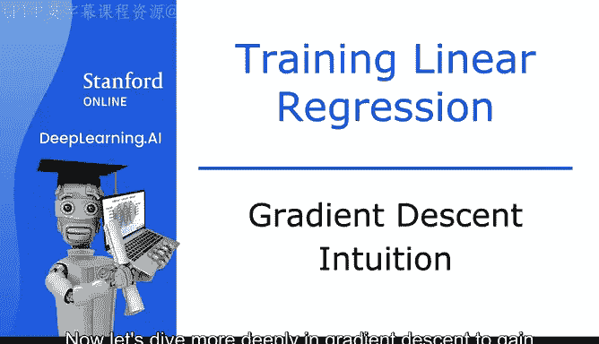
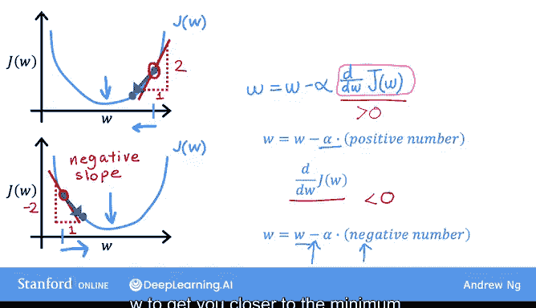

# 吴恩达《机器学习》｜machine-learning（中英字幕-deepseek翻译） - P17：17_01_03_梯度下降法直观理解.zh_en - GPT中英字幕课程资源 - BV1MN4y1S7DE

Now let's dive more deeply into gradient descent to gain better intuition about what it's doing and why it might make sense。

Here's the gradient descent algorithm that you saw in the previous video。And as a reminder。

 this variable， this Greek symbol alpha is the learning rate。

And the learning rate controls how big of a step you take when updating the model's parameters W and B。

So this term here， this D over DW， this is a derivative term and by convention in math。

 this D is written with this funny font here and in case anyone watching this as a PhD in math or as an expert in multivariary calculus。

 they may be wondering that's not the derivative that's the partial derivative and yes they'd be right。

 but for the purposes of implementing a machine learning algorithm。

 I'm just going to call it derivative and don't worry about these little distinctions。

So what we're going to focus on now is get more intuition about what this learning rate and what this derivative are doing and why when multiply together like this。

 it results in updates to parameters W and B that makes sense。In order to do this。

 let's use a slightly simpler example where we work on minimizing just one parameter。

So let's say that you have a cost function J of just one parameter W with W is a number。

This means that gradient in descent now looked like this。

 W is updated to W minus the learning rate alpha times D over Tw of J of W。

And you're trying to minimize the cost by adjusting the parameter W。

So this is like our previous example where we had temporarily set B equal to zero。

With one parameter w instead of two， you can look at two dimensional graphs of the cost function J instead of three dimensional graphs。

Let's look at what gradient descent does on this J of W。

Here on the horizontal axis is parametered W and on the vertical axis is the cost J of W Now let's initialize gradient descent with some startinging value for W let's initialize it at this location so imagine that you start off at this point right here on the function J。

What gradient descent will do is it will update W to be w minus。

Learning rate alpha times d over Dw of J ofW。Let's look at what this derivative term here means。

A way to think about the derivative at this point on the line is to draw a tangent line。

 which is a straight line that touches this curve at that point。In math。

 the slope of this line is the derivative of the function J at this point。And to get the slope。

 you can draw a little triangle like this。 and if you compute the height divided by the width of this triangle。

 that is the slope。So， for example， the slope might be you know， two over1， for instance。

 and when the tangent line is pointing up into the right， the slope is positive。

 which means that this derivative is a positive number， so is greater than 0。

And so the updated W is going to be W minus the learning rate times some positive number。

The learning rate is always a positive number， so if you take W minus a positive number。

 you end up with a new value for W that is smaller。So on the graph， you are moving to the left。

 you're decreasing the value of W。And you may notice that this is the right thing to do if you go is to decrease the cost J because when we move toward the left on this curve。

 the cost J decreases and you're getting closer to the minimum for J， which is over here。So so far。

 grave in descent seems to be doing the right thing。Now， let's look at another example。

 let's take the same function J of w is above， and now let's say that you initialize gradient descent at a different location。

Say by choosing a starting value for W， that's over here on the left。

So that's this point of the function J。Now the derivative term remember is D over Dw of J of w。

 and when we look at the tangent line at this point over here。

 the slope of this line is a derivative of j at this point。

 but this tangent line is sloping down into the right。

 and so this line sloping down into the right has a negative slope。 In other words。

 the derivative j at this point is a negative number。 For instance， if you draw a triangle。

 then the height like this is negative2 and the width is1。

 So the slope is negative2 divided by one which is negative2， which is a negative number。

So when you update W， you get W minus the learning rate times a negative number。

And so this means you subtract from W a negative number。

But subtracting a negative number means adding a positive number。 and so you end up increasing W。

Because subtracting a negative number is the same as adding a positive number to W。

So this step of gradientd descent causes w to increase。

 which means you're moving to the right of the graph and your cost J has decreased down to here。

And again， it looks like gradient descent is doing something reasonable it's getting you closer to the minimum。

So hopefully， these last two examples show some of the intuition behind what the derivative term is doing and why this helps gradient descent change W to get you closer to the minimum。

 I hope this video gave you some sense for why the derivative term in gradient descent makes sense。

 One other key quantity in the gradient descent algorithm is the learning rate alpha。

 How do you choose alpha， What happens if it's too small or what happens if it's too big。

 In the next video， let's take a deeper look at the parameter alpha to help build intuitions about what it does。

 as was how to make a good choice for a good value of alpha for your implementation of gradient descent。

