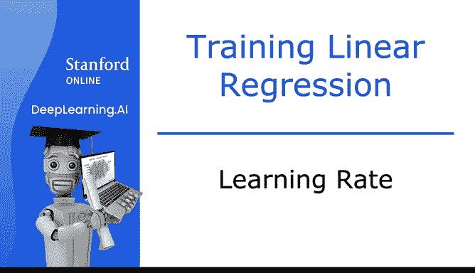
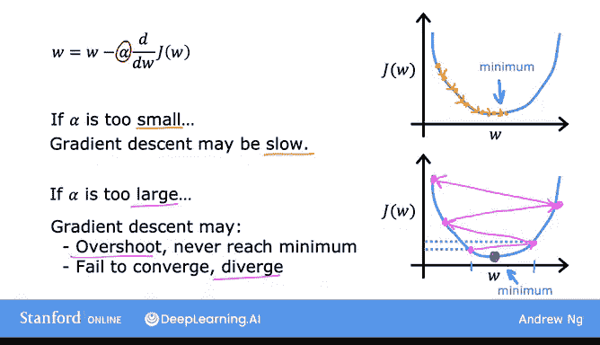
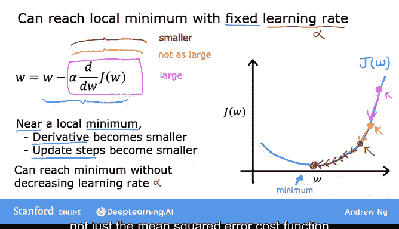

# 吴恩达《机器学习》｜machine-learning（中英字幕-deepseek翻译） - P18：18_01_04_学习率.zh_en - GPT中英字幕课程资源 - BV1MN4y1S7DE

The choice of the learning rate alpha will have a huge impact on the efficiency of your implementation of gradient descent。

 and if alpha the learning rate is chosen poorly gradient descent may not even work at all In this video let's take a deeper look at the learning rate This will also help you choose better learning rates for your implementations of gradient descent。

So here again is the gradient descent rule W is updated to be W minus the learning rate alpha times the derivative term to learn more about what the learning rate alpha is doing。

 let's see what could happen that the learning rate alpha is either too small or if it is too large。

For the case where the learning rate is too small， here's a graph where the horizontal axis is W and the vertical axis is the cost J。

 and here's a graph of the function J of W。Let's start reading descent at this point here。

If the learning rate is too small， then what happens is that you multiply your derivative term by some really。

 really， really small number， so you're going to be multiplying by number alpha that's really small like 0。

0000001。And so you end up taking a very small baby step like that。 Then from this point。

 you're going to take another， you know， tiny， tiny little baby step。

But because the learning rate is so small， the second step is also just minuscu the outcome of this process is that you do end up decreasing the cost J but incredibly slowly。

So here's another step and another step， another tiny step until you finally approach the minimum。

 but as you may notice you're going to need a lot of steps to get to the minimum。

 so to summarize if the learning rate is too small， then gradient descent will work。

 but it will be slow， it will take a very long time because it's going to take these tiny tiny baby steps and it's going to need a lot of steps before it gets anywhere close to the minimum。

Now let's look at a different case。What happens if the learning rate is too large。

 here's another graph of the cost function。And let's say we saw gradient descent with W at this value here。

 So it's actually already pretty close to the minimum。So the derivative points to the right。

 but if the learning rate is too large， then you update W via a giant step to be all the way over here and that's this point here on the function J。

So you move from this point on the left all the way to this point on the right。

 And now the cost has actually gotten worse。 It has increased because it has started out at this value here。

 and after one step， it actually increased to this value here。Now。

 the derivative at this new point says to decrease W。But when the learning rate is too big。

 then you may take a huge step going from here all the way out here。

So now you've got to this point here。And again， if the learning rate is too big。

 then you take another huge step with an acceleration iteration and way overshoot the minimum again。

So now you're at this point on the right and one more time you do another update and end up all the way here。

 and so you're now at this point here。So as you may notice。

 you're actually getting further and further away from the minimum。

So if the learning rate is too large， then gradient descent may overshoot and may never reach the minimum。

And another way to say that is that gradient descent may fail to converge。And may even diverge。

So here's another question you may be wondering。

One of your parameter W is already at this point here so that your cost J is already at a local minimum。

What do you think one step of gradient descent will do if you've already reached a minimum？

So this is a tricky one。When I was first learning this stuff。

 it actually took me a long time to figure it out， but let's work through this together。

Let's suppose you have some cost function J。And the one you see here isn't a square error co function。

 and this cost function has two local minima corresponding to two valuess that you see here。Now。

 let's suppose that after some number of steps of gradient descent， your parameter w is over here。

 say equal to5。And so this is the current value of W。

 This means that you're at this point on the cost function J， and that happens to be a local minimum。

Turns out if you draw a tangent to the function at this point， the slope of this line is 0。

 and thus the derivative term here is equal to 0 for the current value of W。

And so your gradient descent update becomesW is updated to W minus the learning rate times 0 right here that's because the derivative the term is equal to 0。

And this is the same as saying， let's set W to be equal to W。

So this means that if you're already at a local minimum。

 gradientd descent leaves W unchanged because it just updates the new value of W to be the exact same old value of W。

So concretely， let's say if the current value of w is 5 and alpha is 0。1， After one iteration。

 you update W as w minus alpha times 0 and it is still equal to 5。

So if your parameters have already brought you to a local minimum。

 then further gradient descent steps do absolutely nothing， it doesn't change the parameters。

 which is what you want because it keeps the solution at that local minimum。

This also explains why gradient incent can reach a local minimum。

 even with a fixed learning rate alpha。Here's what I mean。To illustrate this。

 let's look at another example， here's a cost function J of W that we want to minimize。

 let's initialize gradient descent up here at this point。If we take one update step。

Maybe it'll take us to that point。And because this derivative is pretty large。

 braing descent takes a relatively big step， right？

Now we're at this second point where we take another step。

And you may notice that the slope is not as steep as it was at the first point。

 so the derivative isn't as large， and so the next update step will not be as large as that first step。

Now read this third point here and the derivative is smaller than it was at the previous step and will take an even smaller step。

As we approach the minimum， the derivative gets closer and closer to0， so as we run gradient descent。

 eventually we're taking very small steps until you finally reach a local minimum， so just a recap。

As we get nearer a local minimum， gradient descent will automatically take smaller steps。

And that's because as we approach the local minimum， the derivative automatically gets smaller。

 And that means the update steps also automatically gets smaller。

 even if the learning rate alpha is kept at some fixed value。

So that's the gradient descent algorithm。You can use it to try to minimize any cost function J。

 not just the mean squared error cost function that we're using fold linear regression。

In the next video， we're going to take the function J and set that back to be exactly the linear regression models cost function。

 the mean squared error cost function that we had come up with earlier。

And putting together gradient descent with this cost function that will give you your first learning algorithm。

 the linear regression algorithm。