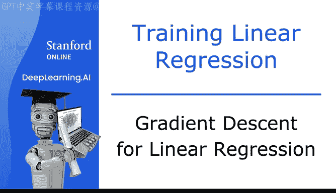
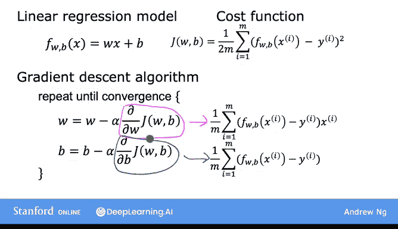
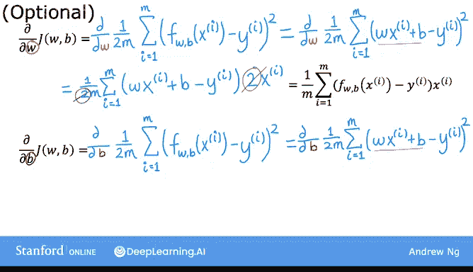
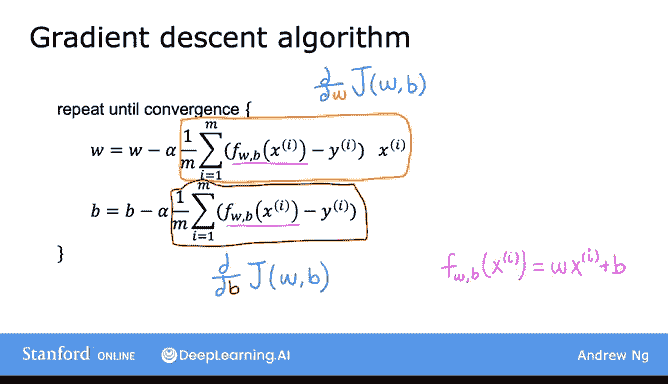

# 吴恩达《机器学习》｜machine-learning（中英字幕-deepseek翻译） - P19：19_01_05_线性回归的梯度下降法.zh_en - GPT中英字幕课程资源 - BV1MN4y1S7DE

So previously， you took a look at the linear regression model and then the cost function and then the gradient descent algorithm。

In this video， we're going to put all together and use the square error cost function for the linear regression model with gradient descent。

 This will allow us to train the linear regression model to fit the straight line to our training data。

 Let's get to it。 Here's the linear regression model and to the right is the squared error cost function。

And below is the gradient descent algorithm。 It turns out if you calculate these derivatives。

 these are the terms you would get。 The derivative with respect to W is this。

One over m sum from I equals 1 through M， then the error term that is the difference between the predicted and the actual values times the input feature X。

 and the derivative respect to B is this formula over here。

 which looks the same as the equation above except that it doesn't have that XI term at the end。

And if you use these formulas to compute these two derivatives and implement gradient descent this way。

 it will work。

Now you may be wondering where did I get these formulas from they derived using calculus If you want to see the full derivation。

 I'll quickly run through the derivation on the next slide。

 but if you don't remember or aren't interested in the calculus， don't worry about it。

 you can skip the materials on the next slide entirely and still be able to implement gradient descent and finish this class and everything will work just fine。

So in this slide， which is one of the most mathematical slides of the entire specialization and again is completely optional。

 will show you how to calculate the derivative terms。Let's start with the first term。

 the derivative of the cost function J with respect to W。

We'll start by plugging in the definition of the cost function J。 So J of WB is this。

So1 over 2 m times this sum of the squared error terms。And now remember also that F of W B of X I。

Is equal to this term over here。Which is W X I plus B。

And so what we would like to do is compute the derivative。

 also called the partial derivative with respect to W of this equation right here on the right。

 If you've taken a calculus class before and again is totally fine if you haven't。

 you may know that by the rules of calculus， the derivative is equal to this term over here。

Which is why the two here and the two here cancel out leaving us with this equation that you saw on the previous slide。

So this， by the way， is why we had defined the cost function with the one half earlier this week is because it makes the partial derivative neatta。

 it cancels out the two that appears from computing to derivative。

For the other derivative with respect to B， this is quite similar。

I can write it out like this and once again， plug in the definition of F of XI giving this equation。

And by the rules of calculus， this is equal to this where there's no Xi anymore at the end。

 and so the twos cancel once more and you end up with this expression for the derivative with respect to B。

And so now you have these two expressions for the derivatives and you can plug them into the gradients descent algorithm。

So here's the gradient descent algorithm for linear regression。

You repeatedly carry out these updates to W and B until convergence。

 Remember that this F of x is a linear regression model， so it' equal to W times x plus B。

This expression here is the derivative of the cost function with respect to W。

 and this expression is the derivative of the cost function with respect to B。And just as a reminder。

 you want to update W and B simultaneously on each step。 Now。

 let's get familiar with how gradient in descent works。

 One issue we saw with gradient in descent is that it can lead to a low coal minimum instead of a global minimum。

 where a global minimum means the point that has the lowest possible value for the cost function J out of all possible points。

 You may recall this surface thought that looks like an outdoor park with a few hills with a grass in the birds is a relaxing outdoor hill。

This function has more than one local minimum。 Remember。

 depending on where you initialize the parameters W and B。

 you can end up at different local minimumma。 You can end up here or you can end up here。

But it turns out when you're using a square error cost function with linear regression。

 the cost function does not and will never have multiple local minimum。

 It has a single global minimum because of this bow shape。

The technical term for this is that this cost function is a convex function。 Informally。

 a convex function is a bow shaped function， and it cannot have any local minimumma other than the single global minimum。

So when you implement gradient descent on a convex function。

 one nice property is that so long as your learning rate is chosen appropriately it will always converge to the global minimum congratulations you now know how to implement gradient descent for linear regression We have just one last video for this week in that video we'll see thisar in action let's go to that last video。

