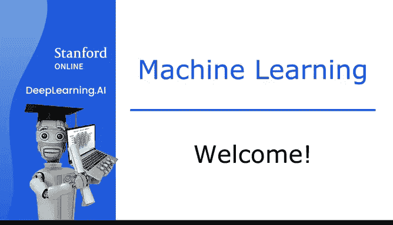
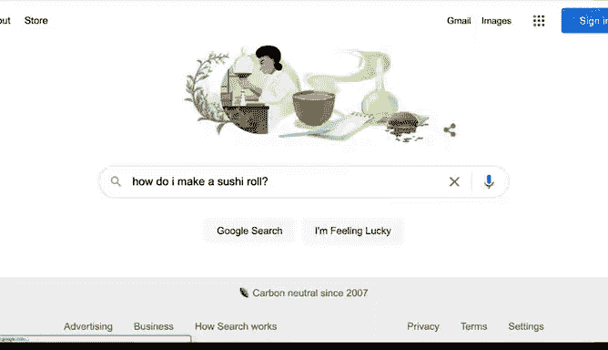
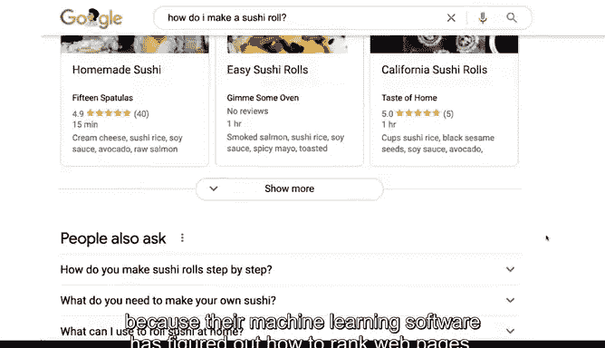

# 吴恩达《机器学习》｜machine-learning（中英字幕-deepseek翻译） - P1：01_01_01_欢迎来到机器学习.zh_en - GPT中英字幕课程资源 - BV1MN4y1S7DE

🎼。

🎼Bkens and machines are new。For this machine learning。

 you probably use it many times a day without even knowing it。

Anytime you want to find out something like how do I make a sushi Road。

 you can do a web search on Google Bing or by do to find out。

 and that works so well because their machine learning software has figured out how to rank web pages。

Or when you upload pictures to Instagram or Snapchat and think to yourself I want to tag my friends so they can see their pictures Well these apps can recognize your friends in your pictures and label them as well that's also machine learning。

Or if you've just finished watching a Star Wars movie on the video streaming surface and you think。

 what other similar movies could I watch？Well the streaming service will likely use machine learning to recommend something that you might like each time you use voice text on your phone to write a text message。

 Hey Andrew， how's it going or tell your phone， hey Siri。

 play a song by Rihanor or ask your other phone okay Google show me Indian restaurants near me。

That's also machine learning Each time you receive an email titledCongratulations you've won a million dollars while maybe you're rich congratulations or more likely your email service will probably flag good a spam that too is an application of machine learning。

Beyond consumer applications that you might use， AI is also rapidly making its way into big companies and into industrial applications。

For example， I'm deeply concerned about climate change and I'm glad to see that machine learning is already hoping to optimize wind turbine power generation。

 or in healthcare， is starting to make its way into hospitals to help doctors make accurate diagnoses。

🎼Or recently， at landing AI， I've been doing a lot of work putting computer vision into factories to help inspect if something coming off the assembly line as any defects。

🎼That's machine learning Its a science of getting computers to learn without being explicitly programmed。

🎼In this class， you learn about machine learning and get to implement machine learning and code yourself。

🎼Millions of others have taken the earlier version of this course。

 which is a course that led to the founding of Coursera。

 and many learners ended up building exciting machine learning systems or even pursuing very successful careers in AI。

I'm excited that you're on this journey with me welcomecom and let's get started。

