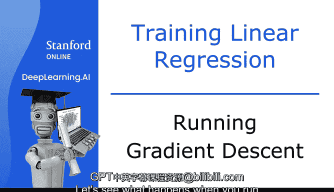
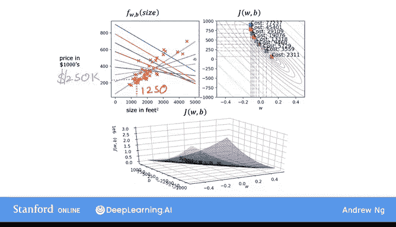
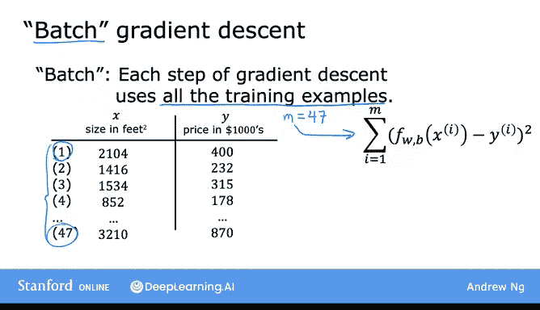
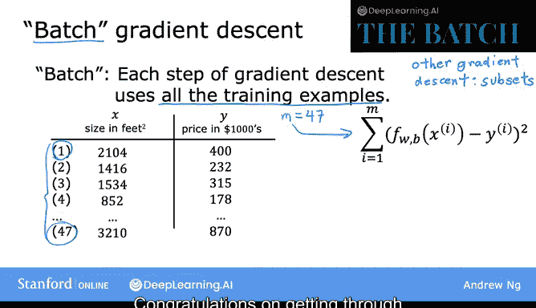
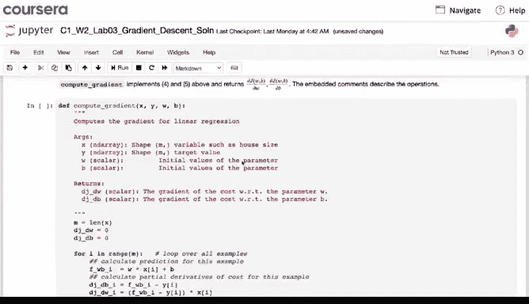
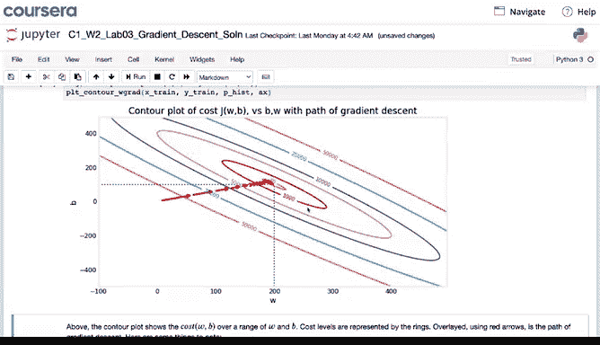
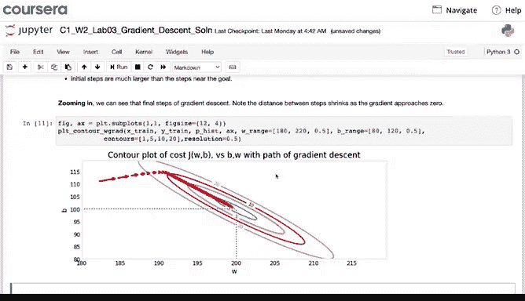
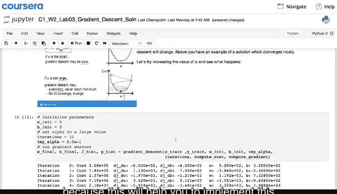

# 吴恩达《机器学习》｜machine-learning（中英字幕-deepseek翻译） - P20：20_01_06_运行梯度下降法.zh_en - GPT中英字幕课程资源 - BV1MN4y1S7DE

Let's see what happens when you run gradient intocentense for linear regression。

 let's go see the algorithm in action。

Here's a plot of the model and data on the upper left and a con plot of the cost function on the upper right。

 and at the bottom is the surface plot of the same cost function。

Often W and B will both be initialized to 0， but for this demonstration。

 let's initialize w to be equal to negative 0。1 and b to be 900。

 so this corresponds to F of x equals negative 0。1 x plus 900。Now。

 if we take one step using gradient descent， we end up going from this point of the cost function here to。

This point。Just down and to the right。And notice that the straight line fit is also changed a bit。

Let's take another step。The cost function has now moved to this third point。

 and again the function F of x has also changed a bit。As you take more of these steps。

 the cost is decreasing at each update， so the parameters W and B are following this trajectory。

And if you look on the left， you get this corresponding straight line fit that， you know。

 fits the data better and better until we've reached the global minimum。

The global minimum corresponds to this straightray line fit。

 which is a relatively good fit to the data， I mean， isn't that cool。And so that's gradient descent。

 and we're going to use this to fit a model to the housing data。

And you can now use this F of X model to predict the price of your client's house or anyone else's house。

 For instance， if your friend's house size is 1250 square feet。

 you can now read off the value and predict that maybe they could get， I don't know，$250。

000 for the health。

To be more precise， this gradient descent process is called batch gradient descent。

The termbash gradienting descent refers to the fact that on every step of gradient descent。

 we're looking at all of the training examples instead of just a subset of the training data。

So in computing gradient descent， when computing derivatives were computing the sum from I equals1 to M。

 and batch gradient descent is looking at the entire batch of training examples at each update。

I know that batchsh gradientding descent may not be the most intuitive name。

 but this is what people in the machine learning community call it if you've heard of the newsletter the batch that's published by Deep Learning AI。

The newsletter， The batchge， was also named for this concept in machine learning。

And then it turns out that there are other versions of gradient descent that do not look at the entire training set。

 but instead looks at smaller subsets of the training data at each update step。

But we use batchsh gradient descent for linear regression。So that's it for linear regression。

 congratulations on getting through your first machine learning model。

 I hope you go and celebrate or I don't know， maybe take a nap in your hammock。

In the optional lab that follows this video， you see a review of the gradient In descent algorithm。

 as well how to implement it in code。

You also see a plot that shows how the cost decreases as you continue training more iterations。

 and you also see a contour plot， seeing how the cost gets closer to the global minimum as gradient descent finds better and better values for the parameters WnB。

So remember that to do the optional lab， you just need to read and run this code。

 you won't need to write any code yourself， and I hope you take a few moments to do that and also become familiar with the gradient descent code because this will help you。

To implement this and sooner algorithms in the future yourself。

Thanks for sticking with me through the end of this lost video for the first week and congratulations for making it all the way here。

 you're on your way to becoming a machine learning person。In addition to the optional labs。

 if you haven't done so yet， I hope you also check out the practicee quizzes。

 which are a nice way that you can double check your own understanding of the concepts。

It's also totally fine if you don't get them all right the first time and you can also take the quizzes multiple times until you get the score that you want。

You now know how to implement linear regression with one variable。

 and that brings us to the close of this week。Next week。

 we'll learn to make linear regression much more powerful。

 instead of one feature like size of a house， you learn how to get to work with lots of features。

 You also learn how to get to fit non nonlinear curves。

 These improvements will make the algorithm much more useful and valuable。😊，Lastly。

 we'll also go over some practical tips that we really hope for getting linear regression to work on practical applications。

I'm really happy to have you here with me in this class and I look forward to seeing you next week。😊。

