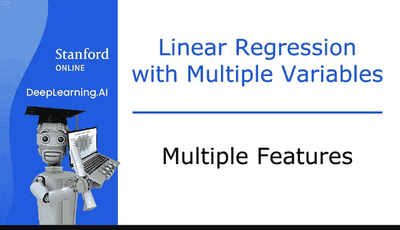
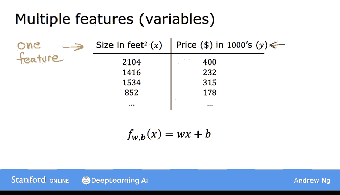
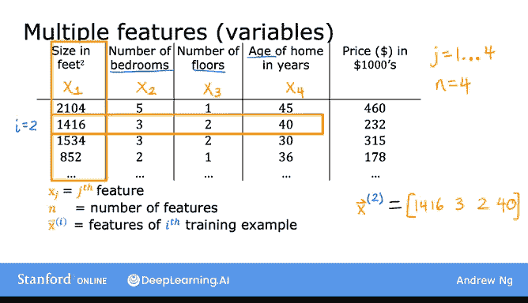
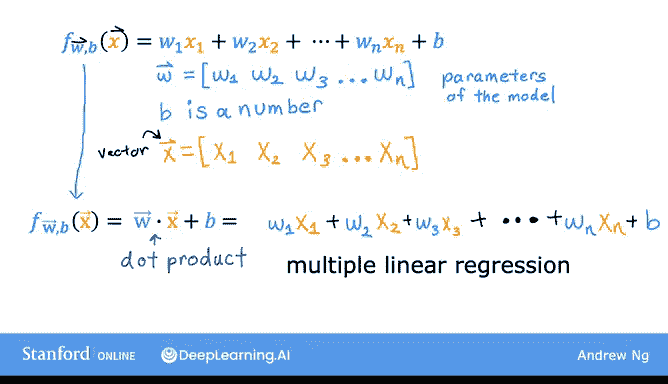

# 吴恩达《机器学习》｜machine-learning（中英字幕-deepseek翻译） - P21：21_02_01_多特征.zh_en - GPT中英字幕课程资源 - BV1MN4y1S7DE

Welcome back in this week we'll learn to make linear regression much faster and much more powerful and by the end of this week you'll be twothirs of the way to finishing this first course let's start by looking at a version of linear regression that can look at not just one feature but a lot of different features let's take a look。

😊，In the original version of linear regression。You had a single feature X， the size of the holesse。

And you're able to predict why the price of the house。 So the model was FwB of x equals Wx plus B。

But now， what if you did not only have the size of the house as a feature with which to try to predict the price。

 but if you also knew the number of bedrooms， the number of floors and the age of the home in years。

 it seems like this would give you a lot more information with which to predict the price？

To introduce a little bit of new notation， we're going to use the variables x sububscript 1。

 x sububscript 2， x subscript 3， and X sub 4 to denote the four features。And for simplicity。

 let's introduce a little bit more notation， we'll write x subscript J。

 or sometimes I'll just say for short x subj to represent the list of features。

 so here J will go from one through four because we have four features。

I'm going to use lowercase n to denote the total number of features so in this example n is equal to4 as before we'll use x superscriptpped I to denote the if training example so here x superscript I is actually going to be a list of four numbers。

Or sometimes we'll call this a vector。That includes all the features of the Ive。Training example。

So as a concrete example， x super strip in parentheses 2 will be a vector of the features for the second training example。

 so it will equal to this 1，4，1，6，3，2 and 40。And technically， I'm writing these numbers in a row。

 so sometimes this is called a row vector rather than a column vector。

 but if you don't know what the difference is， don't worry about it。

It's not that important for this purpose。And to refer to a specific feature in the IF training example。

I will write x superscript I subscript J。So for example， x superscript2。

 subscript 3 will be the value of the third feature that is the number of flooraws in the second training example。

 and so that's going to be equal to2。Sometimes in order to emphasize that this x2 is not a number。

 but it's actually a list of numbers that is a vector will draw an arrow on top of that。

Just to visually show that is a vector。And over here as well。

But you don't have to draw this arrow in your notation。

You can think of the arrow as an optional signifier that' sometimes use just to emphasize that this is a vector and not a number。

Now that we have multiple features， let's take a look at what a model would look like。Previously。

 this is how we defined the model where x was a single feature， so a single number。

 but now with multiple features we're going to define it differently。Instead， the model will be。

Fwb of x equals w1 x1 plus w2 x2 plus w3 xv plus w4 x4 plus B。Concretely。

 for housing price prediction， one possible model may be that we estimate the price of thehu as 0。

1 times x1， the size of thehu plus 4 times x2， the number of bedrooms plus 10 times x3。

 the number of floors， minus 2 times x4， the age of the housing years plus A。

Let's think a bit about how you might interpret these parameters。

If the model is trying to predict the price of the house in thousands of dollars。

 you can think of this B equals 80 as saying that the base price of a house starts off at maybe $80。

000， assuming it has no size， no bedrooms， no floor， and no age。And you can think of this 0。

1 as saying that maybe for every additional square foot， the price will increase by $0。1。

000 or by $100， because we're saying that for each square foot， the price increases by $0。1。

 you know， times $1，000， which is $100。And maybe for each additional bathroom。

 the price increases by $4，000 and for each additional four， the price may increase by $10。

000 and for each additional year of the house's age， the price may decrease by $2。

000 because the parameter is negative2。And in general。If you have n features。

 then the model will look like this。Here again is the definition of the model with N features。

What we're going to do next is introduce a little bit of a notation to rewrite this expression in a simpler but equivalent way。

Let's define W as a list of numbers that list the parameters W1， W2。

 W3 all the way through WN in mathematics， this is called a vector。

 and sometimes to designate that this is a vector， which just means a list of numbers。

 I'm going to draw a little arrow on top。You don't always have to draw this arrow and you can do so or not in your own notation。

 so you can think of this little arrow as just an optional signifier to remind us that this is a vector。

If you've taken the linear algebra class before， you might recognize that this is a row vector as opposed to a column vector。

 but if you don't know what those terms means， you don't need to worry about it next same as before。

 B is a single number not a vector， and so this vector W together with this number B are the parameters of the model。

Let me also write x as a list or a vector， again， a row vector that lists all of the features x1， x2。

 x3 up through XN。This is again a vector， so I'm going to add a little arrow up on top。To signify so。

In the notation up on top， we can also add little arrows here and here。

To signify that that W and that x are actually these lists of numbers。There actually these vectors。

So with this notation， the model can now be rewritten more succinctly as F of x equals deed w。

Dot and this dot refers to a dot product from linear algebra of x the vector plus the number B。

So what is this dot product thing？Well， the dot product of two vectors of two lists of numbers。

 W and X。Is computed by taking the corresponding pairs of numbers。W1 and x1 multiplying that。

W2 x2 multiplying that， W3 x3， multiplying that all the way up to WN XN， multiplying that。

 and then summing up all of these products。Writing that out。

 this means that the dot products is equal to。W1 x 1 plus W2 x2 plus W3 x3 plus all the way up to W N X N。

And then finally， we add back in the B。On top。And you notice that this gives us exactly the same expression as we had on top。

So the dot traffic notation lets you write the model in a more compact form with fewer characters。

The name for this type of linear regression model with multiple inputfeatures is multiple linear regression。

This is in contrast to Uniivvariary regression， which had just one feature。And by the way。

 you might think this algorithm is called multithe regression。

 but that term actually refers to something else that we won't be using here。

 so I'm going to refer to this model as multiple linear regression and so that's it for linear regression with multiple features which is also called multiple linear regression in order to implement this there's a really neat trick called vectorization which will make it much simpler to implement this and many other learning algorithms let's go on to the next video to take a look at what is vectorization。

