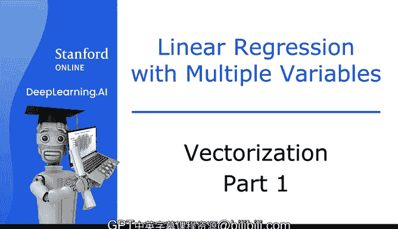
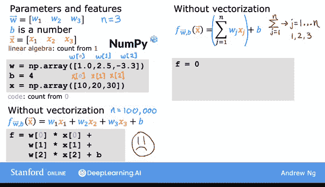

# 吴恩达《机器学习》｜machine-learning（中英字幕-deepseek翻译） - P22：22_02_02_向量化第一部分.zh_en - GPT中英字幕课程资源 - BV1MN4y1S7DE

In this video you see a very useful idea called vectorization when you're implementing a learning algorithm using vectorization will both make your code shorter and also make it run much more efficiently。

Learning how to write vectorized code will allow you to also take advantage of modern numerical linear algebra libraries。

 as well as maybe even GPU hardware that stands for a graphics processor unit This is hardware originally designed to speed up computer graphics in your computer。

 but turns out can be used when you write vectorized code to also help you execute your code much more quickly let's look at a concrete example of what vectorization means。

Here's an example of parameters W and B， where W is a vector with three numbers。

 and you also have a vector of features x with also three numbers， so here n is equal to 3。

So notice that in linear algebra， the index or the counting starts from one。

 and so the first value is subed W1 and x1。In Python code。

 you can define these variables WB and X using arrays like this here I'm actually using a numerical linear algebra library in Python called nuumPy。

 which is by far the most widely used numerical linear algebra library in Python and in machine learning。

Because in Python the indexing of a array or counting in a race starts from0。

 you would access the first value of w using w square bracket0。

 the second value using W square bracket 1 and the third using W square bracket 2。

 so the indexing here goes from 0，1 to2 rather than12 to3。

Similarly to access individual features of x， you would use x0， x1 and x2。

 many programming languages， including Python start counting from zero rather than1。

Now let's look at an implementation without vectorization for computing the model's prediction in code。

 it will look like this， you take each parameter W and multiply it by its associated feature。

Now you could write your code like this， but what if n is in3， but instead n is 100 or 100。

000 is both inefficient for you to code and inefficient for your computer to compute。

So here's another way， still without using vectorization by using a full loop。In math。

 you can use a summation operator to add all the products of WJ and X J for J equals1 through N。

Then outside the summation， you add B at the end。So the summation goes from J equals 1 up to and including n for n equals 3。

J therefore goes from12 to 3 in code， you can initialize F to0。Then for J and range from0 to n。

 this actually makes J go from 0 to n minus1， so from 01 to2。

 you can then add to F the product of Wj times xj。

Finally， outside the for loop， you add B notice that in Python。

 the range0 to n means that j goes from0 all the way to n minus1 and does not include NSO。

And more commonly， this is written range n in Python。

 but in this video I added a zero here just to emphasize that it starts from zero。

While this implementation is a bit better than the first one。

 it still doesn't use factorization and isn't that efficient。

Now let's look at how you can do this using vectorization。

This is the math expression of the function F， which is the dot products of W and X plus B。

And now you can implement this with a single line of code by computing FP equals NP dot dot。

 I said dot dot because the first dot is the period and the second dot is the function or the method called DOT。

But is FP equals NP dot dot W comma X。And this implements。

The mathematical dot products between the vectors W and X。 And then finally。

 you can add B to it at the end。This Nmpy dot function is a vectorized implementation of the dot product operation between two vectors。

 and especially when n is large， this will run much faster than the two previous code examples。

I want to emphasize that vectorization actually has two distinct benefits First。

 it makes a code shorter， is now just one line of code， isn't that cool， and second。

 it also results in your code running much faster than either of the two previous implementations that did not use vectorization。

And the reason that the vectorized implementation is much faster is behind the scenes the Ny dot function is able to use parallel hardware in your computer。

 and this is true whether you're running this on a normal computer that is on a normal computer CPU or if you are using a GPU。

 a graphics processor unit that's often used to accelerate machine learning jobs。

 and the ability of the Nmpy dot function to use parallel hardware makes it much more efficient than the for loop or the sequential calculation that we saw previously。

Now， this version is much more practical when n is launched because you are not typing w0 times  x0 plus w1 times x1 plus lots of additional terms like you would have had for the previous version but。

While this save a lot on the typing is still not that computationally efficient because it still doesn't use vectorization。

So to recap， vectorization makes your code shorter。

 so hopefully easier to write and easier for you or others to read。

 and it also makes it run much faster。But what this this magic behind vectorization that mixes run so much faster。

 let's take a look at what your computer is actually doing behind the scenes to make vectorized code runs so much faster。

