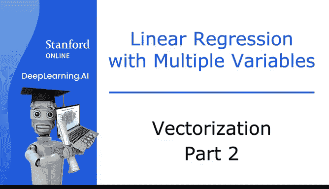
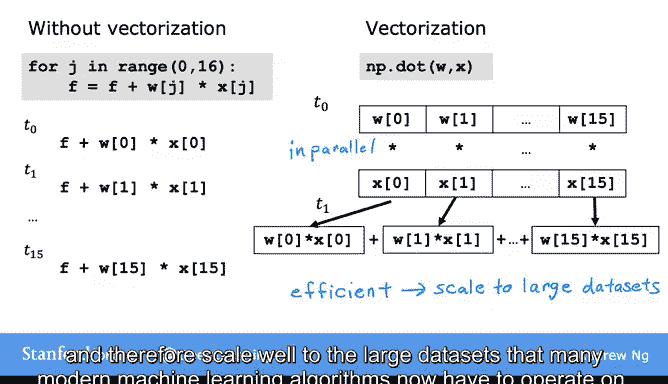
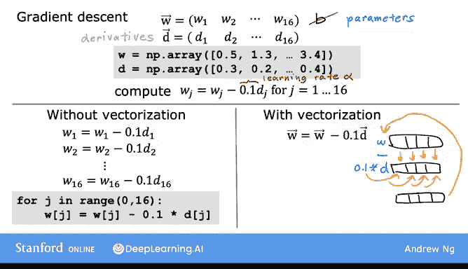
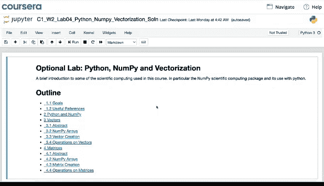
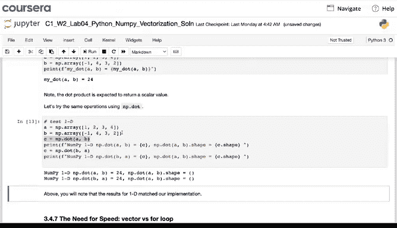
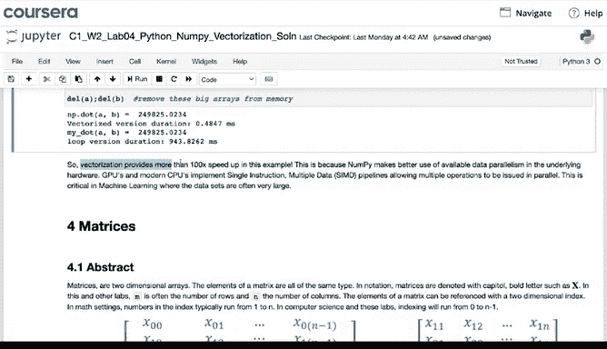
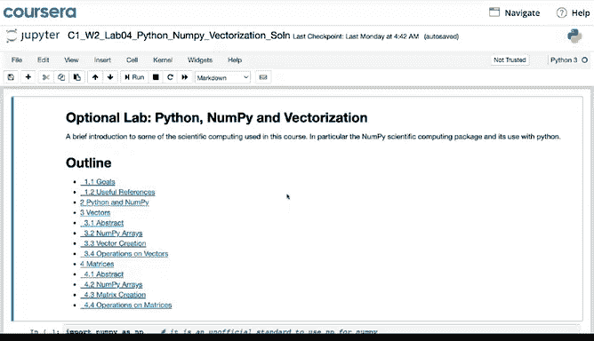

# 吴恩达《机器学习》｜machine-learning（中英字幕-deepseek翻译） - P23：23_02_03_向量化第二部分.zh_en - GPT中英字幕课程资源 - BV1MN4y1S7DE

I remember when I first learned about vectorization。

 I spent many hours on my computer taking an unvectorized version of an algorithm， running it。

 see how long I ran， and then running a vectorized version of the code and seeing how much faster that ran and it just spent hours playing with that and it frankly blew my mind that the same algorithm vectorized would run so much faster。

 it felt almost like a magic trick to me。

In this video， let's figure out how this magic trick really works let's take a deeper look at how a vectorized implementation may work on your computer behind the scenes let's look at this full loop。

A full loop like this runs without vectorization， so if J ranges from0 to say 15。

 this piece of code performs operations one after another。On the first time step。

 which I'm going to write as time0 or T0。It first operates on the values at index0。

At the next time step， it calculates values corresponding to index 1 and so on until the 15th step where it computes that。

In other words， it calculates these computations one step at a time， one step after another。

In contrast， this function in NI is implemented in the computer hardware with vectorization。

 so the computer can get all values of the vectors WNX， and in a single step。

 it multiplies each pair of W andX with each other all at the same time in parallel。Then after that。

 the computer takes these 60 numbers and uses specialized hardware to add them all together very efficiently。

 rather than needing to carry out distinct additions one after another to add up these 60 numbers This means that code with vectorization can perform calculations in much less time than code without vectorization。

And this matters more when you are running learning algorithms on large datasets or trying to train large models。

 which is often the case with machine learning。So that's why being with the right vectorized implementations of learning algorithms has been a key step to getting learning algorithms to run efficiently and therefore scale well to the launch dataset sets that many modern machine learning algorithms now have to operate on。

Now let's take a look at a concrete example of how this helps with implementing multiple linear regression that is linear regression with multiple input features。

Say you have a problem with 16 features and 16 parameters w1 through W16 in addition to the parameter B。

You calculated 16 derivative terms for these 16 weights。And in code。

 maybe you sort the values of W&D in two Nier arrays。With deoring the values of the derivatives。

For this example， I'm just going to ignore the parameter B Now you want to compute an update for each of these 16 parameters。

 so WJ is updated to Wj minus the learning rate， say 0。1。Times DJ。For J from 1 through 16。

En code without vectorization。You would be doing something like this。

Update W1 to be W1 minus the learning rate 0。1 times D1 Next update W2 similarly。

And so on through W 16。Updated as W16 minus 0。1 times d16 in code without vectorization。

 you could use a full loop like this for J in range 016 that again goes from 0 to 15。

Said WJ equals WJ minus 0。1 times DJ。In contrast。With factorization。

 you can imagine the computer's parallel processing hardware like this。

 it takes all 16 values in the vector W and subtracts in parallel 0。

1 times all 16 values in the vector D and assign all 16 calculations back to W all at the same time and all in one step。

In code， you can implement this as follows。W is assigned to W minus 0。1 times d。Behind the scenes。

 the computer takes these Nier arrays， W& D， and uses parallel processing hardware to carry out all 16 computations efficiently。

 so using a vectorized implementation you should get a much more efficient implementation of linear regression。

Maybe the speed difference won't be huge if you have 16 features。

 but if you have thousands of features and perhaps very large training sets。

 this type of vectorized implementation will make a huge difference in the running time of your learning algorithm。

 it could be the difference between code finishing in one or two minutes versus taking many。

 many hours to do the same thing。In the optional lab that follows this video。

 you see an introduction to one of the most used Python libraries in machine learning。

 which we've already touched on in this video called NumpI。

You see how the three vectors encode and these vectors or list of numbers are called nuier arrays。

And you also see how to take the dot product of two vectors using a Ny function called dot。

And you also get to see how vectorized code， such as using the dot function。

 can run much faster than a full loop。In fact， you get to time disco yourself and hopefully see it run much faster。

This optional lab introduces a fair amount of new Ny syntax。

 so when you read through the optional lab， please don't feel like you have to understand all the code right away。

 but you can save this notebook and use it as a reference to look at when you're working with data slot in Numpy array so congrats on finishing this video on vectorization you've learned one of the most important and useful techniques in implementing machine learning algorithms in the next video well put the math of multiple linear regression together with vectorization so that you're going to implement gradient in descent for multiple linear regression with vectorization let's go on to the next video。

