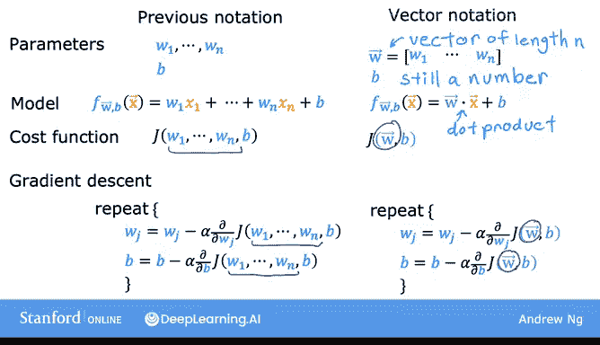
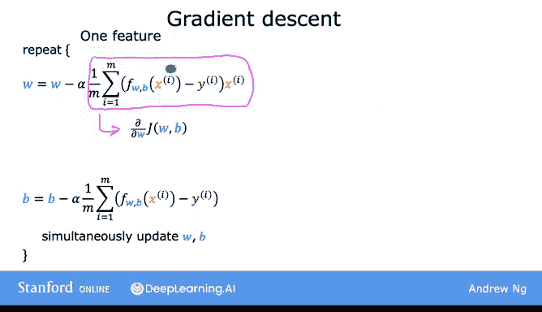
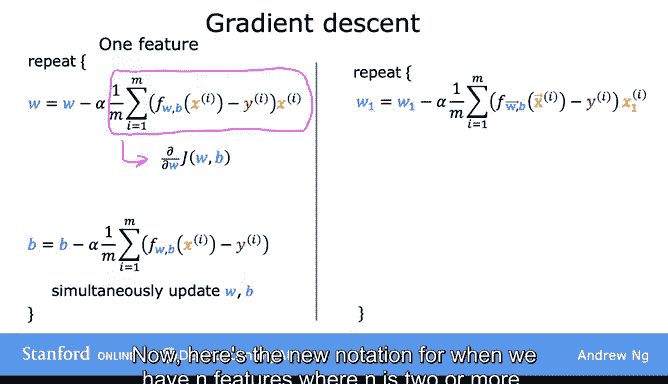
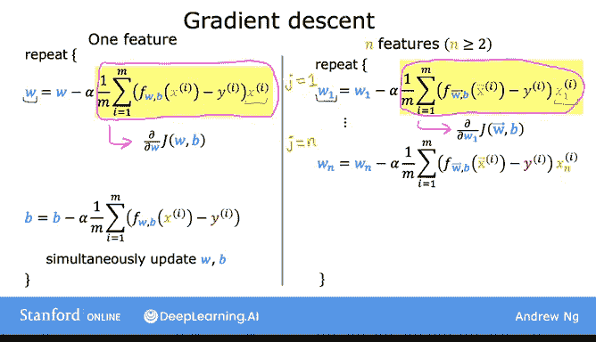
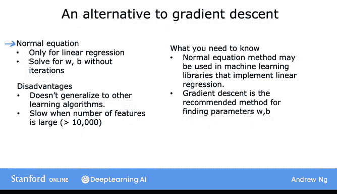
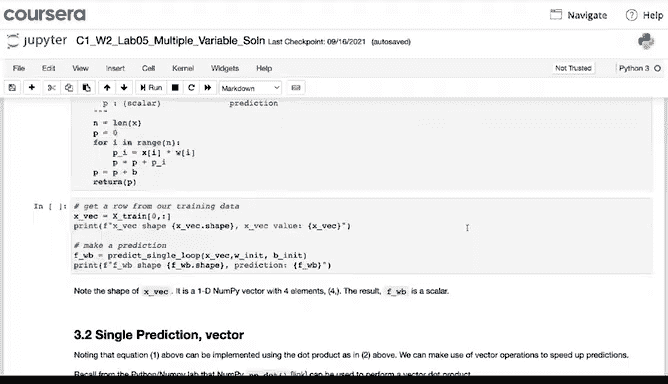
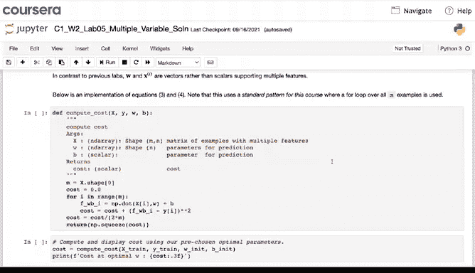
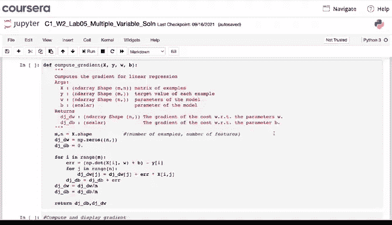
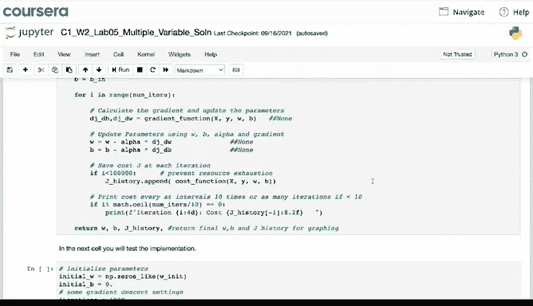
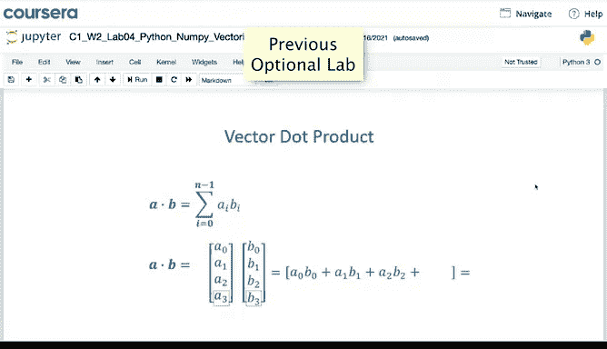

# 吴恩达《机器学习》｜machine-learning（中英字幕-deepseek翻译） - P24：24_02_04_多元线性回归的梯度下降法.zh_en - GPT中英字幕课程资源 - BV1MN4y1S7DE

So you've learned about gradient descent about multiple linear regression and also vectorization。

 let's put law together to implement gradient descent for multiple linear regression with vectorization。

 this would be cool。Let's quickly review what mouse regression look like using our previous notation。

 let's see how you can write it more succinctly using vector notation we have parameters W1 to WN as well as B。

But instead of thinking of w1 to Wn as separate numbers that is separate parameters。

 let's instead collect all of the w's into a vector W。 so that now W is a vector of length n。

So we're just going to think of the parameters of this model as a vector w， as well as B。

 where B is still a number， same as before。Whereas before we had defined multiple linear regression like this。

 now using vector notation， we can write the model as F subwb of x equals the vectorw dot product with the vector x plus B。

And remember that this dot here means dot product。 Our cost function can be defined as J of W1 through WN comma B。

But instead of just thinking of J as a function of these n different parameters Wj as well as B。

 we're going to write J as a function of parameter vector W and the number B。

 So this W1 through Wn is replaced by this vector W and J now takes this input a vector W and the number B and returns the number Here's what gradient descent looked like We're going to repeatedly update each parameter Wj to be Wj minus alpha times the derivative of the co J where J has parameters W1 through Wn and B and once again we just write this as J of vector W and number B。

Let's see what this will look like when you implement gradient descent， and in particular。

 let's take a look at the derivative term。

We'll see that gradientding descent becomes just a little bit different with multiple features compared to just one feature。

Here's what we had when we had gradient indesscent with one feature。

 we had an update rule for W and a separate update rule for B。

 so hopefully these look familiar to you。And this term here is the derivative of the co function J with respect to the parameter W。

 and similarly， we have an update rule for parameter B with Uniive regression。

 we had only one feature。We call that feature Xi without any subscript。

Now， here's the new notation for when we have n features where n is two or more。

 We get this update rule for gradient in descent。 update W1 to be w1 minus alpha times this expression here。

And this formula is actually the derivative of the co J with respect to W1。

The formula for the derivative of J with respect to W1 on the right looks very similar to the case of one feature on the left。

The error term still takes a prediction。F of x minus the target y。

 One difference is that W and x are now vectors， and just as W on the left has now become W1 here on the right。

X I here on the left is now instead X I Sub1 here on the right。And this is just for J equals1。

For multiple linear regression， we have J ranging from 1 through n。

 and so we'll update the parameters W1， W2 all the way。Up to WN。And then as before， we'll update B。

And if you implement this， you get gradient descent for multiple regression。

So that's it for gradient descent for multiple regression。Before moving on from this video。

 I want to make a quick aside or a quick side note on an alternative way for finding W andB for linear regression。

And this method is called the normal equation。Whereas it turns out。

 gradient descent is a great method for minimizing the cost function J to find W and B。

There is one other algorithm that works only for linear regression and pretty much none of the other algorithms you see in this specialization for solving for W andB。

 and this other method does not need an iterative gradient descent algorithm。

Called the normal equation method， it turns out to be possible to use an advanced linear algebra library to just solve for W&B all in one goal without iterations。

Some disadvantages of the normal equation method are。First， unlike gradient descent。

 this does not generalize to other learning algorithms。

 such as the logistic regression algorithm that you learn about next week or the neural networks or other algorithms you see later in this specialization。

The normal equation method is also quite slow if the number of futures end is large。

Almost no machine learning practitioners should implement the normal equation method themselves。

 but if you are using a mature machine learning library and call linear regression。

 there is a chance that on the back end it will be using this to solve a W andB。

So if you're ever in a job interview and hear the term normalmal equation。

 that's what this refers to。Don't worry about the details of how the normal equation works。

 just be aware that some machine learning libraries may use this complicated method in the back end to solve a W andB。

 but for most learning algorithms， including how you implement linear regression yourself。

 gradient descents often a better way to get the job done。

In the optional lab that follows this video， you see how to define a multiple regression model in code。

And also how they calculate the prediction F of x？

You also see how to calculate the cost。

And implements gradient descent for a multiple linear regression model。

 this will be using Python's NumpI library， so if any of the code looks very new that's okay。

 but you should feel free also to take a look at the previous optional lab that introduces Numpy and vectorization for refresher of NumpI functions and how to implement those in code。

So that's it， you now know multiple linear regression。

 this is probably the single most widely used learning algorithm in the world today。

But there's more with just a few tricks such as picking and scaling features appropriately and also choosing the learning rate alpha appropriately。

 you will make this work much better So just a few more videos to go for this week。

 let's go on to the next video to see those little tricks that will help you make multiple linear regression work much better。

😊。