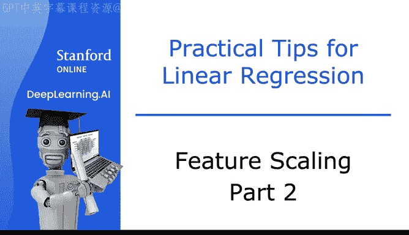
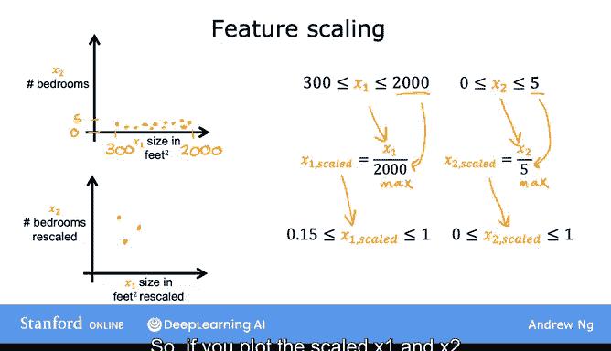
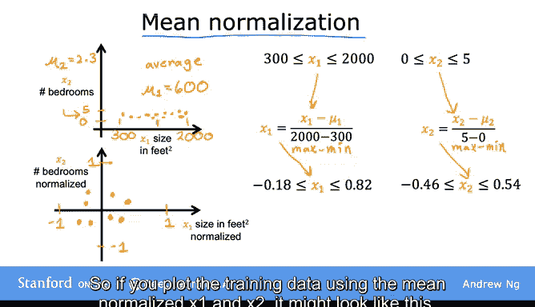
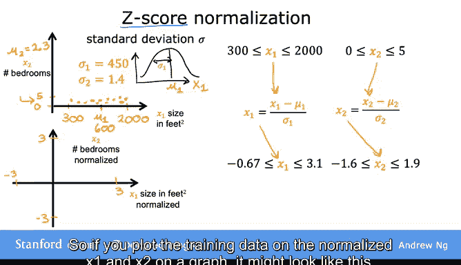
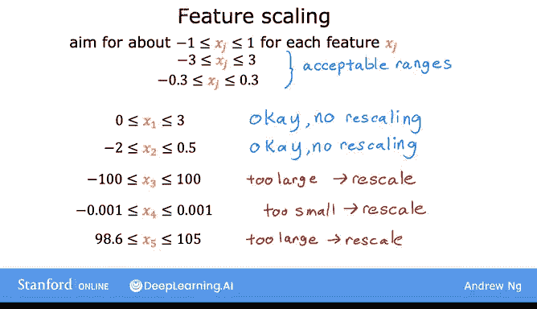

# 吴恩达《机器学习》｜machine-learning（中英字幕-deepseek翻译） - P26：26_02_02_特征缩放第二部分.zh_en - GPT中英字幕课程资源 - BV1MN4y1S7DE

Let's look at how you can implement features scaling to take features that take on very different ranges of values and scale them to have comparable ranges of value to each other so how do you actually scale features Well if x1 ranges from 3 to 2000 one way to get a scale version of x1 is to take each original x1 value and divide by 2000 the maximum of the range so the scale x1 will range from 0。

15 up to1。Similarly， since x2 ranges from 0 to 5， you can calculate a scale version of x2 by taking each original x2 and dividing by 5。

 which is again the maximum， so the scale x2 will now range from 0 to 1。

So if you plot the scaled x1 and x2 on a graph， it might look like this。

In addition to dividing by the maximum you can also do what's called mean normalization so what this looks like is you start the original features and then you rescale them so that both of them are centered around zero so whereas before they only had values greater than zero now they have both negative and positive values but maybe usually between negative1 and plus1。

So to calculate the mean organization of x1， first find the average also called the mean of x1 on your training set。

 and let's call this mean new one。With this being the Greek alphabet mu， for example。

 you may find that the average of feature1， mu 1 is 600 square feet。 So let's take each X 1。

 subtract the mean mu 1。And then let's divide by the difference， 2000 minus 300。

 where 2000 is the maximum and 300， the minimum， and if you do this。

 you get the normalizedize x1 to range from negative 0。18 to 0。82。Similarly to me normalize x2。

 you can calculate the average of Fika2， and for instance， mu 2 may be 2。3。Then you can take each x2。

 subtract mu2 and divide by 5 minus0 again， the max 5 minus the min， which is 0。

The mean normalized x2 now ranges from negative 0。46 to 0。54。

 so if you plot the training data using the mean normalized x1 and x2， it might look like this。

There's one last common rescaling method called Zco normalization。

To implement Z score normalization you need to calculate something called the standard deviation of each feature If you don't know what the standard deviation is。

 don't worry about it， you won't need to know it for this clause。

 or if you've heard of the normal distribution or the bell shaper sometimes also called the Gaussian distribution。

 this is what the standard deviation for the normal distribution looked like。

 but if you haven't heard of this you don't need to worry about that either。

 but if you do know what is the standard deviation， then to implement a z score normalization。

 you first calculate the mean mu as well as the standard deviation which is often denoted by the lowercase Greek alphabet sigma of each feature。

So， for instance， maybe feature one has a standard deviation of 450 and mean 600。

Then to these or normalize x1， take each x1， subtract mu 1。

 and then divide by the standard deviation， which I'm going to denote as Sigma 1。

And what you might find is that the score normalize x1 now ranges from negative 0。67 to 3。1。

Similarly， if you calculate the second features standard deviation to be 1。4 and mean to be 2。3。

 then you can compute x2 minus mu2 divided by sigma 2， and in this case。

 the z score normalized by x2 might now range from negative 1。6 to 1。9。

So if you plot the training data on the normalized X1 and X2 on a graph， it might look like this。

As a rule of thumb when performing feature scaling。

 you might want to aim for getting the features to range from maybe anywhere around negative  one to somewhere around plus one for each feature X。

But these values， negative  one and plus one can be a little bit loose。

So if the features range from negative 3 to plus 3 or negative 0。3 to plus 0。3。

 all of these are completely okay， so if you have a feature x1 that winds up being between0 and 3 that's not a problem and you can rescale it if you want but if you don't rescale it it should work okay too。

Or if you have a different feature， x2 whose values are between negative 2 and plus 0。5， again。

 that's okay， no harm rescaling it， but it might be okay if you leave it alone as well。

But if another feature like x3 here ranges from negative 100 to plus 100。

Then this takes on a very different range of values than something from around negative 1 to plus1。

So you're probably better off rescaling this feature x3 so that it ranges from something closer to negative 12 plus1。

Similarly， if you have a feature X4 that takes on really small values， say between negative 0。

001 and plus 0。001， then these values are so small， that means you may want to rescale it as well。

Finally， what if your feature X5， such as measurements of a hospital patient's body temperature ranges from 98。

6 to 105 degrees Fahrenheit in this case these values are around 100 which is actually pretty large compared to other scale features and this will actually cause gradient descent to run more slowly so in this case feature rescaling will likely hope。

There's almost never any harm to carrying out feature rescaling。

 so when in doubt I encourage you to just carry it out and that's it for feature scaling with this little technique you often be able to get gradient descent to run much faster。

So that's feature scaling and with or without feature scaling when you run gradient descent。

 how can you know how do you check if gradient descent is really working if it is finding you the global minimum or something close to it in the next video let's take a look at how to recognize if gradient descent is converging and then in the video after that this will lead a discussion of how to choose a good learning rate for gradient descent。

