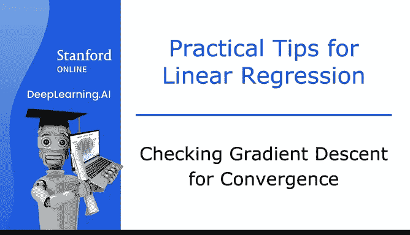
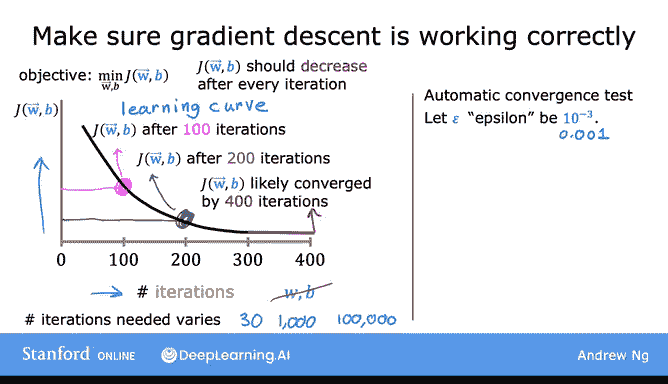

# 吴恩达《机器学习》｜machine-learning（中英字幕-deepseek翻译） - P27：27_02_03_检查梯度下降法的收敛性.zh_en - GPT中英字幕课程资源 - BV1MN4y1S7DE

When running gradientian descent， how can you tell if it is converging。

 that is whether it's helping you to find parameters close to the global minimum of the cost function？

By learning to recognize what the well runningning implementation of gradient descent looks like。

 we will also in a later video be better able to choose the good learning rate alphapha let's take a look as a reminder here's the gradient descent rule and one of the key choices is the choice of the learning rate alpha。

Here's something that I often do to make sure that gradient descent is working well recall that the job of gradient descent is to find parameters W and B that hopefully minimize the cost function of J。

 So what I'll often do is plot the cost function J， which is calculated on the training set。

And app plot the value of J at each iteration of gradient descent。

Remember that each iteration means after each simultaneous update of the parameters W and B。

 so in this plot， the horizontal axis is the number of iterations of gradient descent that you've run so far。

And so you may get a curve that looks like this。Notice that the horizontal axis is the number of iterations of gradient descent and not a parameter like W or B。

 This differs from previous graphs you've seen where the vertical axis was cost J and the horizontal axis was a single parameter like W or B。

This curve is also called a learning curve。Note that there are a few different types of learning curves used machine learning and you'll see some other the types later in this course as well。

Concretely， if you look at this point on the curve。

 this means that after you've run gradient and descent for 100 iterations。

 meaning 100 simultaneous updates of the parameters， you have some learned values for W and B。

And if you compute the cost JWB for those values of W and B， the ones you got after 100 iterations。

 you get this value for the cost J that is this point on the vertical x's and this point here corresponds to the value of J for the parameters that you got after 200 iterations of gradient descent。

So looking at this graph helps you to see how your cost J changes after each iteration or gradient descent。

If gradientcent is working properly， then the cost J should decrease after every single iteration if J ever increases after one iteration。

That means either alpha is chosen poorly， and it usually means alpha is too large or there could be a bug in the code。

Another useful thing that this plot can tell you is that if you look at this curve by the time you reach maybe 300 iterations also。

 the cost J is leveling off and is no longer decreasing much and by 400 iterations it looks like the curve has flattened out So this means that gradient descent has more or less converged because the curve is no longer decreasing。

So looking at this learning curve， you can try to spot whether or not gradient descent is converging。

By the way。The number of iterations that gradient descent takes to converge can vary a lot between different applications in one application it may converge after just 30 iterations for a different application。

 it could take 1000 or 100，000 iterations。It turns out to be very difficult to tell in advance how many iterations gradient thecent needs to converge。

 which is why you can create a graph like this， a learning curve to try to find out when you can stop training your particular model。

Another way to decide when your model is done training is with an automatic convergence test。

So let's let epsilon this here is the Greek alphabet Epsilon。

 Let's let epsilon be available representing a small number， such as 0。

001 or 1 the power of negative 3。

If the cost J decreases by less than this number epsilon on one iteration。

 then you're likely on this flattened part of the curve that you see on the left and you can declare convergence。

Remember， convergence hopefully indicates that you found parameters W and B that are close to the minimum possible value of J。

I usually find that choosing the right threshold epsilon is pretty difficult。

 so I actually tend to look at grass like this one on the left rather than rely on automatic convergence tests。

Looking at this little figure can tell you。I'll give you some advanced warning if maybe gradient In descent is not working correctly as well。

So you've now seen what the learning curve should look like when gradient descent is running well。

 let's take these insights and in the next video take a look at how to choose an appropriate learning rate。

