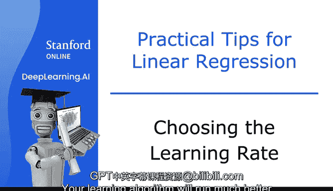
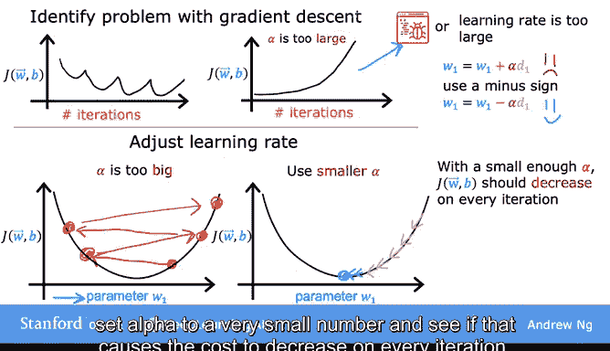
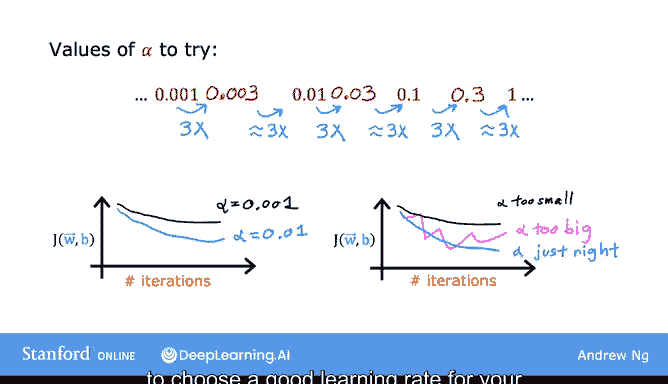
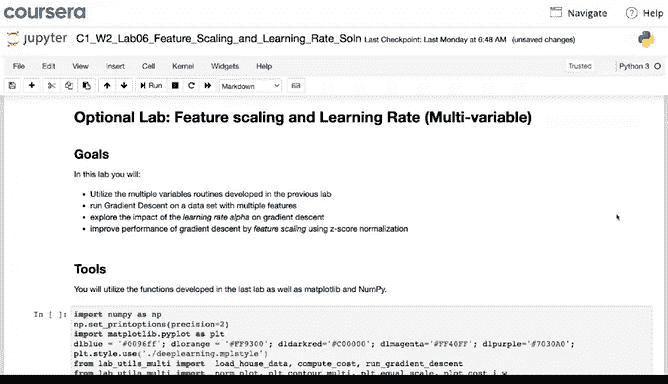
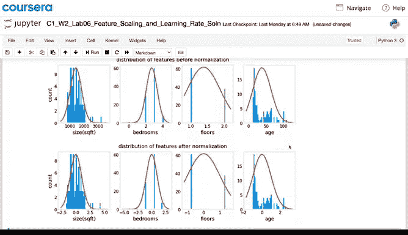

# 吴恩达《机器学习》｜machine-learning（中英字幕-deepseek翻译） - P28：28_02_04_选择学习率.zh_en - GPT中英字幕课程资源 - BV1MN4y1S7DE

Your learning algorithm will run much better with an appropriate choice of learning rate。

 if it's too small， it would run very slowly， and if it's too large， it may not even converge。

 Let's take a look at how you can choose a good learning rate for your model concretely if you plot the cost for a number of iterations and notice that the cost sometimes goes up and sometimes goes down。

 you should take that as a clear sign that gradient in descent is not working properly。

 This could mean that there's a bugic code or sometimes it could mean that your learning rate is too large。

 So here is an illustration of what might be happening。

Here the vertical axis is a cost function J， and the horizontal axis represents a parameter like maybe w1。

And if the learning rate is too big， then if you start off here。

 your update step may overshoot the minimum and end up here。

 and in the next update step here you're gain overshooting so you end up here and so on。

 and that's why the cost can sometimes go up instead of decreasing。To fix this。

 you can use a smaller learning rate， so then your updates may start here and go down a little bit and down a bit and will hopefully consistently decrease until it reaches the global minimum。

Sometimes you may see that the cost consistently increases after each iteration like this curve here。

 this is also likely due to a learning rate that is too large and it could be addressed by choosing a smaller learning rate。

But learning ray like this could also be a sign of a possible bcony code， for example。

 if I row my code so that W1 gets updated as w1 plus alpha times this derivative term。

 this could result in a cost consistently increasing at each iteration。

 and this is because adding the derivative term moves your cause J further from the global minimum instead of closer。

So remember， you want to use a minus sign， so the code should be updated W1 updated by w1 minus alpha times the derivative term。

One debugging tip for a correct implementation of gradient descent is that with a small enough learning rate。

 the cost function should decrease on every single iteration。So if gradient descent isn't working。

 one thing I will often do and I hope you find this tip useful too。

 one thing I'll often do is just set alpha to be a very。

 very small number and see if that causes the cost to decrease on every iteration。

If even with alpha set to a very small number， J doesn't decrease on every single durationeration。

 but instead sometimes increases， then that usually means there's a bug somewhere in the coat。

Note that setting alpha to be really， really small is meant here as a debugging step， and a very。

 very small value of alpha is not going to be the most efficient choice for actually training your learning algorithm。

One important trade off is that if your learning rate is too small。

 then gradient interscent can take a lot of iterations to converge。

So when I am running gradient in descent， I will usually try a range of values for the learning rate alpha。

 so I might start by trying a learning rate of 0。001。

 and I might also try a learning rate as's 10 times as large， say 0。01 and 0。1 and so on。

And for each choice of alpha， you might run gradient descent just for a handful of iterations and plot the cause function J as a function of the number of iterations。

And after trying a few different values， you might then pick the value of alpha that seems to decrease the learning rate rapidly。

 but also consistently。In fact， what I actually do is try a range of values like this。

 after trying 0。001， I'll then increase the learning rate 3fo to 0。003 and after that I'll try 0。01。

Which is again， about3 times as large as 0。003。 So these are roughly trying out gradient into sense with each value of alpha being roughly three times bigger than the previous value。

So what I'll do is try a range of values until I found a value that's too small and then also make sure I found a value that's too large and I'll slowly try to pick the largest possible learning rate or just something slightly smaller than the largest reasonable value that I found and when I do that it usually gives me a good learning rate for my model。

So I hope this technique too will be useful for you to choose a good learning rate for your implementation of grade and descent。

In the upcoming optional lab。

You can also take a look at how feature scaling is done in code and also see how different choices of the learning rate alpha can lead to either better or worse training of your model。

 I hope you have fun playing with the value of alpha and seeing the outcomes of different choices of alpha。

 so please take a look and run the code in the optional lab to gain a deeper intuition about feature scaling as well as the learning rate alpha。

Choosing learning rates is an important part of training many learning algorithms。

 and I hope that this video gives you intuition about different choices and how to pick a good value for Alpha。

Now there are a couple more ideas they can use to make multiple linear regression much more powerful。

 and that is choosing custom features which will also allow you to fit curves。

 not just a straight line to your data， let's take a look at that in the next video。

