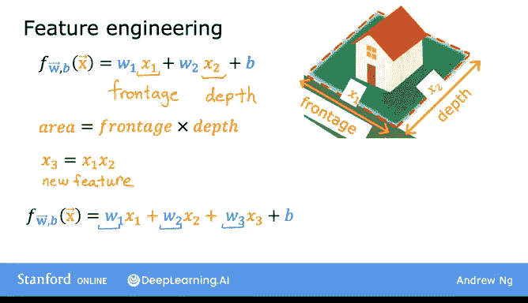

# 吴恩达《机器学习》｜machine-learning（中英字幕-deepseek翻译） - P29：29_02_05_特征工程.zh_en - GPT中英字幕课程资源 - BV1MN4y1S7DE

The choice of features can have a huge impact on your learning algorithm's performance。

 in fact for many practical applications， choosing or entering the right features is a critical step to making the algorithm work well。

In this video， let's take a look at how you can choose or engineer the most appropriate features for your learning algorithm。

Let's take a look at future engineering by revisiting the example of predicting the price of a house。

Say you have two features for each house。X1 is the widthiff of the lot size of the plot of land that the house is built on。

This in real estate is also called the frontage of the mot。

And the second feature x2 is the depth of the lot size of let's assume the rectangular plots of land that the Hu was built on given these two features。

 x1 and x2， you might build a model like this where F of x is w1 x1 plus w2x2 plus B where x1 is the frontage or with and x2 is the depth。

And this model might work okay。But here's another option for how you might choose a different way to use these features in the model that could be even more effective。

 You might notice that the area of the land can be calculated as the frontage or width times the depth。

 and you may have an intuition that the area of the land is more predictive of the price。

 than the frontage and depth as separate features。So you might define a new feature x3 as x1 times x2。

 so this new feature x3 is equal to the area of the plot of land。With this feature。

 you can then have a model， Fwb of x equals w1x1 plus w2x2 plus w3x3 plus B。

 so that the model can now choose parameters W1， W2 and W3。

 depending on whether the data shows at the frontage or the depth。

 or the area x3 of the lot turns out to be the most important thing for predicting the price of the house。

What we just did creating a new feature is an example of what's called feature engineering in which you might use your knowledge or intuition about the problem to design new features。

 usually by transforming or combining the original features of the problem in order to make it easier for the learning algorithm to make accurate predictions So depending on what insights you may have into the application。

 rather than just taking the features that you happen to start off with sometimes by defining new features you might be able to get a much better model。

 so that's feature engineering。

And it turns out that there's one flavor of feature engineering that allow you to fit not just straight lines but curves。

 non nonlinear functions to your data， let's take a look in the next video at how you can do that。

