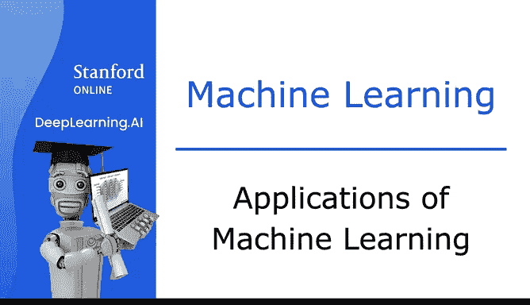
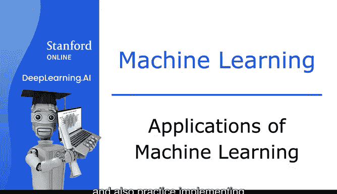

# 吴恩达《机器学习》｜machine-learning（中英字幕-deepseek翻译） - P2：02_01_02_机器学习的应用.zh_en - GPT中英字幕课程资源 - BV1MN4y1S7DE

In this class， you learn about the state of the art and also practice implementing machine learning algorithm rooms yourself。

You learn about the most important machine learning algorithms。

 some of which are exactly what's being used in large AI or large tech companies today。

 and you get sense of what is the state of the art in AI。Beyond learning the algorithms though。

 in this class， you also learn all the important practical tips and tricks for making them perform well。

 and you get to implement them and see how they work for yourself。

So why is machine learning so widely used today？Machine learning had grown up as a subfield of AI or artificial intelligence。

 We wanted to build intelligent machines， and it turns out that there are a few basic things they could program a machine to do。

 such as how to find the shortest path from A to B like in your GPS。 but for the most part。

 we just did not know how to write an explicit program to do many of the more interesting things such as perform web search。

 recognize human speech， diagnose diseases or mixed rays or build a self-driving car。

The only way we knew how to do these things was to have a machine learn to do it by itself。For me。

 when I founded and was leading the Google Brain team， I worked on problems like speech recognition。

 computer vision for Google Maps Street View images， and advertising， or leading AI by do。

 I worked on everything from AI for augmented reality to combat payment fraud to leading a self- drivingriving car team。

Most recently， at landing AI， AI fund and at Stanford University are been going to work on AI applications in manufacturing。

 large scale agriculture， healthcare， e-commerce， and other problems。

Today there are hundreds of thousands， perhaps millions of people working on machine learning applications that could tell you still the stories about their work with machine learning。

When you've learned these skills， I hope that you too will find it great fun to dabble in exciting different applications and maybe even different industries。

In fact， I find it hard to think of any industry that machine learning is unlikely to touch in a significant way now in the near future。

😊，Looking even further into the future， many people， including me。

 are excited about the AI dream of someday building machines as intelligent as your me。

This is sometimes called artificial general intelligence or AGI。

I think AGI has been overheped and was still a long way away from that go。

 I don't know if it'll take 50 years or 500 years or longer to get there。

 but most AI researchers believe that the best way to get closer to what that go is by using learning algorithms。

 maybe ones that take some inspiration from how the human brain works。

 You also hear little more about this quest for AGI later in this course。

 According to a study by Mckeninzie， AI and machine learning is estimated to create an additional $13 trillion dollars of value annually by the year 2030。

Even though machine learning is already creating tremendous amounts of value in the software industry。

I think there could be even vastly greater value that is yet to be created outside the software industry in sectors such as retail。

 travel， transportation， automotive， materials， manufacturing， and so on。

Because of the massive untapped opportunities across so many different sectors， today。

 there is a vast， unfulfilled demand for this skill set。

That's why this is such a great time to be learning about machine learning。

If you find machine learning applications exciting。

 I hope you stick with me through this class I can almost guarantee that you find mastering these skills worthwhile in the next video we'll look at a more formal definition of what is machine learning。

And we'll begin to talk about the main types of machine learning problems and algorithms。

 you pick up some of the main machine learning terminology and start to get a sense of what are the different algorithms and when each one might be appropriate。

So let's go on to the next video。