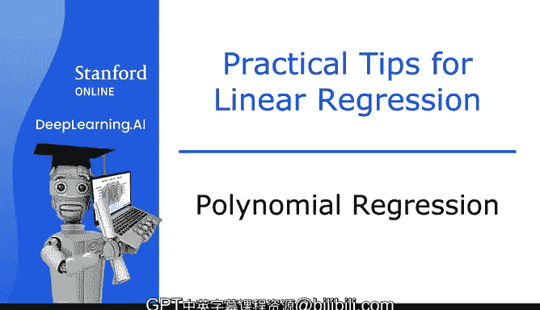
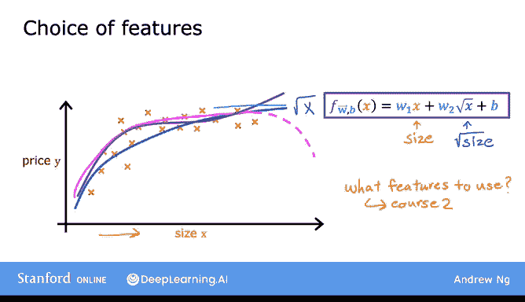
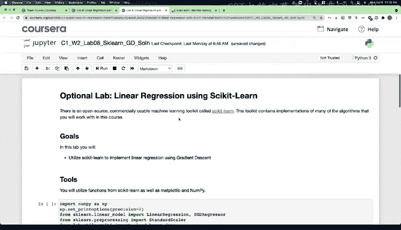
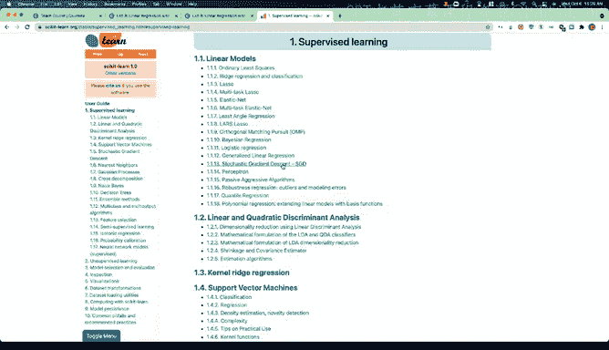
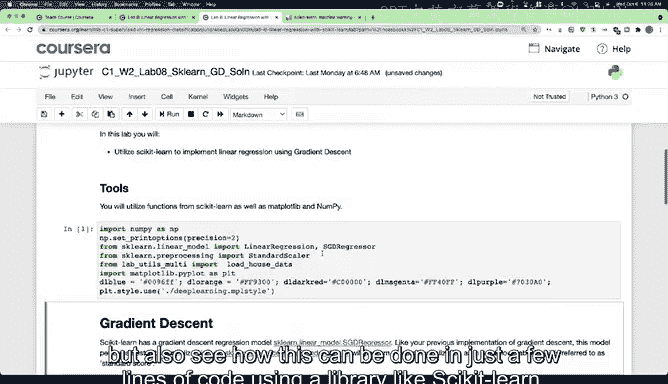

# 吴恩达《机器学习》｜machine-learning（中英字幕-deepseek翻译） - P30：30_02_06_多项式回归.zh_en - GPT中英字幕课程资源 - BV1MN4y1S7DE

So far we've just been fitting straight lines to our data。

 let's take the ideas of multiple linear regression and feature engineering to come up with a new algorithm called polynomial regression。

 which let you fit curves non nonlinear functions to your data let's say you have a housing data set that looks like this where feature X is the size in square feet。

 It doesn't look like a straight line fits this data set very well。

 so maybe you want to fit the curve， maybe a quadratic function to the data like this which includes a size x and also x squared which is the size raised to the power of two。

And maybe they'll give you a better fit to the data。

But then you may decide that your quadratic model doesn't really make sense because the quadratic function eventually comes back down and well we wouldn't really expect housing prices to go down when the size increases right because houses seem like they should usually cost more。

So then you may choose a cubic function where we now have not only x squared but x cubed。

So maybe this model produces this curve here， which is a somewhat better fit to the data because the size does eventually come back up as the size increases。

These are both examples of polynomial regression because you took your original feature X and raised it to the power of2 or3 or any other power。

 and in the case of the cubic function， the first feature is the size。

 the second feature is a size squared and the third feature is the size cubed。

I just want to point out one more thing， which is that if you create features so are these powers like the square of the original features like this。

 then feature scaling becomes increasingly important。

 So if the size of the house ranges from say1 to 1000 square feet。

 then the second feature which is a size squared， will range from one to a million。

 and the third feature， which is size cubed， ranges from one to a billion。

 So these two features x squared and x cubed， take on very different ranges of values compared to the original feature X and if you're using gradient in descent is important to apply feature scaling to get your features into comparable ranges of values。

Finally， here's one last example of how you really have a wide range of choices or features to use another feasible alternative to taking the size squared and size cubed is to say use the square root of x。

 so your model may look like w1 times x plus w2 times the square root of x plus B。

The square root function looks like this and it becomes a bit less steep as x increases。

 but it doesn't ever completely flatten out and it certainly never ever comes back down。

So this would be another choice of features that might work well for this data set as well。

So you may ask yourself how do I decide what features to use Later in the second course into the specialization。

 you see how you can choose different features and different models that include or don't include these features and you have a process for measuring how well these different models perform to help you decide which features include or not include。

For now， I just want you to be aware that you have a choice in what features you use and by using feature engineering and polynomial functions。

 you can potentially get a much better model for your data。

In the optional lab that follows this video， you will see some code that implements polynomial regression using features like x。

 x squared and X cubed， so please take a look and run the code and see how it works。

There's also another optional lab after that one that shows how to use a popular open source toolkit that implements linear regression。

PsyedLearn is a very widely used open source machine learning library that is used by many practitioners in many of the top AI。

 internet machine learning companies in the world。

So if either now or in the future you're using machine learning in your job。

 there's a very good chance you'll be using tools like PsyL to train your models。

And so working through that optional lab will give you a chance to not only better understand linear regression。

 but also see how this can be done in just a few lines of code using a library like Psyit Learnn。

For you to have a solid understanding of these algorithms and be able to apply them。

 I do think it's important that you know how to implement linear regression yourself and not just call some psycho learn function that is a black box。

But PsyCOL also has an important role in the way machine learning is done in practice today。

So we're just about at the end of this week congratulations on finishing all of this week's videos。

 please do take a look at the practice quizzes and also the practice lab。

 which I hope will let you try out and practice ideas that we've discussed in this week's practice lab you implement linear regression I hope you have a lot of fun getting this learning algorithm to work for yourself。

😊，Best of luck with that， and I also look forward to seeing you in next week's videos where we'll go beyond regression that is predicting numbers to talk about our first classification algorithm which can predict categories。

 I'll see you next week。