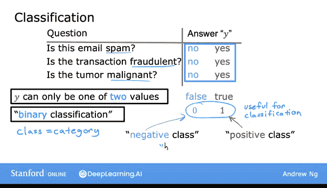
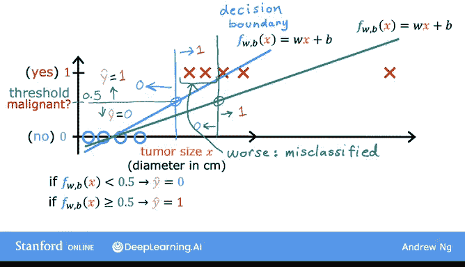
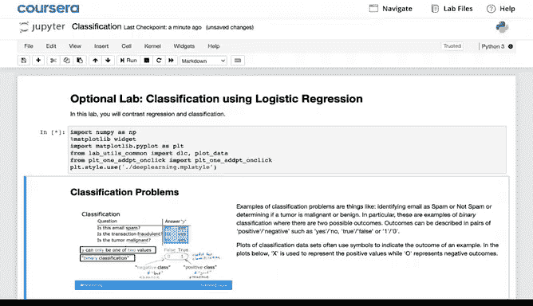
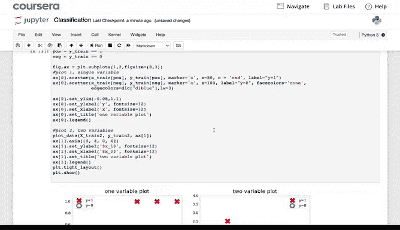
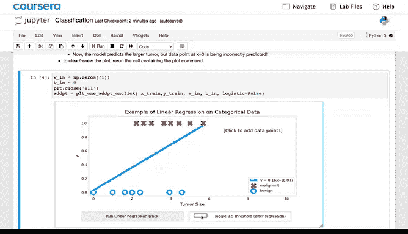
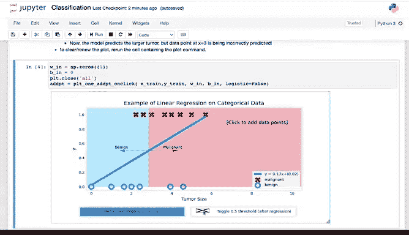

# 吴恩达《机器学习》｜machine-learning（中英字幕-deepseek翻译） - P31：31_03_01_动机.zh_en - GPT中英字幕课程资源 - BV1MN4y1S7DE

Welcome to the third week of this course By the end of this week you have completed the first course of this specialization。

 so let's jump in。Last week you learned about linear regression which predicts a number this week you learned about classification where your output variable y can take on only one of a small handful of possible values instead of any number in an infinite range of numbers。

It turns out that linear regression is not a good algorithm for classification problems。

 let's take a look at why and this will lead us into a different algorithm called logistic regression。

 which is one of the most popular and most widely used learning algorithms today。

Here are some examples of classification problems recall the example of trying to figure out whether an email is spam。

So the answer you want to output is going to be either a no or a yes。

Another example would be figuring out if an online financial transaction is fraudulent。

Fighting online financial fraud is something I once worked on and it was strangely exhilarating because I knew there were forces out there trying to steal money and my team's job was to stop them。

So the problem is given a financial transaction， can your learning algorithm figure out is this transaction fraudulent。

 such as was the credit card stolen？Another example we've touched on before was trying to classify a tumor as malignant versus not。

In each of these problems， the variable that you want to predict can only be one of two possible values。

 no or yes， this type of classification problem where there are only two possible outputs is called binary classification where the word binary refers to there being only two possible clause or two possible categories。

In these problems， I will use the terms class and category relatively interchangeably。

 they mean basically the same thing。By convention， we can refer to these two classes or categories in a few common ways。

We often designate classes as no or yes， or sometimes equivalently false or true。

 or very commonly using the numbers zero or1。Following the common convention in computer science was zero denoting false and one denoting true。

I'm usually going to use the numbers zero and1 to represent the answer Y。

 because that will fit in most easily with the types of learning algorithms we want to implement。

But when we talk about it， we'll often say no or yes or false or true as well。

One that the technologies is commonly used is to call the false or zero class。

 the negative class and the true or the one class， the positive class。For example。

 for spam classification， an email that is not spam may be referred to as a negative example because the output to the question of is a spam。

 the output is no or zero。In contrast， an email that is STM might be referred to as a positive training example because the answer to is a ST is yes or true or one？

Typically， negative and positive do not necessarily mean bad versus good or evil versus good。

 it's just that negative and positive examples are used to convey the concepts of absence or zero or false。

 versus a presence or true or one， of something you might be looking for。

 such as the absence or presence of the spaminess or the spam property of an email or the absence of presence of fraud activity or absence of presence of malignancy in a tumor。

Between nontm and spam emails， which one you call false or zero and which one you call true or one is a little bit arbitrary。

 Often either choice could work， so different engineer might actually swap around and have the positive class be the presence of a good email or the positive class be the presence of a real financial transaction or a healthy patient。

So how do you build a classification algorithm？Here's the example of a training set for classifying if a tumor is malignant。

 a class1 positive class， yes class， or benign class0 or negative class。

 I plotted both the tumor size on the horizontal axis as well as the label Y on the vertical axis。

By the way， in week one， when we first talked about classification。

 this is how we previously visualized it on the number line。

 except that now we're calling the classes0 and1 and plotting them on the vertical axiss。Now。

 one thing you could try on this training set is to apply the algorithm you already know。

 linear regression and try to fit a straight line to the data。If you do that。

 maybe the straight line looks like this， right， and that's your F of x。

Linear regression predicts not just the values 0 and1。

 but all numbers between0 and1 or even less than zero or greater than1。

But here we want to predict categories。One thing you could try is to pick a threshold of， say， 0。

5 so that if the model outputs a value below 0。5， then you predict y equals0 or not malignant。

 and if the model outputs the number equal to or greater than 0。5。

 then predict y equals1 or malignant。Notice that this threshold value of 0。

5 intersects the best fit straight line at this point， so if you draw this vertical line here。

 everything to the left ends up with a prediction of y equals zero and everything on the right ends up with a prediction of y equals 1。

Now for this particular data， it looks like linear regression could do something reasonable。

But now let's see what happens if your data has one more training example。

 this one way over here on the right， let's also extend the horizontal axis。

Notice that this trading example shouldn't really change how you classify the data points。

This vertical dividing line that we drew just now still makes sense as the cutoff where tumor is smaller than this should be classified as zero。

 and tumors greater than this should be classified as 1。

But once you've added this extra training exam on the right。

 the best fit line for linear regression will shift over like this。

And if you continue using the threshold of 0。5， you now notice that everything to the left of this point is predicted as zero。

 non malignant， and everything to the right of this point is predicted to be one or malignant。

This isn't what we want。Because adding that example way to the right shouldn't change any of our conclusions about how to classify malignant versus benign tumors。

But if you try to do this with linear regressiong， adding this one example。

 which feels like it shouldn't be changing anything。

 it ends up with us learning a much worse function for this classification problem。Clearly。

 when a tumor is large， we want the algorithm to classify it as malignant。

So what we just saw was linear regression causes the be fit line when we added one more example to the right。

To shift over and thus the dividing line also called the decision boundary to shift over to the right。

You learn more about the decision boundary in the next video you also learn about an algorithm called logistic regression where the output value of the outcome will always be between0 and1 and the algorithm will avoid these problems that we're seeing on the slide By the way。

 one thing confusing about the name logistic regression is that even though it has the word regression in it is actually used for classification Don't be confused by the name which was given for historical reasons is actually used to solve binary classification problems where the output label Y is either zero or one。

In the upcoming optional lab， you also get to take a look at what happens when you try to use linear regression for classification。

Sometimes you get lucky and it may work。But often it will not work well。

 which is why I don't use linear regression myself for classification。In the optional lab。

 you'll see an interactive plot that attempts to classify between two categories and you hopefully notice how this often doesn't work very well。

 which is okay because that motivates the need for a different model to do classification tasks。

So please check out this optional lab and after that we'll going to the next video to look at logistic regression for classification。

