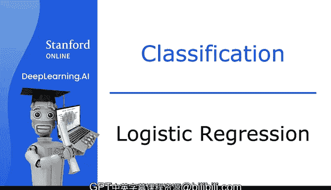
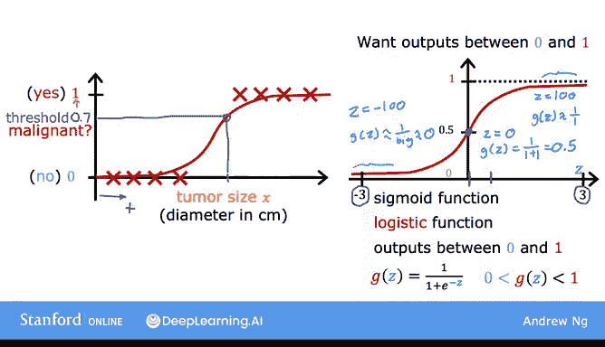
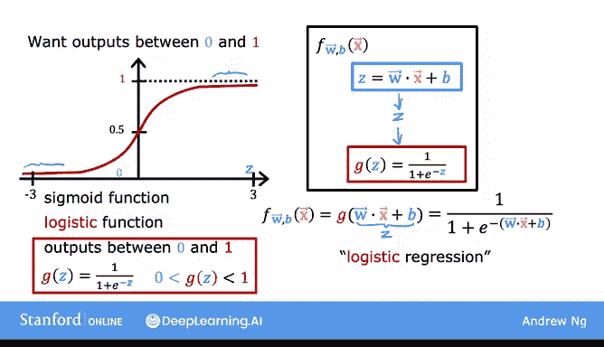
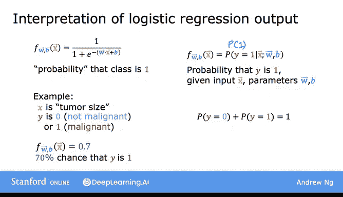
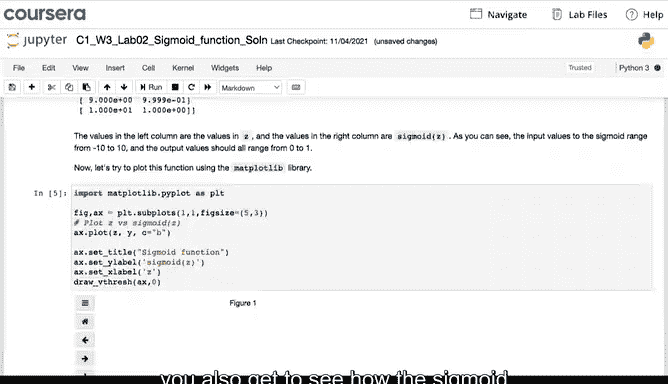
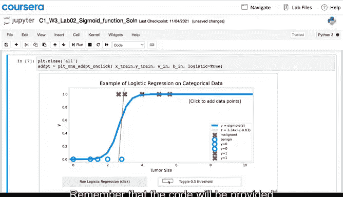
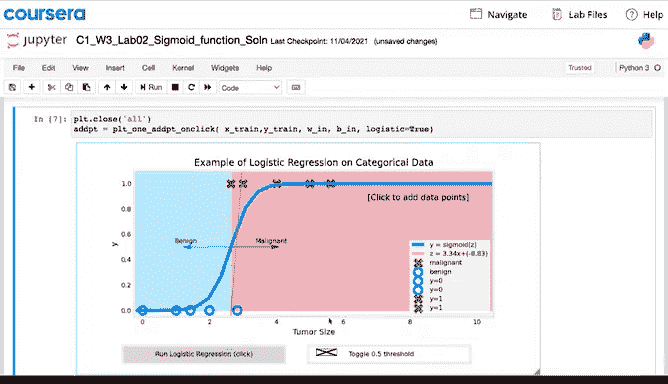

# 吴恩达《机器学习》｜machine-learning（中英字幕-deepseek翻译） - P32：32_03_02_逻辑回归.zh_en - GPT中英字幕课程资源 - BV1MN4y1S7DE

Let's talk about logistic regression， which is probably the single most widely used classification algorithm in the world。

 this is something that I use all the time in my work。

Let's continue with the example of classifying whether a tumor is malignant。

Whereas before we're going to use the label1 or yes。

 the positive class to represent malignant tumors and zero or no negative examples to represent benign tumors。

Here's a graph of the data where the horizontal axis is the tumor size。

And the verical axis takes on only values of zero and1 because it's a classification problem。

You saw in the last video that linear regression is not a good algorithm for this problem。

In contrast， what logistic regression will end up doing is fit a curve that looks like this。

A sort of S shaped curve to this data set。And so for this example。

 if a patient comes in with a tumor of this size， which I'm showing on the X axis。

Then the a will output 0。7， suggesting that it's closer or maybe more likely to be malignant than benign。

We'll say more later what 0。7 actually means in this context。But the output label Y is never 0。

7 is only ever0 or1。To build up to the logistic regression algorithm。

 there's an important mathematical function I'd like to describe。

 which is called the sigmoid function， sometimes also referred to as the logistic function。

The sigmoid function looks like this notice that the x axis of the graph on the left and right are different in the graph to the left on the x axis is the tumor size。

 so it's all positive numbers。Whereas in the graph on the right， you have zero down here。

And the horizontal axis takes on both negative and positive values and have label the horizontal axis Z。

 and I'm showing here just a range of negative 3 to plus 3。

So the sigoid function outputs values between0 and1 and if I use G of z to denote this function。

 then the formula of G of z is equal to1 over 1 plus e to the negative z where here E is a mathematical constant that takes on the value of about 2。

7 and so e to the negative z is that mathematical constant to the power of negative z。

Notice if z were really big， say 100。E to the negative z is e to the negative 100， which is a tiny。

 tiny number。So this ends up being one over one plus a tiny little number。

And so the denominator will be basically very， very close to1， which is why when z is large， G of z。

 that is a sigoid function of z is going to be very close to1。And conversely。

 you can also check for yourself that when z is a very large negative number。

 then G of z becomes1 over a giant number， which is why G of z is very close to0。

So that's why the sig Y function has this shape where it starts very close to zero and slowly builds up or grows to the value of one。

Also， in the sigm y function， when z is equal to0， then e to the negative z is e to the negative0。

 which is equal to 1。And so， G O Z is equal to。1 over 1 plus1， which is 0。5。

 so that's why it passes the vertical axis at 0。5。

Now let's use this to build up to the logistic regression algorithm。

We're going to do this in two steps。In the first step。

 I hope you remember that a straight line function， like a linear regression function。

 can be defined as w dot product of x plus B。So let's store this value in a variable。

 which I'm going to call Z， and this will turn out to be the same Z as the one you saw on the previous slide。

 but we'll get to that in a minute。The next step then is to take this value of z and pass it to the sigoid function。

 also called the logistic function G。So now G of Z。

Then outputs the value computed by this formula 1 over1 plus e than ne z that's going to be between0 and 1。

When you take these two equations and put them together。

 they then give you the logistic regression model F of x。Which is equal to G of W X plus B。

 or equivalent G of Z。Which is equal to this formula over here。

So this is the logistic regression model and what it does is it inputs a feature or set of features X and it outputs a number between0 and1。

Next， let's take a look at how to interpret the output of logistic regression。

We'll return to the tumor classification example。The way I'd encourage you to think of logistic regressions output is to think of it as outputting the probability that the class or the label Y will be equal to one。

 given a certain input X。So， for example。In this application where x is the tu size and y is either01。

If you have a patient come in and she has a tumor of a certain size x， and if based on this input X。

 the model outputs 0。7。Then what that means is that the model is predicting or the model thinks there's a 70% chance that the true label Y would be equal to one for this patient。

In other words， the model is telling us that it thinks the patient has a 70% chance of their tumor turning out to be malignant。

Now， let me ask you a question。See if you can get this right。

We know that y has to be either zero or one， So if y has a 70% chance of being one。

 what is the chance that it is  zero？So why has got to be either 01 and thus the probability of it being zero or1？

These two numbers have to add up to one or to 100% chance。

So that's why if the chance of y being 1 is 0。7 or 70% chance。

 then the chance of it being 0 has got to be 0。3 or 30% chance。

If someday you read research papers or blog posts about logistic regression。

 sometimes you see this notation that F of x is equal to p of y equals1。

Given the input features X and with parameters W and B。

What the semicolon here is used to denote is just that W and B are parameters that affect this computation of what is the probability of y being equal1。

 given the input feature X for the purpose of this clause。

 don't worry too much about what does vertical line and what does semicolon mean you don't need to remember of follow any of this mathematical notation for this class。

 I' mentioning this only because you may see this in other places。

In the optional lab that follows this video， you also get to see how the Sigmoid function is implemented in code。

You can see a plot that uses a sigoid function so as to do better on the classification tasks that you saw in the previous optional lab remember that the code will be provided to you so you just have to run it。

I hope you take a look and get familiar with the code。

So congrats on getting here， you now know what is the logistic regression model as well as the mathematical formula that defines logistic regression。

For a long time， a lot of internet advertising was actually driven by basically a slight variation of logistic regression。

 this was very lucrative for some large companies and this was basically the algorithm that decided what ad was shown to you and many others on some large websites。

Now there's even more to learn about this algorithm in the next video we'll take a look at the details of logistic regression。

 we'll look at some visualizations and also examine something called the decision boundary。

This will give you a few different ways to map the numbers that this model outputs， such as 0。3 or 0。

7 or 0。65 to a prediction of whether y is actually 0 or1。

So let's go to the next video to learn more about logistic regression。😊。

