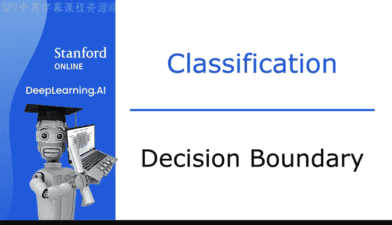
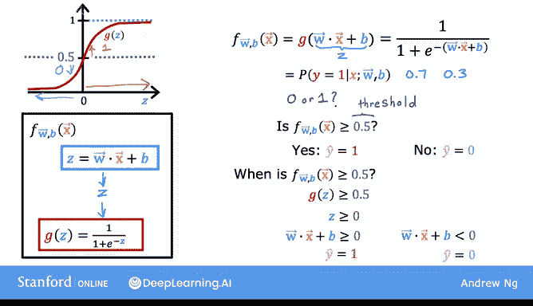
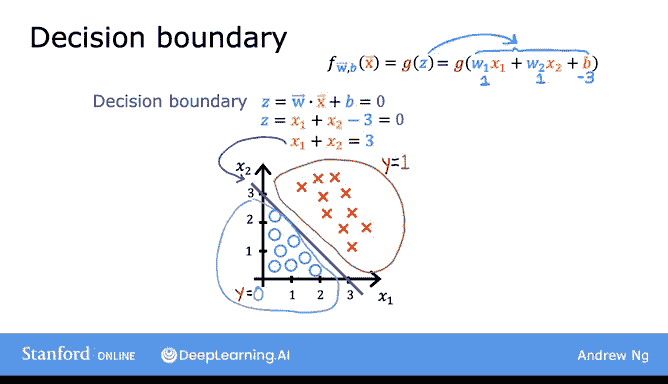
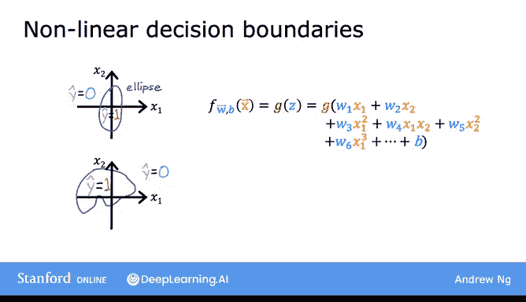
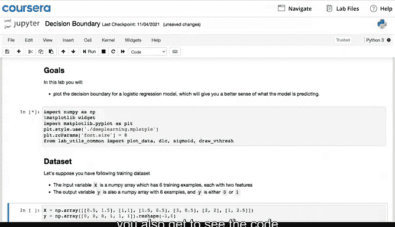
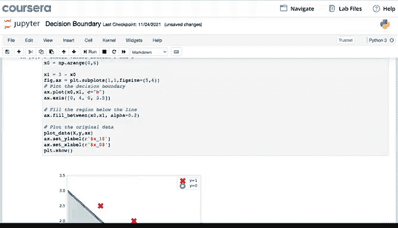
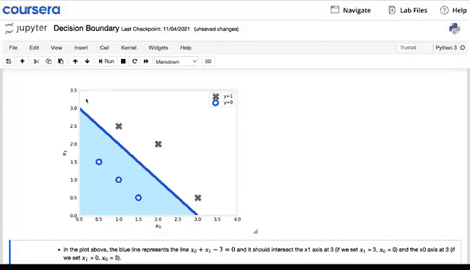

# 吴恩达《机器学习》｜machine-learning（中英字幕-deepseek翻译） - P33：33_03_03_决策边界.zh_en - GPT中英字幕课程资源 - BV1MN4y1S7DE

In the last video you learned about the logistic regression model Now let's take a look at the decision boundary to get a better sense of how logistic regression is computing its predictions to recap。

 here's how the logistic regression models outputs are computed in two steps。

In the first step， you compute Z as W dot x plus B。

Then you apply the sigmoid function G to this value Z。

 and here again is the formula for the sigmoid function。

Another way to write this is we can say F of x is equal to G， the sigoid function。

 also called the logistic function， apply to w。tx plus B， where this is of course the value of z。

And if you take the definition of the sigmoid function and plug in the definition of Z。

 then you find that f of x is equal to this formula over here。

1 over 1 plus e to the negative z where z is W x plus B。

And you may remember we say in the previous video that we interpret this as the probability that y is equal to1 given x and with parameters W and B。

 And so this is going to be a number like maybe a 0。7 or 0。3 Now。

 what if you want the learning algorithm to predict is the value of y going to be 0 or1。Well。

 one thing you might do is set a threshold above which you predict y is one or you set Y hat the prediction to be equal to one。

And below which， you might say why hat my prediction is going to be equal to zero。

So a common choice would be to pick a threshold of 0。

5 so that if F of x is greater than or equal to 0。5， then predict y is 1。

And we write that prediction as y hat equals1， or if f of x is less than 0。5， then predict y is 0。

 or in other words， the prediction y hat is equal to0。

So now let's dive deeper into when the model will predict1， in other words。

 when is F of x greater than or equal to 0。5。We'll recall that f of x is just equal to G of z。

 and so F is greater than or equal to 0。5， whenever G of z is greater than or equal to 0。5。

But when is G of z greater than or equal to 0。5？Well， here's the sigmoid function over here。

And so G of z is greater than or equal to 0。5。 whenever z is greater than or equal to 0， right。

 That is whenever z is on the right half of this axis。And finally。

 when is z greater than or equal to0， Well， z is equal to W dot x plus B。😊。

And so z is greater than equal to 0 whenever w dot x plus B is greater than or equal to0。So to recap。

 what you've seen here is that the model predicts one。

Whenever W dot x plus B is greater than or equal to0。And conversely。

When W dot x plus b is less than0， the algorithmm predicts y is0。So given this。

 let's now visualize how the model makes predictions。

I'm going to take an example of a classification problem where you have two features。

 x1 and x2 instead of just one feature。Here's a training set where the little red crosses denote the positive examples and the little blue circles denote negative examples。

 so the red crosses corresponds to y equals 1 and the blue circles correspond to y equals zero。

So the logistic regression model will make predictions using this function。

F of x equals G of z where Z is now this expression over here， W1 x1 plus W2 x2 plus B。

 because we have two features x1 and x2。And let's just say for this example that the value of the parameters are w1 equals 1。

 w2 equals 1 and b equals negative 3， and let's now take a look at how logistic regression makes predictions。

In particular， let's figure out when W x plus B is greater than equal to0。

And when Wx plus B is less than0。To figure that out， there's a very interesting line to look at。

 which is when Wx plus b is exactly equal to zero。It turns out that this line is also called the decision boundary。

 because that's a line where you're just almost neutral about whether y is zero or y is 1。Now。

 for the values of the parameters， W1， W2 and B that we had written down above。

This decision boundary is just x1 plus x2 minus3。And so when is x1 plus x2 minus3 equal to0？Well。

 that will correspond to the line x1 plus x2 equals3。And that is this line shown over here。

And so this line turns out to be the decision boundary。

 where if the features x are to the right of this line， logistic regression would predict one。

 and to the left of this line， logistic regression would predict zero。In other words。

 what we have just visualized is the decision boundary for logistic regression when the parameters W1 W2 and B are 11 and negative 3。

 Of course， if we had a different choice of the parameters。

 the decision boundary would be a different line。

Now， let's look at a more complex example where the decision boundary is no longer a straight line。

As before， crosses denote the class y equals1 and the little circles denote the class y equals0。

Earlier last week。You saw how to use polynomials in linear regression。

 and you can do the same in logistic regression。So let's set z to be w1 x1 squared plus W2 x2 squared plus B。

With this choice of features， polynomoma features into a logistic regression， so f of x。

 which equals G of z， is now G of this expression over here。

And let's say that we end up choosing W1 and W2 to be one。And B to be negative one。

So z is equal to1 times 61 squared plus1 times 62 squared minus1。And the decision boundary as before。

 will correspond to when z is equal to0。And so this expression will be equal to zero when x1 squared plus x squared is equal to 1。

And if you plot on the diagram on the left， the curve corresponding to xon squared plus  x2 squared equals 1。

 this turns out to be this circle。When exon squared plus x squared is greater than or equal to 1。

 that's this area outside the circle。And that's when you predict y to be one。Conversely。

 when x1 squared plus x2 squared is less than1， that's this area inside the circle。

 and that's when you would predict y to be 0。So can we come up with even more complex decision boundaries than these？

Yes， you can。 You can do so by having even higher order polynomial terms。

 say z is w1x1 plus w2x2 plus w3x1 squared plus w4x1x2 plus w5 x2 squared。

 then it's possible that you can get even more complex decision boundaries。

The model can define decision boundaries such as this example， an ellipse that's like this。

 or with a different choice of the parameters。You can even get more complex decision boundaries。

 which can look like functions that maybe look like that。

So this is an example of an even more complex decision boundary than the ones we've seen previously。

And this implementation of lit regressionion will predict y equals1 inside this shape and outside the shape will predict y equals zero。

 So with these polynomial features。You can get very complex decision boundaries， in other words。

 logistic regression can learn to fit pretty complex data。

Although if you were to not include any of these higher polynomials。

 so if the only features you use are X1 x2 x2 and so1。

 then the decision boundary for the will always be linear， will always be a straight line。

In the upcoming optional lab， you also get to see the code implementation of the decision boundary In the example of the lab there will be two features so you can see the decision boundary as a line so with these visualization I hope that you now have a sense of the range of possible models you can get with logistic regression。

Now that you've seen what F of x can potentially compute。

 let's take a look at how you can actually train a logistic regression model。

 we'll start by looking at the cost function for logistic regression and after that figure out how to apply gradient descent to it let's go on to the next video。

