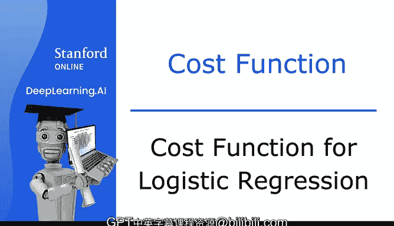
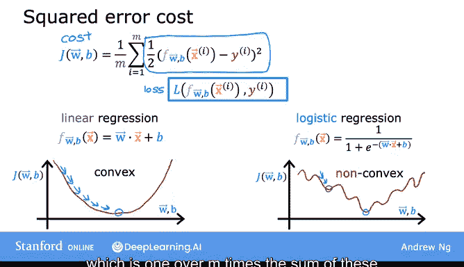
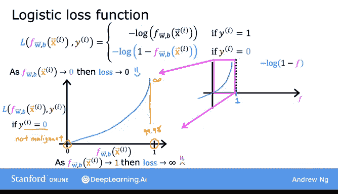
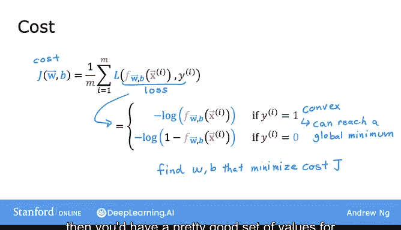
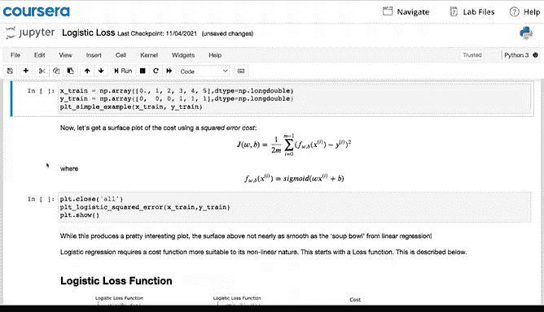
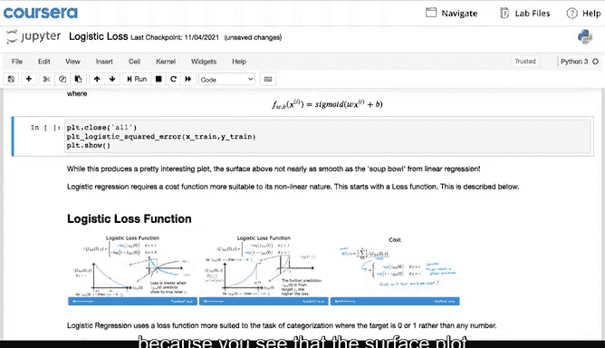
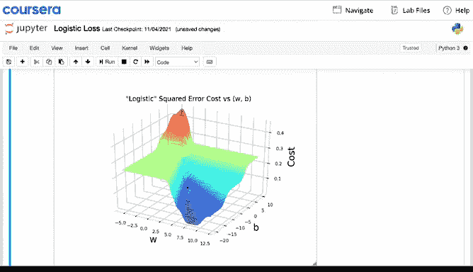

# 吴恩达《机器学习》｜machine-learning（中英字幕-deepseek翻译） - P34：34_03_01_逻辑回归的成本函数.zh_en - GPT中英字幕课程资源 - BV1MN4y1S7DE

Remember that the cost function gives you a way to measure how well a specifics of the parameters fits the training data and it thereby gives you a way to try to choose better parameters in this video we'll look at how the squared error cost function is not an ideal cost function for logistic regression and we'll take a look at a different cost function that can help us choose better parameters for logistic regression。

Here's what the training set for a logistic regression model might look like。

 where here each row might correspond to a patient that was paying a visit to the doctor and wound up with some sort of diagnosis。

As before， we'll use M to denote the number of training examples。

Each training example has one or more features such as the tumor size， the patient's age。

 and so on for a total of n features。And so let's call the features x1 through Xn。

And since this is a binary classification task， the target label Y takes on only two values。

 either zero or1。And finally， the logistic regression model is defined by this equation。Okay。

 so the question you want to answer is， given this training set。

 how can you choose parameters W and B？Recall for linear regression。

 this is the squared error cost function。 The only thing I've changed is that I put the one half inside the summation instead of outside dis summation。

 and you might remember that in the case of linear regression where F of x is the linear function W dot x plus B。

The co function looks like this is a convex function， a bow shape or a hammock shape。

And so gradient descent will look like this where you take one step， one step， one step。

 and so on to converge at the global minimum。Now you could try to use the same cost function for logistic regression。

 but it turns out that if I were to write f of x equals 1 over 1 plus e to the negative wx plus B。

 and plot the cost function using this value of f of x， then the cost will look like this。

This becomes what's called a non convex cause function is not convex。

 and what this means is that if you were to try to use gradient descent。

There are lots of local minima that you can get suck in so it turns out that for logistic regression。

 this squared error cost function is not a good choice instead there will be a different cost function that can make the cost function convex again so the gradient descent can be guaranteed to converge to the global minimum The only thing I've changed is that I put the one half inside dis sumation instead of outside dis sumation this will make the math you see later on the slide a little bit simpler。

In order to build a new cost function， one that will use for logistic regression。

 I'm going to change a little bit the definition of the cost function J of W and B。In particular。

 if you look inside this summ， let's call this term inside the loss on a single training example。

And I'm going to denote the loss via this capital L and is a function of the prediction of the learning algorithm。

 F of x， as well as of the true label y。And so the loss。

 given the predicted F of x and the true label Y is equal in this case to one half of the squared difference。

We'll see shortly that by choosing a different form for this loss function。

 we'll be able to keep the overall cost function， which is1 over m times the some of these loss functions to be a convex function。

Now。The loss function inputs F of x and the true label Y and tells us how well we're doing on that example。

I'm going to just write down here the definition of the loss function we'll use for logistic expression。

If the label y is equal to 1， then the loss is negative log of f of x。

 and if the label y is equal to0， then the loss is negative log of 1 minus f of x。

Let's take a look at why this loss function hopefully makes sense。

Let's first consider the case of y equals1 and plot what this function looks like to gain some intuition about what this loss function is doing。

And remember， the loss function measures how well you're doing on one training example and is by summing up the losses on all of the training examples that you then get the cost function。

 which measures how well you're doing on the entire training set。So if you plot log of F。

It looks like this curve here where F here is on the horizontal axis。

And so a plot of negative of the log of F looks like this where we just flip the curve along the horizontal axis。

Notice that it intersects the horizontal axiss at F equals1 and continues downward from there。

Now F is the output of logistic regression， thus F is always between0 and 1 because the output of logistic regression is always between0 and1。

The only part of the function that's relevant is therefore this part over here。

Presponding to F between0 and 1。So let's zoom in and take a closer look at this part of the graph。

If the algorithm predicts a probability close to one and the true label is one。

Then the loss is very small， It pretty much0 because youre very close to the right answer。Now。

 continue with the example of the true label Y being1， so say it really is a malignant humor。

If the algorithm predicts。0。5， then the loss is at this point here。Whi is a bit higher。

 but not that high， whereas in contrast， if the avom were to have output 0。1。

 if it thinks that there's only a 10% chance of the tumor being malignant，But why really is one。

 it really is malignant， then the loss is this much higher value over here。So when y is equal to one。

 the loss function incentivizes or it nudges or helps push the algorithm to make more accurate predictions because the loss is lowest when it predicts values close to one。

Now， on this slide， we've been looking at what the loss is when y is equal to1。On this slide。

 let's look at the second part of the loss function corresponding to when y is equal to 0。

In this case， the loss is negative log of 1 minus f of x。When this function is plotted。

 it actually looks like this。The range of f is limited to zero to1 because logistic regression only outputs values between zero and1。

And if we zoom in， this is what it looks like。So in this plot， corresponding to y equals0。

 the vertical axis shows the value of the loss for different values of f of x。

So when F is zero or very close to zero， the loss is also going to be very small。

 which means that if the true label is0 and the model's prediction is very close to zero。

 well you nearly got it right， so the loss is appropriately very close to zero。

And the larger the value of F of x gets， the bigger the loss。

 because the prediction is further from the true label zero。And in fact。

 as that prediction approaches one， the loss actually approaches infinity。

Going back to the tumor prediction example。This is that if a model predicts that the patient's tumor is almost certain to be malignant。

 say 99。9% chance of malignancy， but it turns out to actually not be malignant， so y equals  zero。

 then we penalize the model with a very high loss。So in this case of y equals 0。

 similar to the case of y equals 1 on the previous slide。

 the further the prediction f of x is away from the true value of y， the higher the loss。

 and in fact， if f of x approaches0， the loss here actually goes really。

 really large and in fact approaches infinity。

So when the true label is1， the algorithm is strongly incentivized not to predict something too close to zero。

So in this video， you saw why the squared error cost function doesn't work well for logistic regression。

We also defined the loss for a single training example and came up with a new definition for the loss function for logistic regression。

It turns out that with this choice of loss function。

 the overall cost function will be convex and thus you can reliably use gradient and descent to take you to the global minimum。

Proving that this function is convex is beyond the scope of this course。

You may remember that the cost function is a function of the entire training set and is therefore the average or one of m times the sum of the loss function on the individual training examples。

So the cost on a certain set of parameters W and B is equal to1 over M times the sum over all the training examples of the loss on the training examples。

And if you can find the value of the parameters W andB that minimizes this。

 then you'd have a pretty good set of values for the parameters W andB for logistic regression。

In the upcoming optional lab， you get to take a look at how the squared error cost function doesn't work very well for classification because you see that the surface plot results in a very wggly cost surface with many local minima then you take a look at the new logistic loss function and as you can see here this produces a nice and smooth convex surface plot that does not have all those local minima。

So please take a look at the code and the plot after this video。Alright。

 so we've seen a lot in this video in the next video let's go back and take the loss function for a single training example and use that to define the overall cost function for the entire training set。

And we'll also figure out a simpler way to write out the cost function。

 which will then later allow us to run gradient descent to find good parameters for logistic regression let's go on to the next video。

