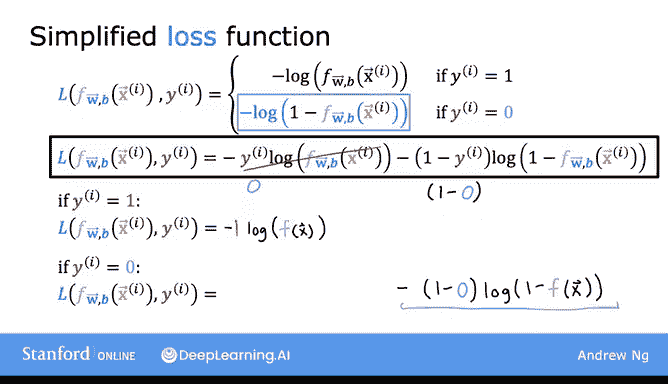
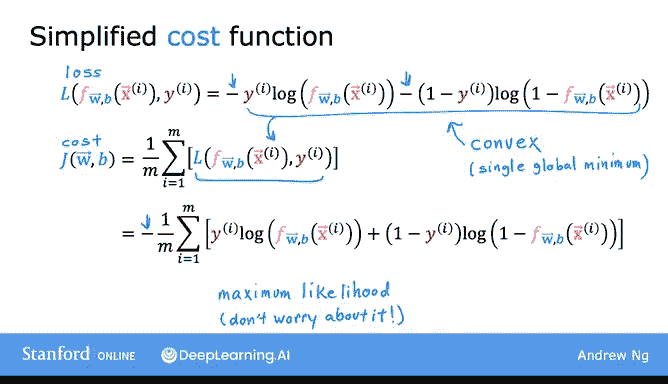
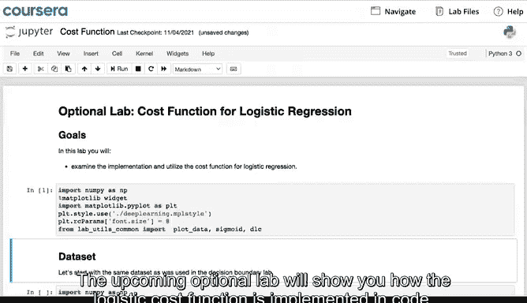
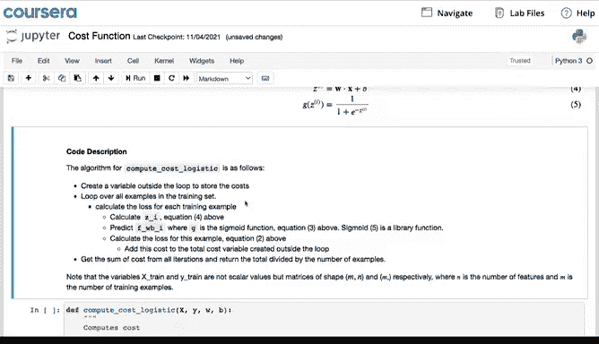
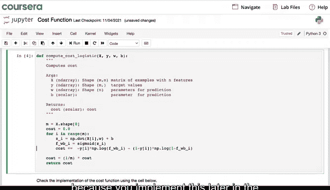
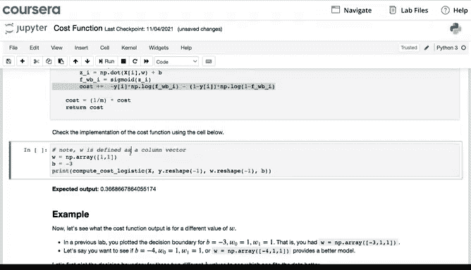
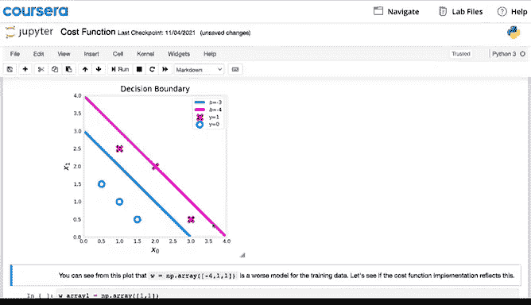

# 吴恩达《机器学习》｜machine-learning（中英字幕-deepseek翻译） - P35：35_03_02_逻辑回归的简化成本函数.zh_en - GPT中英字幕课程资源 - BV1MN4y1S7DE

In the last video you saw the loss function and the cost function for logistic regression In this video you see a slightly simpler way to write out the loss and cost functions so that the implementation can be a bit simpler when we get to gradient descent for fitting the parameters of a logistic regression model let's take a look as a reminder here's the loss function that we had defined in the previous video for logistic regression。

Now， because we're still working on a binary classification problem， why is either zero or one？

Because y is either zero or1 and cannot take on any value other than 0 or1 will be able to come up with a simpler way to write this loss function。

You can write the loss function as follows， given a prediction F of x and the target label Y。

 the loss equals negative y times log of F。Mイus。1 minus y times log of 1 minus F。

And it turns out this equation， which we just wrote in one line。

 is completely equivalent to this more complex formula up here。Let's see why this is the case。Now。

 remember， why can only take on the values of either one or zero？In the first case。

 let's say y equals1。This first y over here is 1， and this 1 minus y is 1 minus1。

 which is therefore equal to0， and so the loss becomes negative1 times log of f of x minus0 times a bunch of stuff that becomes0 and goes away。

And so when y is equal to 1， the loss is indeed the first term on top negative log of F of x。

Let's look at the second case when y is equal to 0。In this case， this y here is equal to zero。

 so this first term goes away。And the second term is 1 minus0 times that logarithmic term。

So the loss becomes this negative one。Times log of 1 minus F of x。And that's just equal to。

This second term up here。And so in the case of y equals 0。

We also get back the original loss function as defined above。

So what you see is that whether y is 1 or zero， the single expression here is equivalent to the more complex expression up here。

 which is why this gives us a simpler way to write the loss with just one equation without separating out these two cases like we did on top。

Using this simplified loss function， let's go back and write out the cost function for literacy regression。

So here again is the simplified loss function。And recall that the cost J is just the average loss。

 average across the entire training set of M examples。

 so is1 over M times the sum of the loss from I equals 1 to M。Now。

 if you plug in the definition in for the simplified loss room above。

 then it looks like this1 over m times a sum of this term above。

And if you bring the negative signs and move them outside。

 then you end up with this expression over here， and this is the cost function。

The cost function that pretty much everyone uses to train logistic regression。

Now you might be wondering， why do we choose this particular function when there could be tons of other cost functions we could have chosen？

Although we won't have time to go into great detail on this in this class。

 I'd just like to mention that this particular cost function is derived from statistics using a statistical principle called maximum likelihood estimation。

 which is an idea from statistics on how to efficiently find parameters for different models。

And this cost function has the nice property that it is complexvexed。

But don't worry about learning the details of maximum likelihood。

 there's just a deeper rationale and justification behind this particular cost function。

The upcoming optional lab will show you how the logistic cost function is implemented in code。

 I recommend taking a look at it because you implement this later in the practice lab at the end of the week。

This upcoming optional lab also shows you how two different choices of the parameters will lead to different cost calculations。

 so you can see in the plot that the better fitting blue decision boundary has a lower cost relative to the magenta decision boundary。

So with the simplified cost function， we're now ready to jump into applying gradient descent to logistic refreshion。

 let's go see that in the next video。