# 吴恩达《机器学习》｜machine-learning（中英字幕-deepseek翻译） - P36：36_03_01_梯度下降法实现.zh_en - GPT中英字幕课程资源 - BV1MN4y1S7DE

To fit the parameters of a logistic regression model。

 we're going to try to find the values of the parameters W and B that minimize the cost function J of W and B and we again apply gradient descent to do this let's take a look at how。

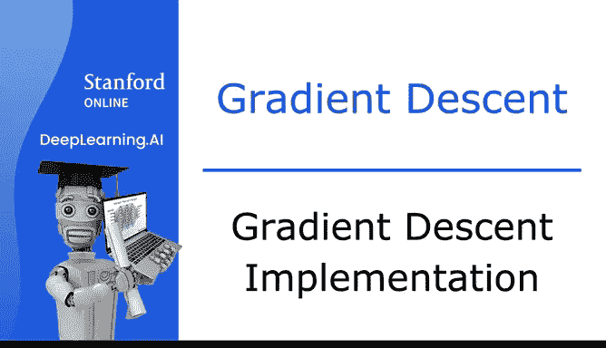

In this video， we'll focus on how to find a good choice of the parameters WNB。After you've done so。

 if you give the model a new input X， save a new patient at the hospital with a certain tumor size and age that needs a diagnosis。

 the model can then make a prediction， or it can try to estimate the probability that the label Y is1。

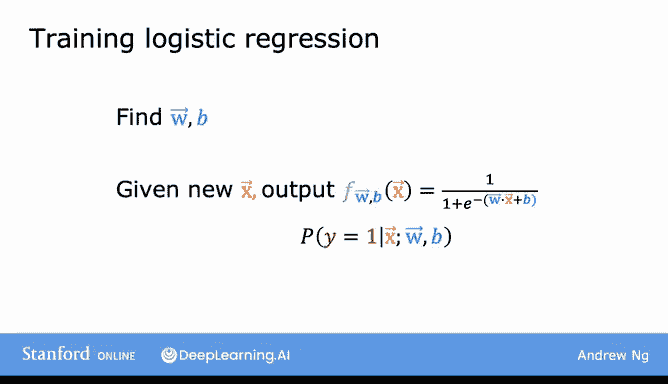

The algorithm you can use to minimize the cost function is gradient descent。

Here again is the cost function and so if you want to minimize the cost J as a function of W and B。

 well here's the usual gradient descent algorithm where you repeatedly update each parameter as the O value minus alpha the learning rate times this derivative term。

Let's take a look at the derivative of J with respect to WJ， this term up on top here。

 where as usual， J goes from1 through n where n is the number of features。

If someone were to apply the rules of calculus， you can show that the derivative with respect to Wj of the cost function capital J is equal to this expression over here is 1 over m times the sum from1 through m of this error term that is。

F minus the label Y。Times。X J。Here this XIJ is the J feature of training example I。

Now let's also look at the derivative of J with respect to the parameter B。

 it turns out to be this expression over here and is quite similar to the expression above except that it is not multiplied by this x superstr I sub J at the end。

So just as a reminder， similar to what you saw for linear regression。

 the way to carry out these updates is to use simultaneous updates。

 meaning that you at first compute the right hand side for all of these updates and then simultaneously overwrite all the values on the left at the same time。

So let me take these derivative expressions here and plug them into these terms here。

This gives you gradient descent for logistic regression。

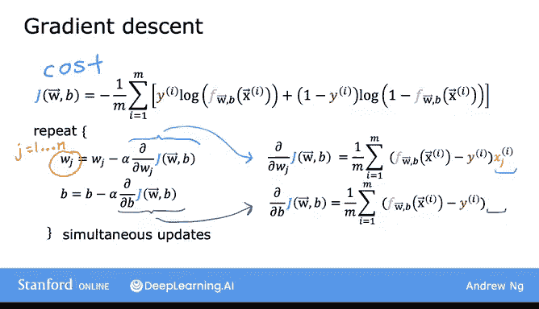

Now one funny thing you might be wondering ishu， that's weird。

 these two equations look exactly like the am we had come up with previously for linear regression。

 so you might be wondering is linear regression actually secretly the same as logistic regression？

Well， even though these equations look the same， the reason that this is not linear regression is because the definition for the function F of x has changed in linear regression。

 F of x is this is wx plus B， but in logistic regression。

 F of x is defined to be the sigmoid function applied to wx plus B。

So although the algorithm written looked the same for both linear regression and logistic regression。

 actually there are two very different algorithms because the definition for f of x is not the same。

When we talked about gradient descent for linear regression previously。

You saw how you can monitor gradient descent to make sure it converges。

 you can just apply the same method for logistic regression to make sure it also converges。

I've written out these updates as if you're updating the parameters WJ1 parameter at a time。

Similar to the discussion on vectorized implementations of linear regression。

 you can also use vectorization to make gradient descent run faster for logistic regression。

I won't dive into the details of the vectorized implementation in this video。

 but you can also learn more about it and see the code in the optional labs。

So now you know how to implement gradient descent for logistic regression。

You might also remember feature scaling when we were using linear regression where you saw how feature scaling that is scaling all the features to take on similar ranges of values。

 say between negative 1 and plus one， how they can help gradient descent to converge faster feature scaling applied the same way to scale the different features to take on similar ranges of values can also speed up gradient descent for logistic regression。

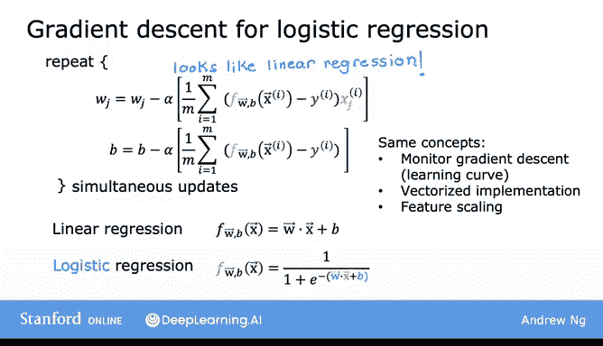

In the upcoming optional lab you also see how the gradient for logistic regression can be calculated in code。

 this will be useful to look at because you also implement this in a practice lab at the end of this week。

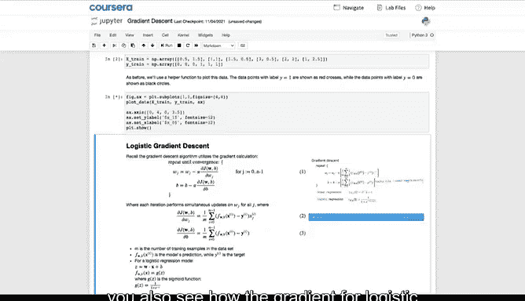

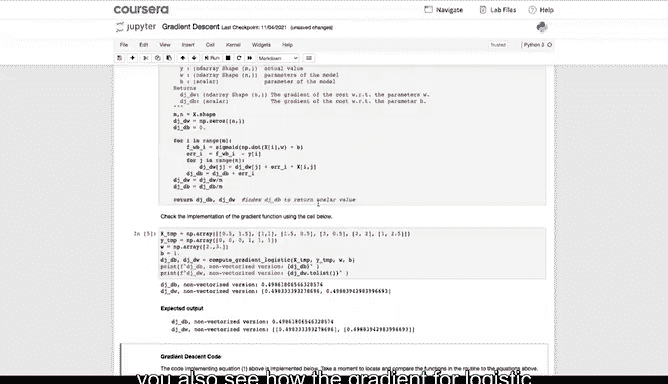

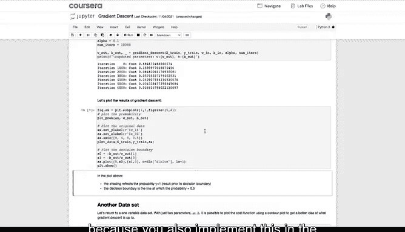

After you run gradient in descent in this lab， there'll be a nice set of animated plots that show gradient descent in action。

You see the sigmoid function， the contour plot of the cost， the 3D surface plot of the cost。

 and the learning curve all evolve as gradient descent runs。

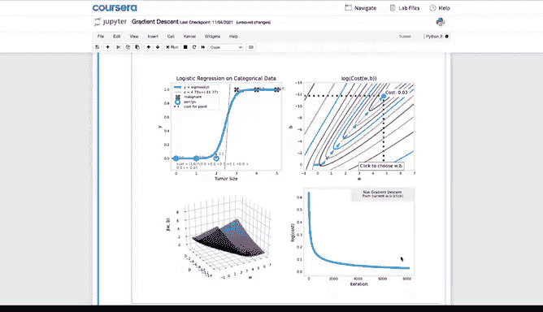

There will be another optional lab after that， which is short and sweet。

 but also very useful because I'll show you how to use the popularsed Learn library to train the logistic regression model for classification。

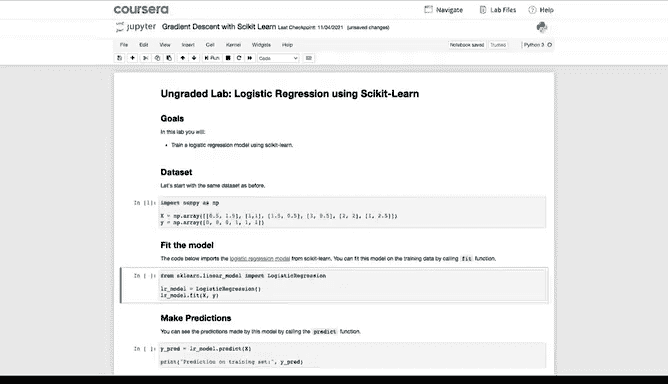

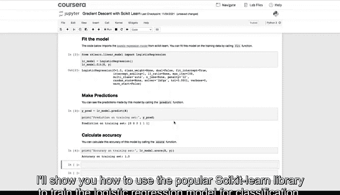

Many machine learning practitioners in many companies today use PsyL regularly as part of their job。

 and so I hope you check out the Ps learn function as well and take a look at how that is used。

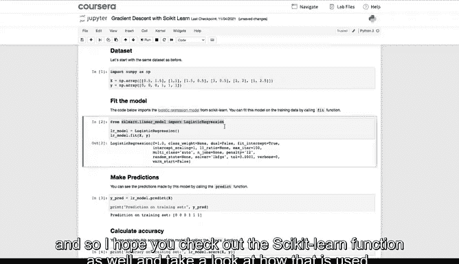

So that's it， you now know how to implement logistic regression this is a very powerful。

 very widely used learning algorithm and you now know how to get into work yourself， congratulations。

😊。