# 吴恩达《机器学习》｜machine-learning（中英字幕-deepseek翻译） - P37：37_03_01_过拟合问题.zh_en - GPT中英字幕课程资源 - BV1MN4y1S7DE

Now you've seen a couple of different learning algorithms， linear regression and logistic regression。

 they work well for many tasks， but sometimes in an application the algorithm could run into a problem called overfitting。

 which can cause it to perform poorly。What I'd like to do in this video is to show you what is overfitting。

 as well as a closely related， almost opposite problem called underfitting。

And in the next videos after this， I'll share you some techniques for addressing overfitting in particular there's a method called regularization。

 very useful technique I use it all the time， but regularization will help you minimize this overfitting problem and get your learning algorithm to work much better so let's take a look at what is overfitting。

To help us understand what is overfitting。Let's take a look at a few examples。

 let's go back to our original example of predicting housing prices with linear aggression。

 where you want to predict the price as a function of the size of a house。

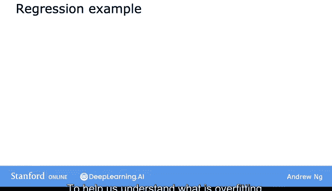

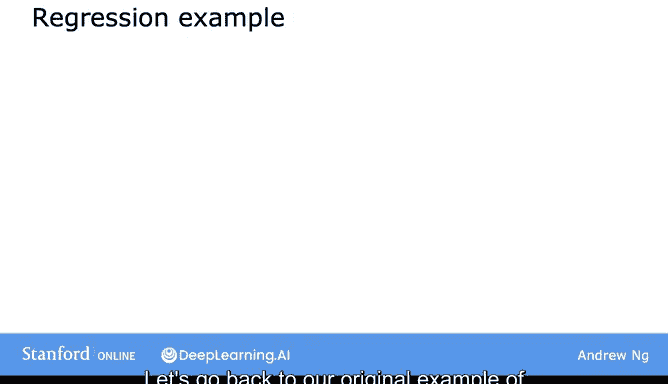

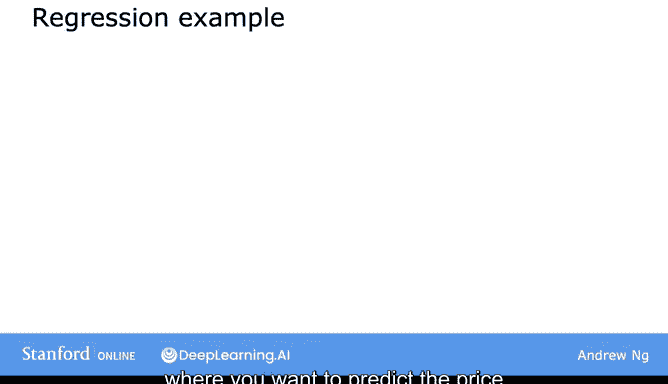

To help us understand what is overfitting， let's take a look at a linear regression example。

 and I'm going to go back to our original running example of predicting housing prices with linear regression。

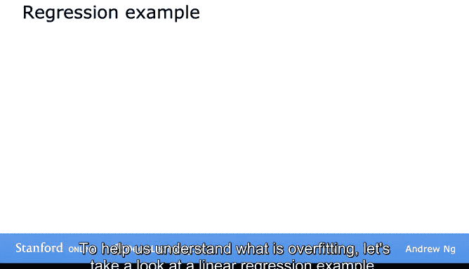

Suppose your data set looks like this with the input feature x being the size of the holes and the value Y they're trying to predict the price of the  holes。

One thing you could do is fit the linear function to this data。

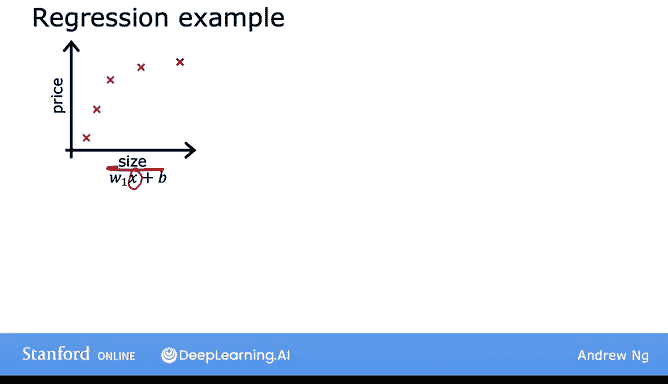

And if you do that， you get a straight line fit to the data that maybe looks like this。

 but this isn't a very good model。

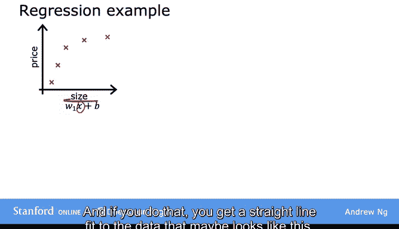

Looking at the data， it seems pretty clearer that as the size of thehuse increases。

 the housing prices kind of flatten out。So this algorithm does not fit the training data very well。

 The technical term for this is the model is underfitting the training data。

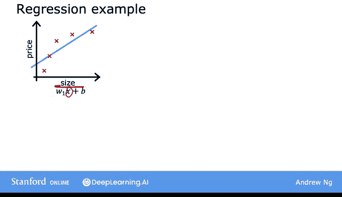

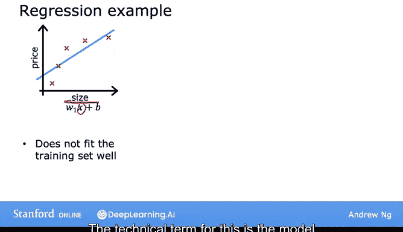

Another term is the a has high bias。You may have read in the news about some learning algorithms。

 really unfortunately。Demonstrating bias against certain ethnicities or certain genders in machine learning。

 the term bias has multiple meanings。Checking learning algorithms for bias based on characteristics such as gender or ethnicity is absolutely critical。

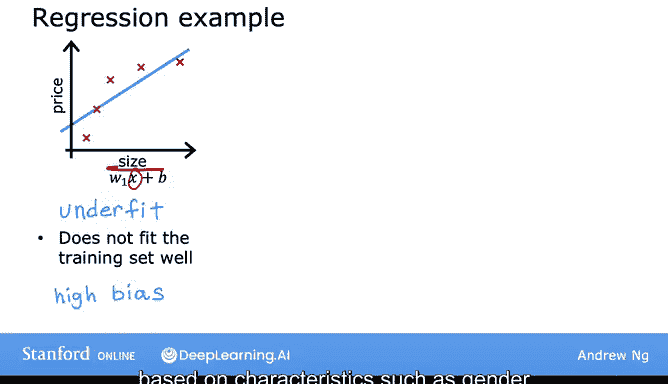

But the term bias has the second technical meaning as well， which is the one I'm using here。

 which is if the AM has underfit the data， meaning that it's just not even able to fit the training set that well。

 that there's a clear pattern in the training data that the Am is just unable to capture。

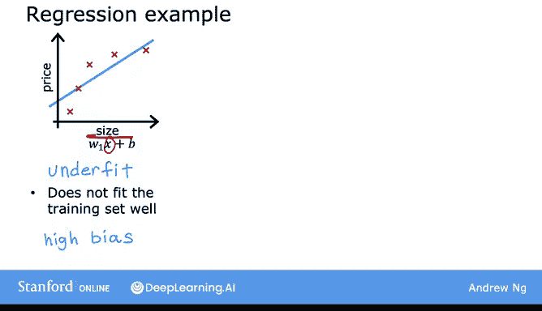

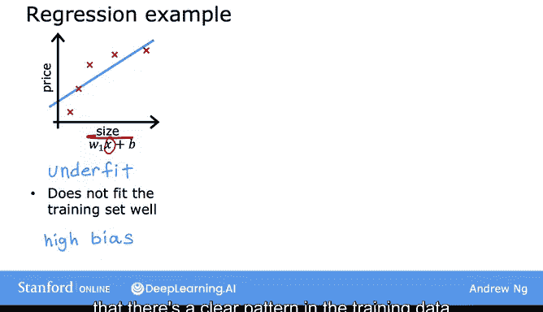

Another way to think of this form of bias is as if the learning algorithm has a very strong preconception。

 or we say a very strong bias， that the housing prices are going to be a completely linear function of the size。

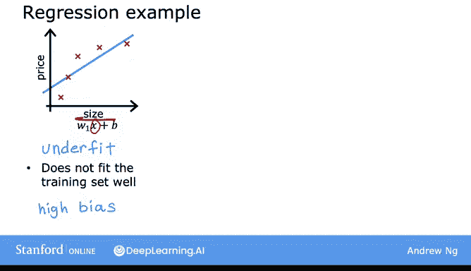

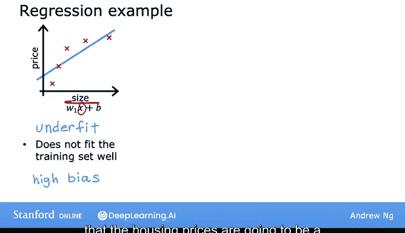

Despite data to the contrary， so this preconception that the data is linear causess it to fit a straight line that fits the data poorly。

 leading it to underfi the data。

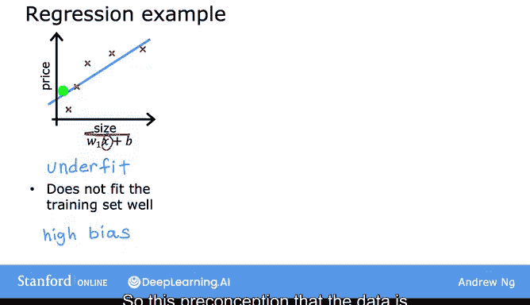

Now， let's look at a second variation of a model。

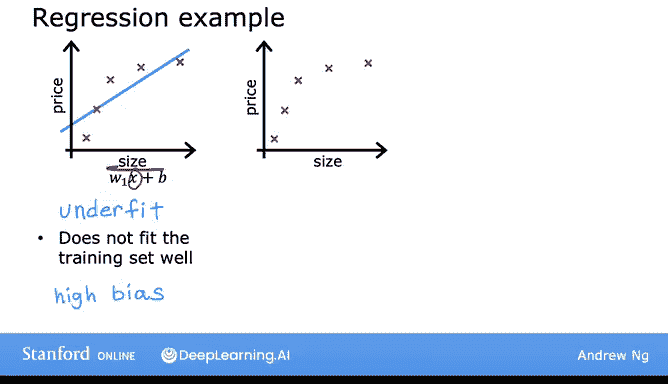

Which is？If you instead fit a quadratic function to the data with two features， x and x squared。

 then when you fit the parameters W1 and W2， you can get a curve that fits the data somewhat better。

 maybe it looks like this。

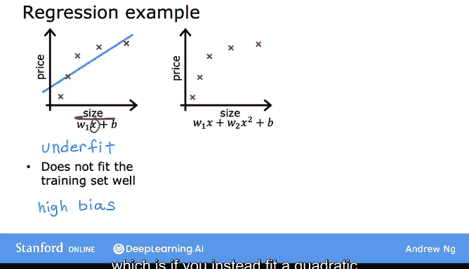

Also， if you were to get a new house， there's not in dissati of five training examples。

This model would probably do quite well on that new house。So if you're a real estate agent。

 the idea that you want your learning algorithm to do well。

 even on examples that are not on the training set。That's called generalization。Technically。

 we say that you want your learning algorithm to generalize well。

 which means to make good predictions， even on brand new examples that it has never seen before。

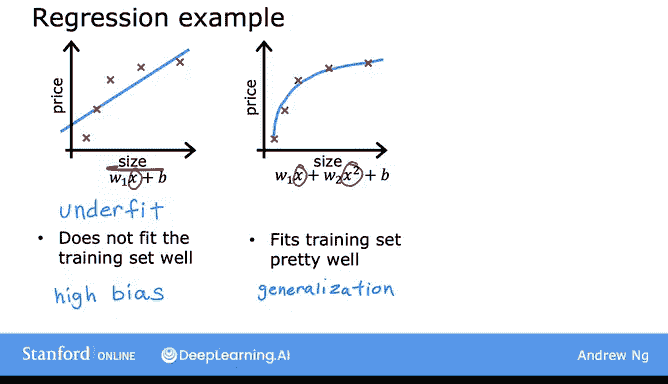

So this quadratic model seems to fit the training set not perfectly， but pretty well。

 and I think go generalize well to new examples。

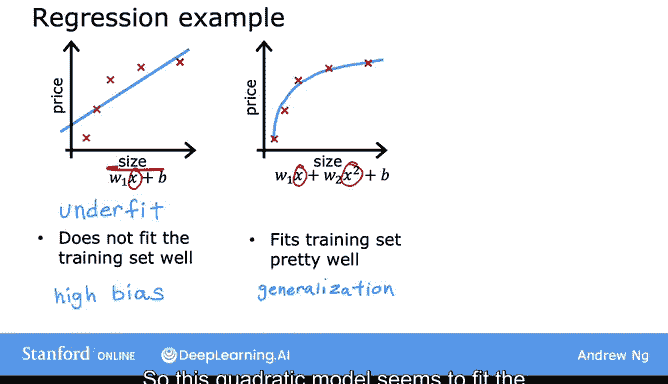

Now， let's look at the other extreme， what if you were to fit a fourth order polynomial to the data。

 so you have x x squared x cubed and x the fourth all as features。

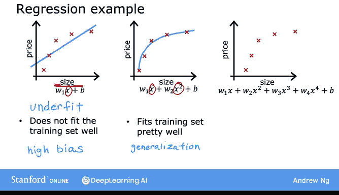

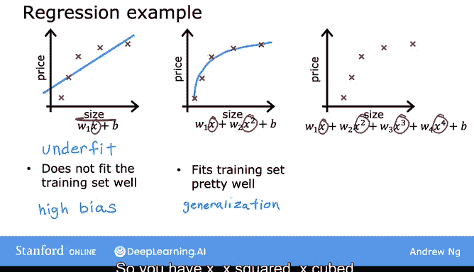

With this fourth order polynomial， you can actually fit the curve that passes through all five of the training examples exactly。

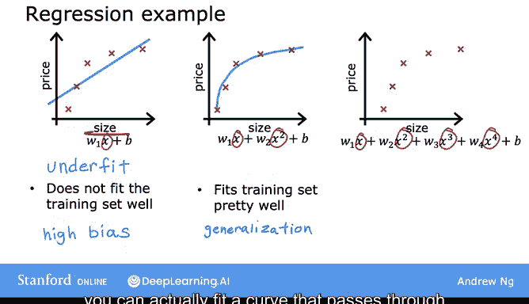

And you might get a curve that looks like this。This， on one hand。

 seems to do an extremely good job fitting the training data because it passes through all of the training data perfectly。

In fact， you'd be able to choose parameters that will result in the cost function being exactly equal to zero because the errors are zero on all five training examples。

But this is a very， you know， wigly curve it's going up and down all over the place。

And if you have thishu size right here， the model would predict that this house is cheaper than houses that are smaller than it。

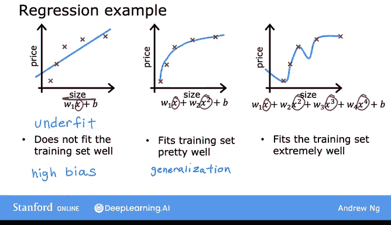

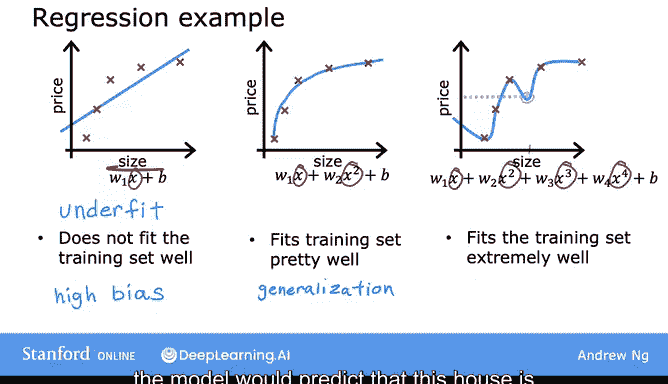

So we don't think that this is a particularly good model for predicting housing prices。

 the technical term is that we'll say this model has overfit the data or this model has an overfitting problem。

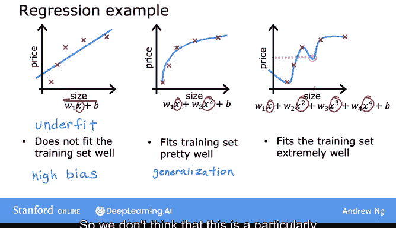

Because even though it fits a training set very well， it has fit the data almost too well。

 hence it's overfit， and it does not look like this model will generalize to new examples it has never seen before。

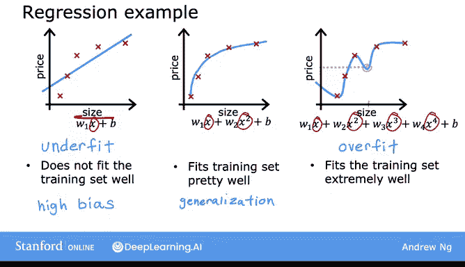

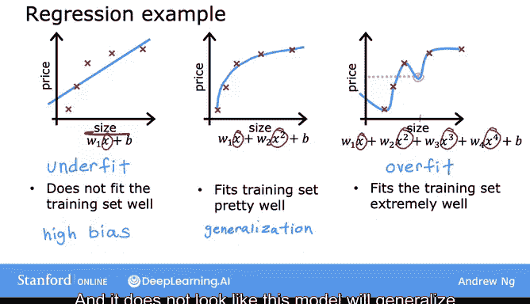

Another term for this is that the am has high variances。

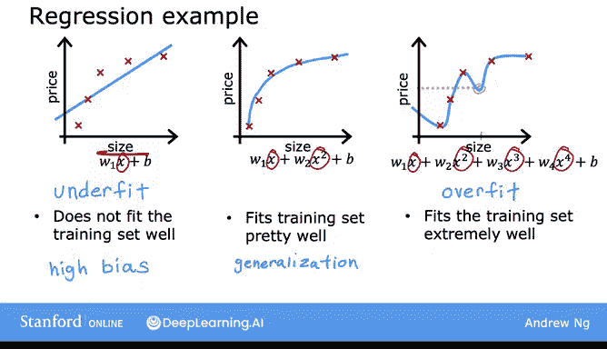

In machine learning， many people will use the terms overfit in high variances almost interchangeably and will use the terms underfit in high bias almost interchangeably。

The intuition behind overfitting or high variances is that the algorithm is trying very。

 very hard to fit every single training example， and it turns out that if your training set were just even a little bit different。

 say one house was priced just a little bit more little bit less。

 then the function that the algorithm fits could end up being totally different。

So if two different machine learning engineers were to fit this fourth order polynomial model to just slightly different data sets。

 they could end up with totally different predictions or highly variable predictions。

 and that's why we say the album has high variances。

Contrasting this rightmost model with the one in the middle。For the same house。

 it seems the middle model gives the much more reasonable prediction for price。

There isn't really a name for this case in the middle。

 but I'm just going to call this just right because it is neither underfit nor overfit。

So you can say that the goal of machine learning is to find a model that hopefully is neither underfitting nor overfitting in other words。

 hopefully a model that has neither high bias nor high variance。

When I think about underfitting and overfitting high biass and high variants。

 I'm sometimes reminded of the children's story of Goldilocks and the three bears。

In this children's tale， a girl called Goillot visits the home of a bear family。

There's a bowl of porridge that's too cold to a taste， and so that's no good。

There's also a bowl of parorridge that's too hot to eat。So that's no good either。

 but there's a bowla parish that is neither too cold nor too hot， the temperature is in the middle。

 which is just right to eat。So to recap， if you have too many features like the fourthwater polynomial on the right。

 then the model may fit the training set well， but almost too well or overfit and if high variances on the flip side if you have two few features。

 then in this example like the one on the left it underfits and has high bias。

 and in this example using quadratic features x and x squared that seems to be just right。

So far we've looked at underfitting and overfitting for linear regression model。

 similarly overfitting applies to classification as well。

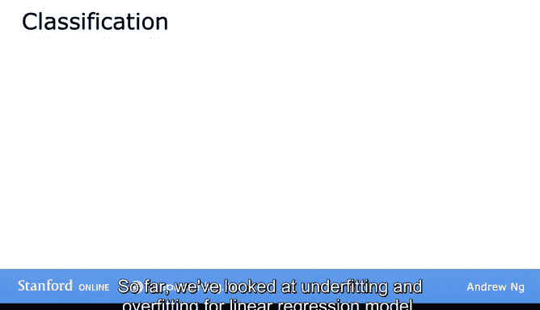

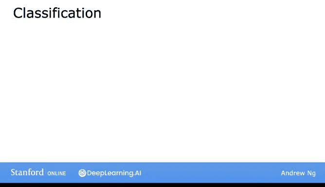

Here's a classification example with two features x1 and x2。

Where x1 is maybe the tumor size in x2 is the age of a patient。

 and we're trying to classify if a tumor is malignant or eye。

 as denoted by these crosses and circles。

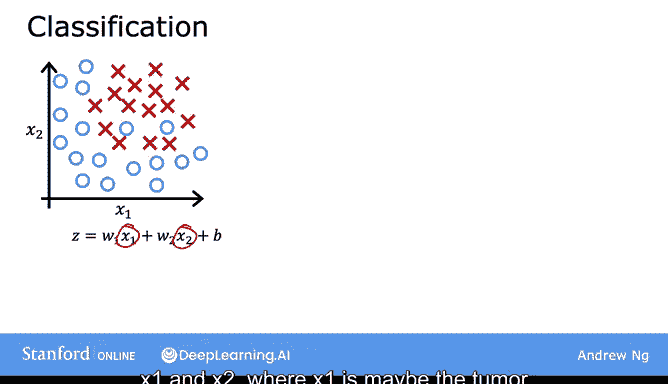

One thing you can do is fit a logistic regression model， just a simple model like this。

 where as usual G is the sigmoid function and this term here inside is the。

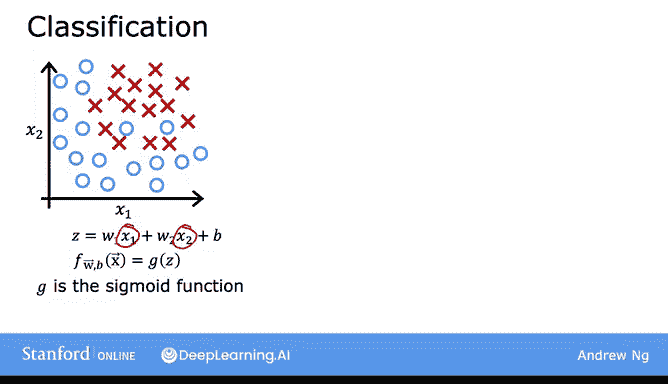

So if you do that。You end up with a straight line as the decision boundary。

 this is the line where z is equal to zero that separates the positive and negative examples。

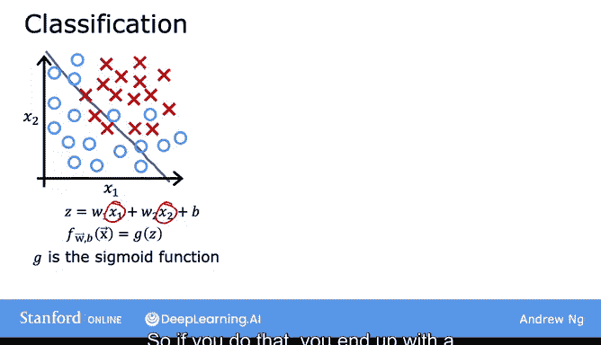

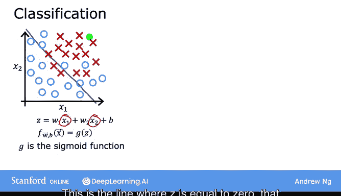

This straight line doesn't look terrible， it looks kind of okay。

 but it doesn't look like a very good fit to the data either。

So this is an example of underfitting or of high bias。Let's look at another example。

 if you were to add to your features these quadratic terms。

 then Z becomes this new term in the middle and the decision boundary that is where z equals zero can look more like this。

 more like an ellipse or part of an ellipse。

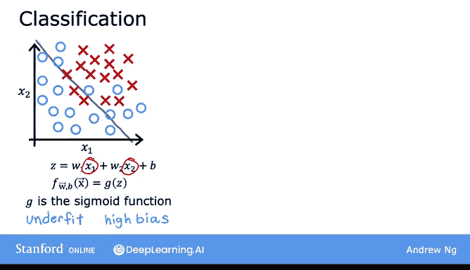

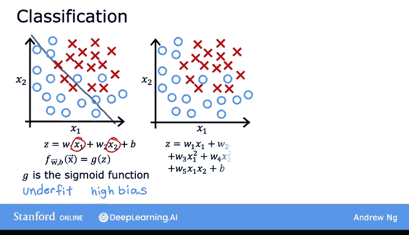

And this is a pretty good fit to the data， even though it does not perfectly classify every single training example in the training set。

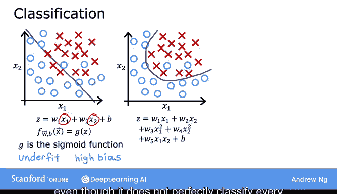

Notice how some of these crosses get classifiedified among the circles。

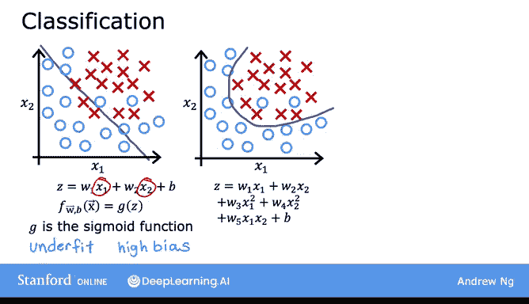

But this model looks pretty good， I'm going to call it just right and it looks like this will generalize pretty well to new patients。

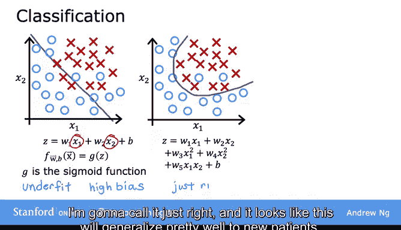

And finally， at the other extreme， if you were to fit a very high order polynomial with many。

 many features like these。Then the model may try really hard and can'tort or twist itself to find a decision boundary that fits your training data perfectly。

Having all these higher order polynomial features allows the algorithm to choose this really overly complex decision boundary。

If the features are tumor size and age and you're trying to classify tumors as malignant orign。

 then this doesn't really look like a very good model for making predictions。So once again。

 this is an instance of overfitting and high variances， because this model。

 despite doing very well in the training set， doesn't look like no generalized well to new examples。

So now you've seen how an algorithm can underfit or have high bias or overfit and have high variances you may want to know how you can get a model that is just right In the next video we'll look at some ways you can address the issue of overfitting。

And' also touch on some ideas relevant for azureing underfitting， let's go on to the next video。

