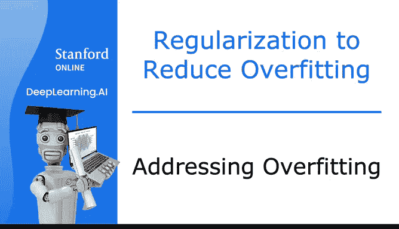
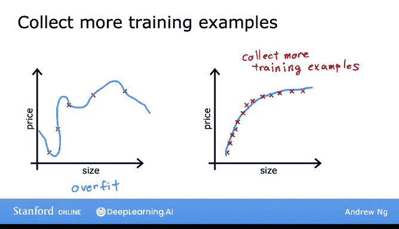
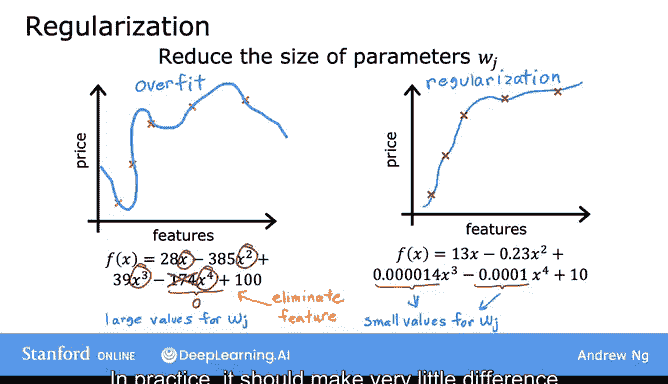
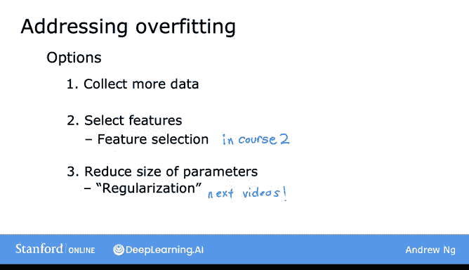
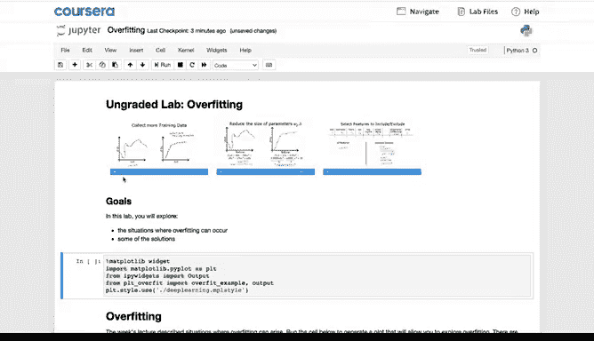
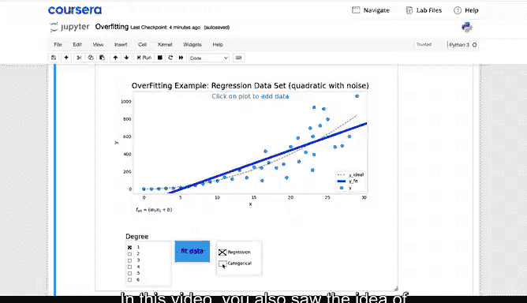

# 吴恩达《机器学习》｜machine-learning（中英字幕-deepseek翻译） - P38：38_03_02_解决过拟合.zh_en - GPT中英字幕课程资源 - BV1MN4y1S7DE

Later into specialization we'll talk about debugging and diagnosing things that can go wrong with learning algorithms。

 you also learn about specific tools to recognize when overfitting and underfitting may be occurring。

But for now， when you think overfitting has occurred， let's talk about what you can do to address it。

Let's say you fit the model and it has high variance。 It's overfit。

Here's our overfit house price prediction model。One way to address this problem is to collect more training data。

 so that's one option if you're able to get more data that is more training examples on sizes and prices of houses。

Then with the larger training set， the learning algorithm will learn to fit a function that is less wigly。

 so you can continue to fit a high order polynomial or some of the function with a lot of features and if you have enough training examples。

 it will still do okay。So to summarize。The number one tool you can use against overfitting is to get more training data。

Now getting more data isn't always an option， maybe only so many houses have been sold in this location。

 so maybe there just isn't more data to be had， but when the data is available。

 this can work really well A second option for addressing overfitting is to see if you can use fewer features。

In the previous video， our models features included the size x。

 as was the size squared that the x squared and x Q and x the4 and so on。

 these were a lot of polynomial features。So in that case。

 one way to reduce overfitting is to just not use so many of these polynomial features。

But now let's look at a different example。Maybe you have a lot of different features of a house with which to try to predict a price。

 ranging from a size， number of bedrooms， number of floors， the age。

 average income of the neighborhood， and so on and so forth to the distance to the nearest coffee shop。

 it turns out that if you have a lot of features like these，But don't have enough training data。

 then your learning algorithm may also overfit to your training set。Now。

 instead of using all 100 features， if we were to pick just a subset of the most useful ones。

 maybe size。Bedrooms。And the age of the halls。If you think those are the most relevant features。

 then using just that smaller subset of features， you may find that your model no longer overfis as badly。

Choosing the most appropriate set of features to use is sometimes also called feature selection one way you could do so is to use your intuition to choose what you think is the best set of features what's most relevant for predicting the price。

Now， one disadvantage of feature selection is that by using only a subset of the features。

 the algorithm is throwing away some of the information that you have about the hos， For example。

 maybe all of these features or 100 of them are actually useful for predicting the price of a holesse。

 so maybe you don't want to throw away some of the information by throwing away some of the features。

Later in course 2， you also see some algorithms for automatically choosing the most appropriate set features to use for prediction task。

Now this takes us to the third option for reducing overfitting， this technique。

 which we'll look at an even greater depth in the next video， is called regularization。

If you look at an overfit model。Here's a model using polynomial features， X X squared。

 X cube and so on， you find that the parameters are often relatively large。Now。

 if you were to eliminate some of these features， say if you were to eliminate the feature x4。

 that corresponds to setting this parameter to0。So setting a parameter to zero is equivalent to eliminating a feature。

 which is what we saw on the previous slide。It turns out that regularization is a way to more gently reduce the impact of some of the features without doing something as harsh as eliminating it outright。

What regularization does is encourage the learning algorithm to shrink the values of the parameters without necessarily demanding that the parameter is set to exactly zero。

And it turns out that even if you fit a higher order polynomial like this。

So long as you can get the algorithm to use smaller parameter values， W1，W2， W3， W4。

 you end up with a curve that ends up fitting the training data much better。

So what regular does is it lets you keep all of your features。

 but it just prevents the features from having an overly large effect。

 which is what sometimes can cause overfitting。By the way。

 by convention we normally just reduce the size of the WJ parameters that is W1 through WN。

 it kind of doesn't make a huge difference whether you regularize the parameter B as well you could do so if you want or not if you don't I usually don't and it's just fine to regularize W1W2 all the way to WN but not really encourage B to become smaller。

In practice， it should make very little difference whether you also regularize B or not。

So to recap。These are the three ways you saw in this video for addressing overfi。One。

 collect more data if you can get more data， this can really help reduce overfitting。

Sometimes that's not possible， in which case some of their options are two。

Try selecting and using only a subset of the features。

You learn more about feature selection in course 2。

Three would be to reduce the size of the parameters using regularization this will be the subject of the next video as well。

Just with myself， I use regularization all the time。

 so this is a very useful technique for training learning algorithms。

 including neural networks specifically， which you see later into specialization as well。

I hope you also check out the optional lab on overfitting。

In the lab， you will see different examples of overfitting and adjust those examples by clicking on options in the plots。

😊，You' also be able to add your own data points by clicking on the plot and see how that changes the curve that is fit。

You can also try examples for both regression and classification。

 and you really change the degree of the polynomial to be x x squared， x cubed， and so on。

The lab also lets you play with two different options for accessing overfitting。

 you can add additional training data to reduce overfitting and you can also select which features to include or to exclude as another way to try to reduce overfitting。

So please take a look at the lab， which I hope will help you build your intuition about overfitting as well as some methods for addressing it。

In this video you also saw the idea of regularization at a relatively high level I realized that all of these details on regularization may not fully make sense to you yet。

 but in the next video we'll start to formulate exactly how to apply regularization and exactly what regularization means and then we'll start to figure out how to make this work with our learning algorithms to make linear regression and logistic regression and in the future other algorithms as well avoid overfitting let's take a look at that in the next video。

