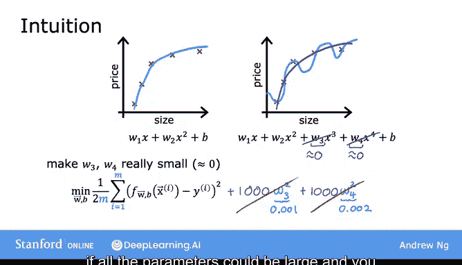
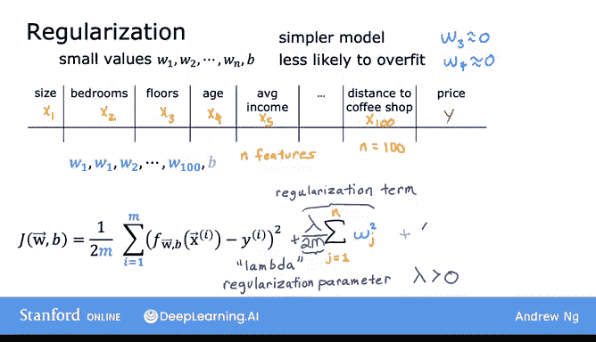
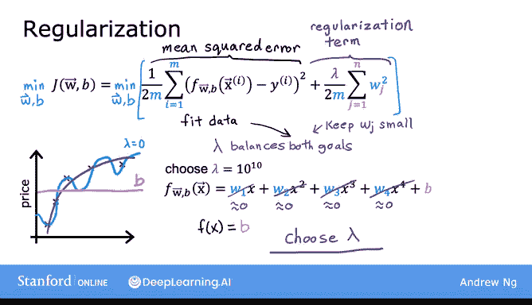

# 吴恩达《机器学习》｜machine-learning（中英字幕-deepseek翻译） - P39：39_03_03_带正则化的成本函数.zh_en - GPT中英字幕课程资源 - BV1MN4y1S7DE

In the last video， we saw that regularization tries to make the parameteral values W1 through WN small to reduce over5tting。

In this video， we'll build on that intuition and develop a modified cost function for your learning algorithm they can use to actually apply regularization。

 Let's jump in。Recall this example from the previous video in which we saw that if you fit a quadratic function to this data。

 it gives a pretty good fit， but if you fit a very high order polynomial you end up with a curve that overfits the data。

 but now consider the following。Suppose that you had a way to make the parameters W3 and W4 really。

 really small， say close to zero。平素难民。Let's say instead of minimizing this objective function。

 this is a cost function for linear regression。Let's say you were to modify the cost function and add to it 1000 times w3 squared plus 1000 times w4 squared。

 and here I'm just choosing 1000 because it's a big number。

 but any other really large number would be okay。So with this modified cost function， you'd in fact。

 be penalizing the model if W3 and W4 are large。Because if you want to minimize this function。

 the only way to make this new cause function small is if W3 and W4 are both small， right？

Because otherwise， this 1000 times Wv squared and 1000 times W4 square terms are going to be really。

 really big。So when you minimize this function， you're going to end up with W3 close to zero and W4 close to zero。

So we're effectively nearly canceling out the effect of the features executed and x the power4 and getting rid of these two terms over here。

And if we do that， then we end up with a fit to the data that's much closer to the quadratic function。

 including maybe just tiny contributions from the features executed and X to the4。

And this is good because it's a much better fit to the data compared to if all the parameters could be large and you end up with this wly quadratic function more generally here's the idea behind regularization。

 The idea is that if there are smaller values for the parameters。

 then that's a bit like having a simpler model， maybe one with fewer features which is therefore less prone to overfitting。

On the last slide we penalize， or we say we regularized only W3 and W4。But more generally。

 the way that regularization tends to be implemented is， if you have a lot of features。

 say 100 features， you may not know which are the most important features and which ones to penalize。

 so the way regularization is typically implemented is to penalize all of the features or more precisely you penalize all the WJ parameters and it's possible to show that this will usually result in fitting a smoother。

 simpler， less wly function that's less prone to overfitting。So for this example。

 if you have data with 100 features for each host， it may be hard to pick an advance which features to include and which ones exclude。

 so let's build a model that uses all 100 features。So you have these 100 parameters。W1 through W100。

 as well as 101st parameter B。Because we don't know which of these parameters are going to be the important ones。

 let's penalize all of them a bit and shrink all of them by adding this new term Lada times the sum from J equals 1 through n。

 where n is 100， the number of features of Wj squared。

This value Lada here is the Greek alphabet Lada and is also called a regularization parameter。

So similar to picking a learning rate alpha， you now also have to choose a number for Laer。

A couple things I would like to point out by convention instead of using Lada times to sum of Wj squared。

We also divide Lada by 2M so that both the first and second terms here are scaled by 1 over 2M。

It turns out that by scaling both terms the same way。

 it becomes a little bit easier to choose a good value for Lada and in particular。

 you find that even if your training set size grows， say you find more training examples。

 so M the training set size is now bigger the same value of Lada that you have previously is now also more likely to continue to work if you have this extra scaling by 2M。

Also， by the way， by convention， we're not going to penalize the parameter B for being large in practice it makes very little difference whether you do or not and some machine learning engineers。

And actually， some learning algorithm implementations will also include Lada over 2M times the B square term。

But this makes very low difference in practice， and the more common convention which we're use in this course is to recognize only the parameters W rather than the parameter B。

So to summarize。In this modified cost function， we want to minimize the original cost。

 which is a mean squared error cost， plus additionally the second term。

 which is called the regularization term。And so this new cost function trades off two goals that you might have。

Trying to minimize this first term encourages the algorithm to fit the training data well by minimizing the squared differences of the predictions and the actual values。

And try to minimize the second term， the algorithm also tries to keep the parameters Wj small。

 which will tend to reduce overfitting。The value of Lada that you choose specifies the relative importance or the relative trade off or how you balance between these two goals。

Let's take a look at what different values of launder will cause your learning algorithm to do。

Let's use the housing price prediction example using linear regression。

 so F of x is the linear regression model。If Lada was set to be zero。

 then you're not using the regular term at all because the regular term is multiply by zero。

 and so if Lada was zero， you end up fitting this overly wly， overly complex curve and it overfis。

So that was one extreme of if lambda was zero， let's now look at the other extreme。

 if you set lambda to be a really， really， really large number。

 say lambda equals 10 to the power of 10。Then you're placing a very heavy weight on this regularization term on the right。

 and the only way to minimize this is to be sure that all the values of W are pretty much very close to zero。

So if Lada is very， very large， the learning algorithm will choose W1， W2。

 W3 and W4 to be extremely close to 0， and thus F of x is basically equal to B。

 and so the learning algorithm fits a horizontal straight line and underfis。To recap， if La is zero。

 this model will overfit， if la is enormous， like ten to part1， this model will underfi。

 and so what you want is some value of Lada that is in between that more appropriately balances these first and second terms of trading off。

 minimizing the mean square error and keeping the parameters small。

And when the value of Lada is not too small and not too large， but just right。

 then hopefully you end up able to fit a fourth order polynomial keeping all of these features。

 but with a function that looks like this。

So that's how regular works When we talk about model selection later into specialization。

 we'll also see a variety of ways to choose good values for Lada。In the next two videos。

 we'll flesh out how to apply regular to linear regression and logistic regression and how to train these models with gradient in desent。

 with that you really to avoid overfitting with both of these algorithms。

