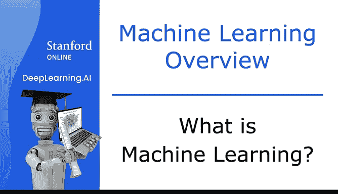
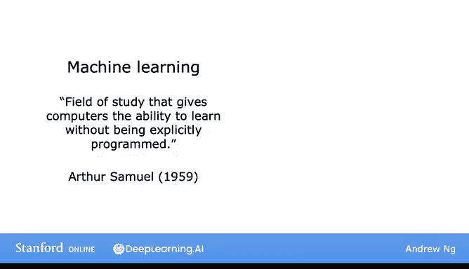
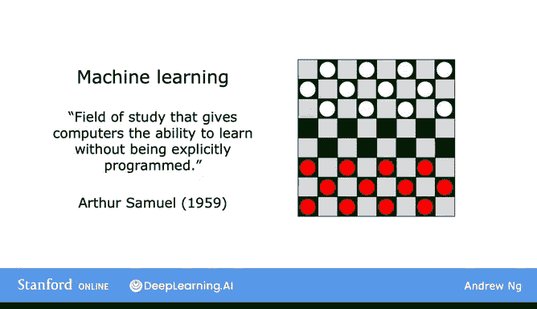
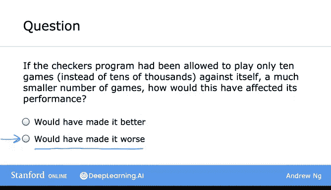
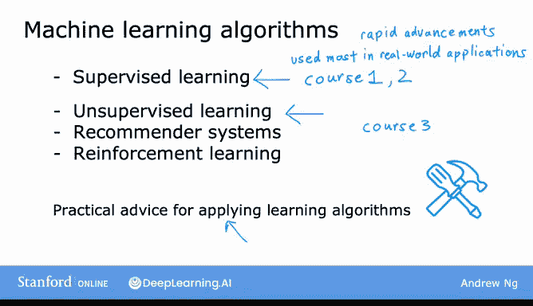

# 吴恩达《机器学习》｜machine-learning（中英字幕-deepseek翻译） - P3：03_01_01_什么是机器学习.zh_en - GPT中英字幕课程资源 - BV1MN4y1S7DE

So what is machine learning in this video， you learn a definition of what it is and also get a sense of when you might want to apply it。

 Let's take a look together。

Here's a definition of what is machine learning that is attributed to Arthur Samuel。

 He defined machine learning as the few study that gives computers did to learn without being explicitly programmed。

 Sam' claim to fame was that back in the 1950s， He wrote a checker' playing program。

 And the amazing thing about this program was that Arthur Samuel himself wasn't a very good checkers player。

What he did was he had programmed a computer to play maybe tens of thousands of games against himself。

 and by watching what sort of board positions tend to delete to wins and what positions tend to delete her losses。

 the Check andplain program learned over time what are good or bad board positions。

By trying to get to good and avoid bad positions， his program learned to get better and better at playing checkers。

Because the computer had the patience to play tens of thousands of games against itself。

 it was able to get so much checkers playing experience that eventually it became a better checkers player than Arthur Samuel himself。

Now throughout these videos， besides me trying to talk about stuff。

 I'll occasionally ask you a question to help make sure you understand the content Here's one about what happens if the computer had played far fewer games Please take a look and pick whichever you think is a better answer。

Thanks for looking at the quiz and so if you have selected this answer。Would it made it worse。

 then you got it right。In general， the more opportunities you give a learning algorithm to learn。

 the better it will perform if you didn't select the correct answer the first time that's totally okay too the point of these quiz questions isn't to see if you can get them all correct on the first try these questions are here just to help you practice the concepts you're learning。

Aruthur Samuel's definition was a rather informal one。

 but in the next two videos we'll dive deeper together into what are the major types of machine learning algorithms。

In this class you learn about many different learning algorithms。

 the two main types of machine learning are supervised learning and unsupervised learning。

We'll define what these terms mean more in the next couple videos。

Of these two supervised learning is the type of machine learning that is used most in many real world applications。

 and has seen the most rapid advancement and innovation in this specialization。

 which has three causes in total， the first and second course will focus on supervised learning。

 and the third will focus on unsupervised learning， recommend systems and reinforcement learning。

By far the most used types of learning algorithm today are supervised learning。

 unsupervised learning and recommend systems。The other thing we're going to spend a lot of time on in this specialization is practical advice for applying learning algorithms。

 This is something I feel pretty strongly about Tea about learning algorithms is like giving someone a set of tools and equally important or even more important then making sure you have great tools is making sure you know how to apply them because you know what good is it if someone were to give you a state of the art hammer or a state of the art handrow and say good luck now you have all the tools you need to build a three story hall doesn't really work like that and so too in machine learning。

 making sure you have the tools is really important and so is' making sure that you know how to apply the tools of machine learning effectively So that's what you get in this class the tools as well as the skills of applying them effectively。

I regularly visit with friends and teams in some of the top tech companies。

 and even today I see experienced machine learning teams apply machine learning algorithms to some problems。

 and sometimes they've been going at it for six months without much success。

And when I look at what they're doing， I sometimes feel like I could have told them six months ago that the current approach won't work and there's a different way of using these tools that will give them a much better chance of success。

So in this class， one of the relatively unique things you learn is you learn a lot about the best practices for how to actually develop a practical valuable machine learning system this way you're less likely to end up in one of those teams that end up losing six months going in the wrong direction。

In this class， you gain a sense of how the most skilled machine learning engineers build systems。

 and I hope you finish this class as one of those very rare people in today's world that know how to design and build seriousrus machine learning systems。

So last machine learning in the next video let's look more deeply at what is supervised learning and also what is unsupervised learning In addition。

 you learn when you might want to use each of them supervised and unsupervised learning I'll see you in the next video。

