# 吴恩达《机器学习》｜machine-learning（中英字幕-deepseek翻译） - P40：40_03_04_正则化线性回归.zh_en - GPT中英字幕课程资源 - BV1MN4y1S7DE

In this video we'll figure out how to get gradient descent to work with regularized linear regression let's jump in。

 here's a cost function we've come up with in the last video for regularized linear regression。

The first part is the usual squared error cost function。

 and now you have this additional regularization term where Lada is the regularization parameter。

 and you'd like to find parameters W and B that minimize the regularized cost function。

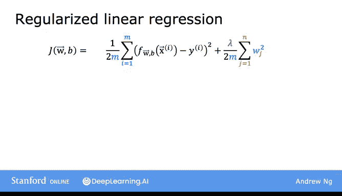

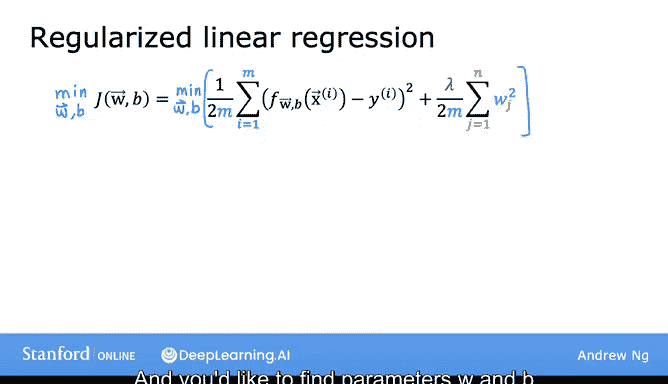

Previously， we were using gradient descent for the original cost function。

 just the first term before we added that second regularization term。And previously。

 we had the following gradient descent algorithm， which is that we repeatedly update the parameters Wj and B for J equals1 through n according to this formula。

 and B is also updated similarly。

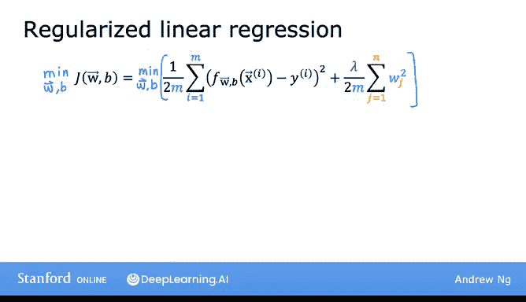

Again， alpha is a very small positive number called the learning rate In fact。

 the updates for a regularized linear regression look exactly the same。

 except that now the cost J is defined a bit differently。

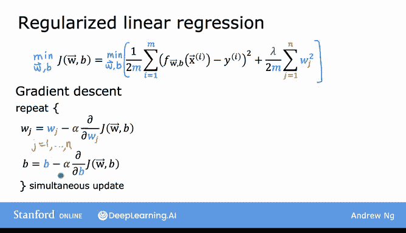

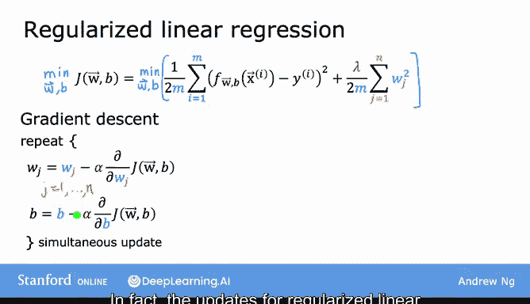

Previously， the derivative of J with respect to WJ was given by this expression over here。

 and the derivative respect to B was given by this expression over here。

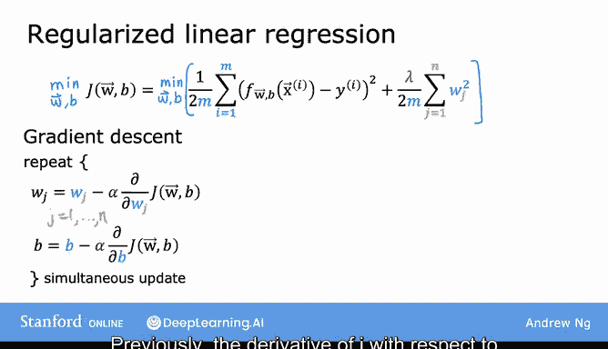

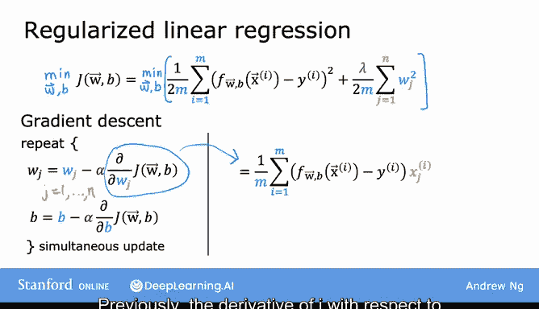

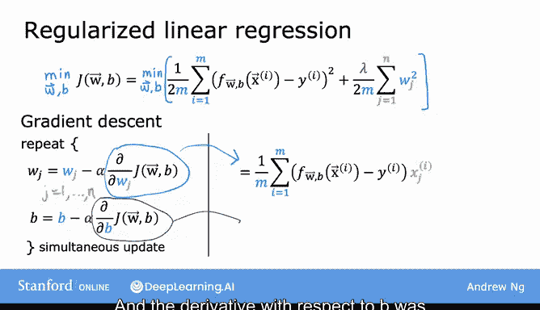

Now that we've added this additional regular term， the only thing that changes is that the expression for the derivative in respect to WJ ends up with one additional term。

This plus lambda over m times WJ。And in particular， for the new definition of the cost function J。

 these two expressions over here， these are the new derivatives of J with respect to Wj and the derivative of J with respect to B。

Recall that we don't regularize B， so we're not trying to shrink B。

 that's why the updated B remains the same as before。

 whereas the updated W changes because the regularization term causes us to try to shrink WJ。

So let's take these definitions for the derivatives and put them back into the expression on the left to write out the gradient descent algorithm for regularized linear regression。

So to implement gradient descent for a regular linear regression。

 this is what you would have your code do。

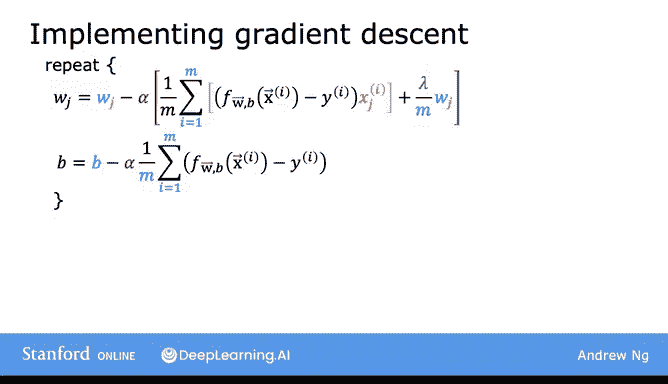

Here's the update for WJ for J equals1 through n and here's the update for B， and as usual。

 please remember to carry out simultaneous updates for all of these parameters。

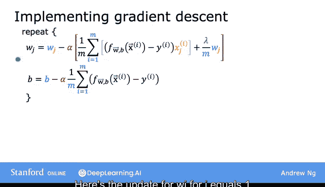

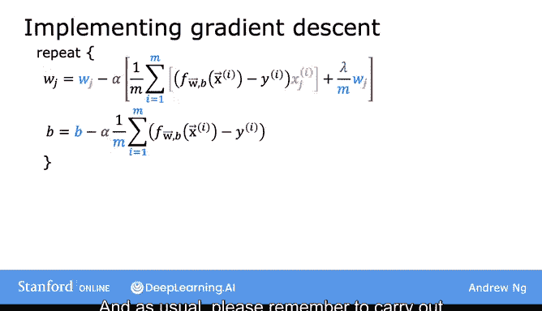

Now， in order for you to get this album to work， this is all you need to know。

 but what I'd like to do in the remainder of this video is to go over some optional material to convey a slightly deeper intuition about what this formula is actually doing。

 as well chat briefly about how these derivatives are derived。

The rest of this video is completely optional it's completely okay if you skip the rest of this video。

 but if you have a strong interest in math， then stick with me。

 it's always nice to hang over with you here and through these equations perhaps you can build a deeper intuition about what the math and what the dus are doing as well so let's take a look。

Let's look at the update rule for WJ and rewrite it in another way。

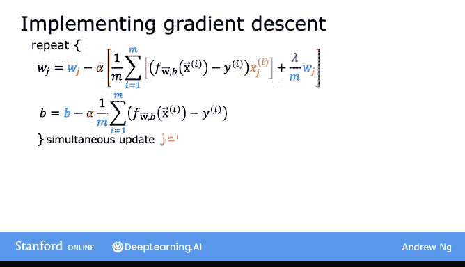

We're updating WJ as1 times Wj minus alpha times lambda over m times Wj。

 so I've moved the term from the end to the frontier。

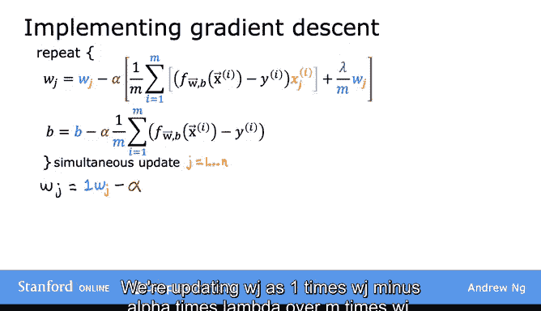

And then minus alpha times1 of a m and then the rest of that term over there。

So we just rearranged the terms a little bit。And if we simplify。

 then we're saying that Wj is updated as Wj times1 minus alpha。

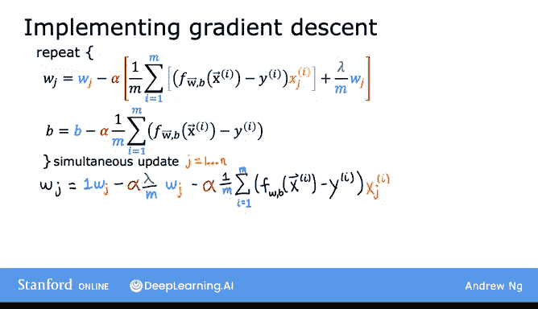

Times lambda over M。

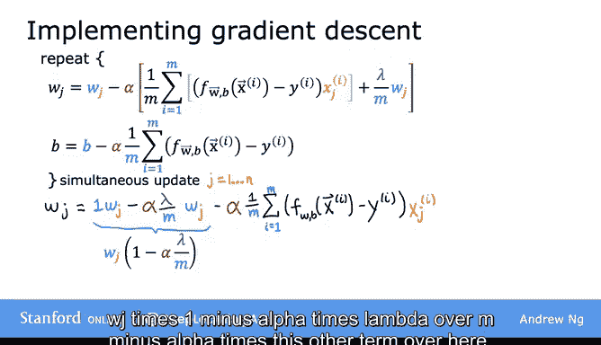

Minus alpha times this other term over here。 and you might recognize this second term as the usual gradient descent update for unregularized linear regression。

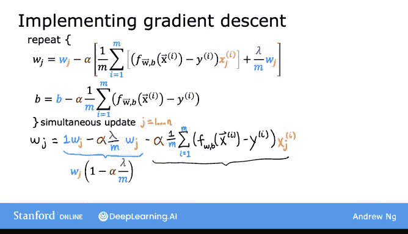

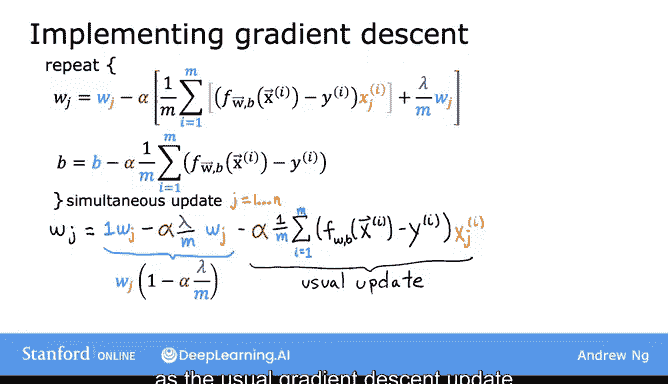

This is the update for linear regression before we had regularization。

 and this is the term we saw in week two of this course。

And so the only change when you have regularization is that instead of Wj being set to be equal to Wj minus alpha times this term is now w times this number minus the usual update。

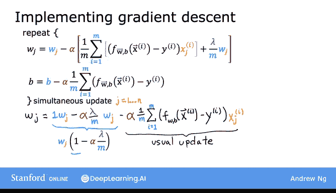

So this is what we had in week one of this course So what is this first term over here Well alpha is a very small positive number。

 say 0。01 lambda is usually a small number， say one or maybe 10。

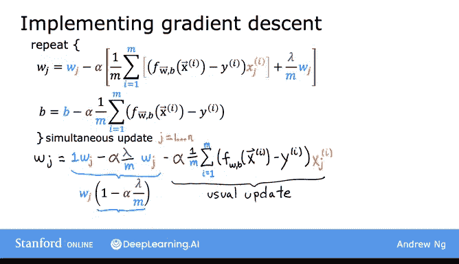

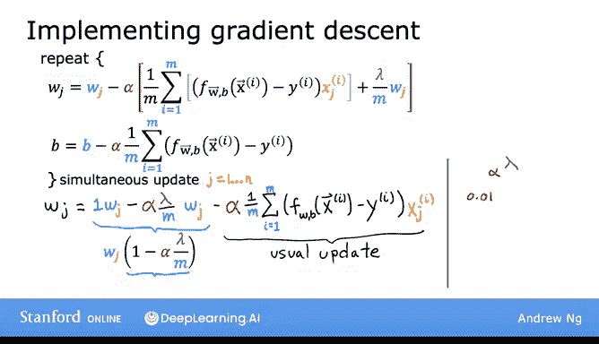

Let's say Lada is1 for this example， and M is the training set size， say 50。

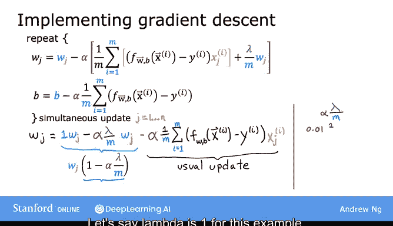

And so when you multiply alpha lambda over M。Say 0。01 times 1 divided by 50。

 this term ends up being a small positive number， say 0。0002。

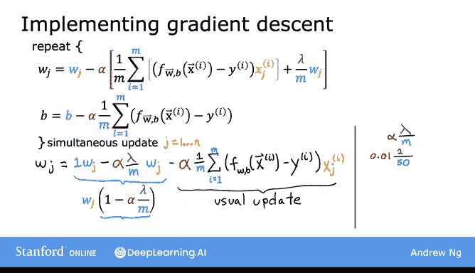

And thus，1 minus alpha lambda over m is going to be a number just slightly less than1， in this case。

 0。9998。

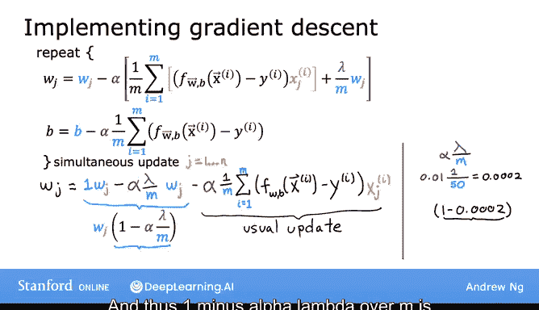

And so the effect of this term is that on every single iteration of gradient descent。

 you're taking WJ and multiplying it by 0。9998 that is by some numbers slightly less than  one before carrying out the usual update。

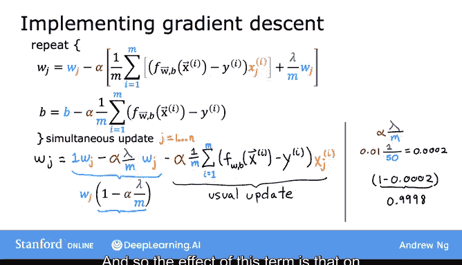

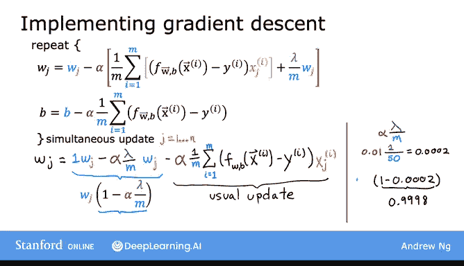

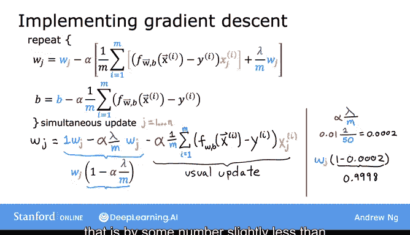

So what regularization is doing on every single iteration is you multiplying W by a number slightly less than1 and that has the effect of shrinking the value of WJ just a little bit。

 so this gives us another view on why regularization has the effect of shrinking the parameters WJ a little bit on every iteration and so that's how regularization works。

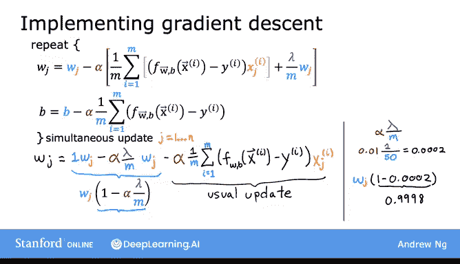

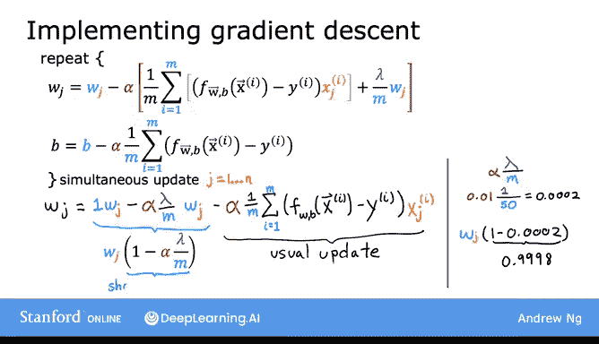

If you're curious about how these derivative terms were computed。

 have just one last optional slide that goes through just a little bit of the calculation of the derivative term again。

 this slide and the rest of this video are completely optional。

 meaning you won't need any of this to do the practice labs and a quizzes。

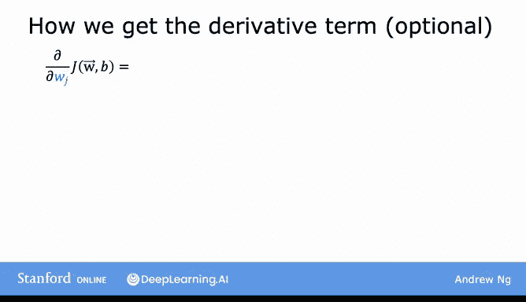

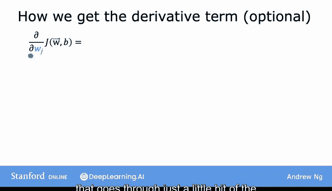

So let's step through quickly the derivative calculation。The derivative of Jay who respect to。

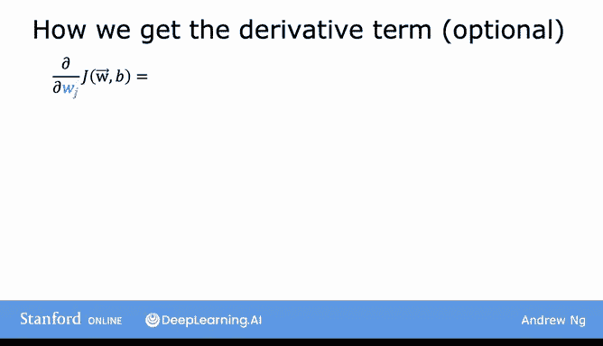

WJ looks like this。

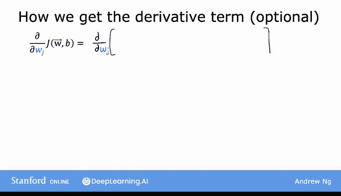

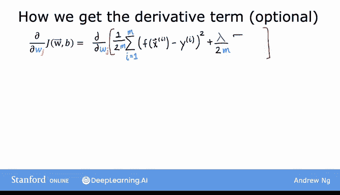

Recall that F of x for linear regression is defined as w dot x plus B。

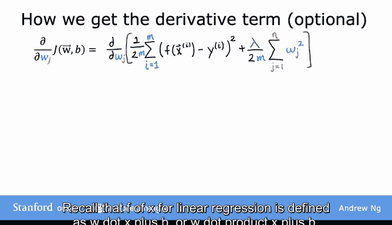

Or W dot product X+ B。

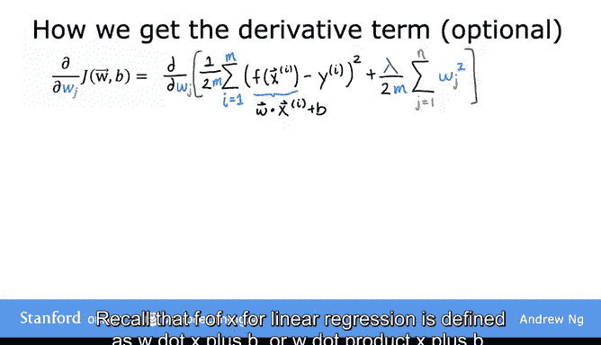

And it turns out that by the rules of calculus， the derivatives look like this is 1 over 2 m times the sum I equals 1 through M。

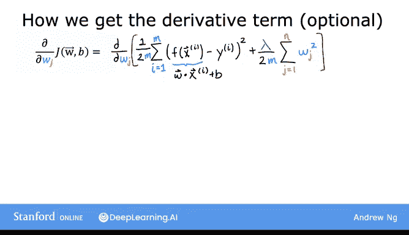

Of W dot x plus B。Minus y times 2 xj plus the derivative of the regularization term。

 which is lambda over 2 m times 2 Wj。

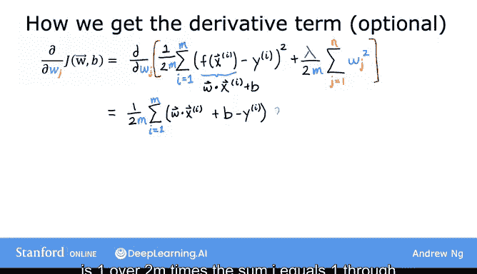

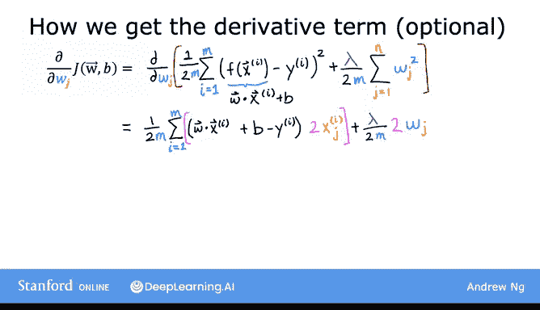

Notice that the second term does not have the summation term from J equals1 through n anymore。

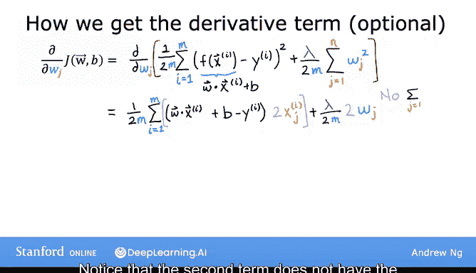

The toolss cancel out here and here and also here and here。

And so it simplifies to this expression over here。

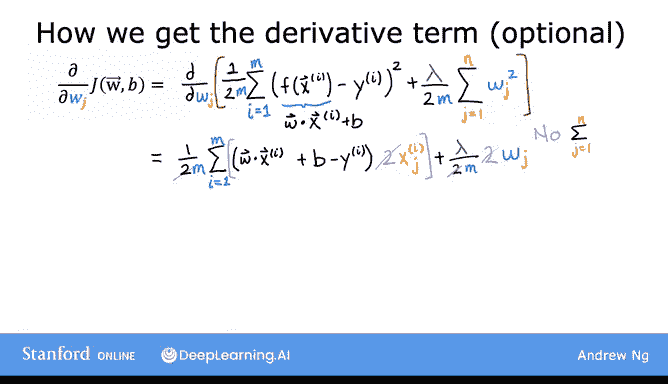

And finally， remember that Wx plus b is F of x， and so you can rewrite it as this expression down here。

So this is why this expression is used to compute the gradient in regularized linear regression。

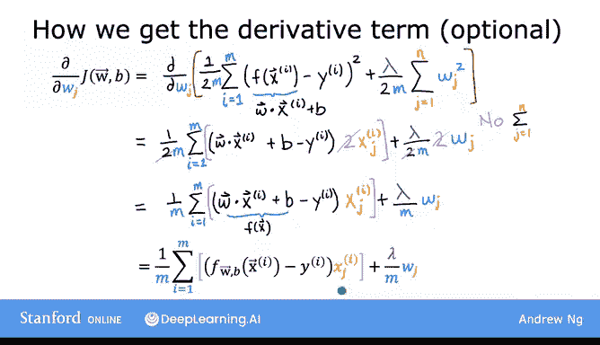

So you now know how to implement regular linear regression using this。

 you really reduce overfitting when you have a lot of features in a relatively small training set。

 and this should let you get linear regression to work much better on many problems。

In the next video， we'll take this regularization idea and apply it to logistic regression to avoid overfitting for logistic regression as well。

 let's take a look at that in the next video。😊。