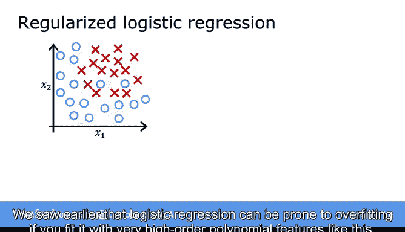
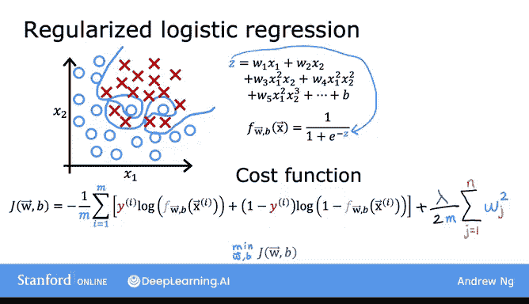
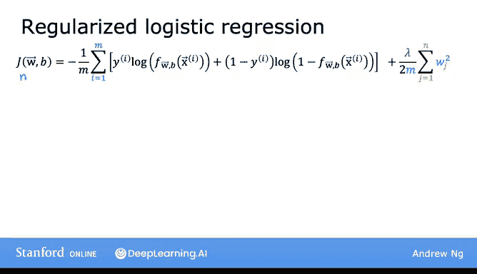
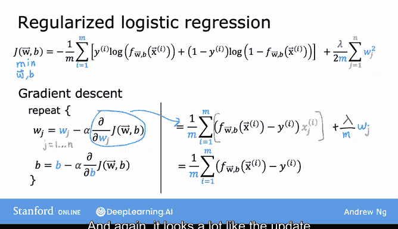
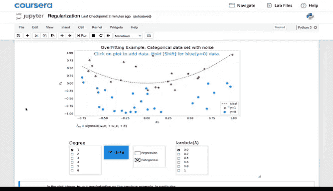
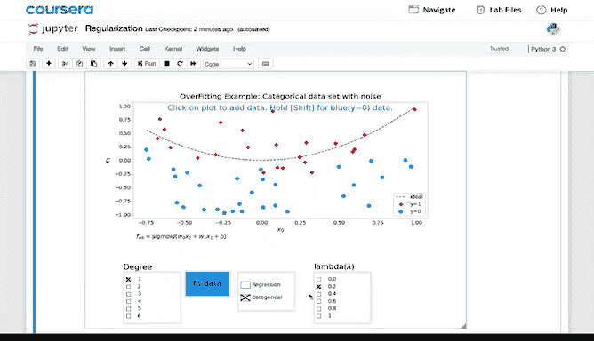
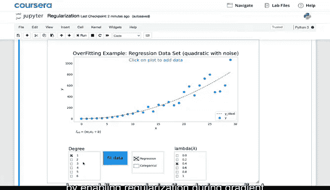
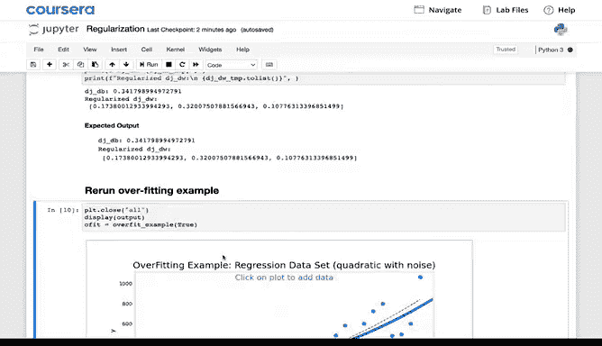
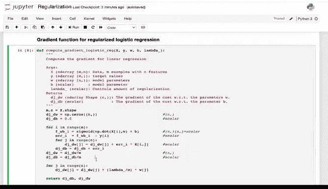
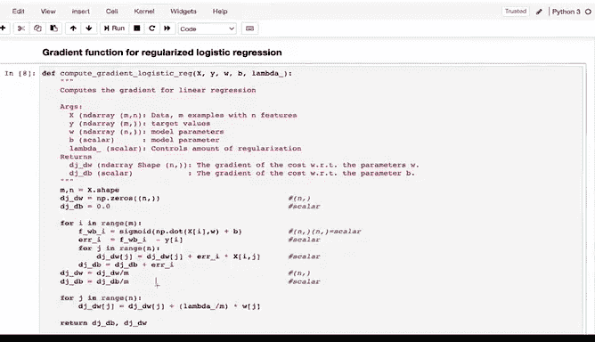

# 吴恩达《机器学习》｜machine-learning（中英字幕-deepseek翻译） - P41：41_03_05_正则化逻辑回归.zh_en - GPT中英字幕课程资源 - BV1MN4y1S7DE

In this video you see how to implement regularized logistic regression just as the gradient update for logistic regression has seemed surprisingly similar to the gradient update for linear regression。

 you find that the gradient to an update for regularized logistic regression will also look similar to the update for regularized linear regression Let's take a look。

Here's the idea we saw earlier that logistic regression can be prone to overfitting if you fit it with very high order polynomial features like this。

Here Z is a high order polynomial that gets passed into the sigmoid function like so to compute F。

And in particular， you can end up with a decision boundary that is overly complex and overfi training set。

More generally， when you train logistic regression with a lot of features。

 whether polynomial features or some other features， there can be a higher risk of overfitting。

This was the cost function for logistic regression。If you want to modify it to use regularization。

 all you need to do is add to it the following term。

Let's add lambda the regulargization parameter over 2 m times the sum from J equals1 through n。

 where n is the number of features as usual， of W J squared。

So when you minimize this cost function as a function of W and B。

 it has the effect of penalizing parameters W1 W2 through WN and preventing them from being too large。

And if you do this， then even though you're fitting a high order polynomial with a lot of parameters。

 you still get the decision boundary that looks like this。

 something that looks more reasonable for separating positive and negative examples while also generalizing。

 hopefully to new examples not in the training set。So when using regularization。

 even when you have a lot of features， how can you actually implement this。

 how can you actually minimize this cost function J of WB that includes the regularization term？Well。

 let's use gradienting descent as before。So here's the cost function that you want to minimize and implement gradient descent as before will carry out the following simultaneous updates。

Over WJ and B。These are the usual update rules for gradient descent。

 and just like regularized linear regression， when you compute what are these derivative terms。

 the only thing that changes now is that the derivative respect to WJ gets this additional term。

Lambda over M times WJ added here at the end。And again。

 it looks a lot like the update for regularized linear regression， in fact。

 it is the exact same equation， except for the fact that the definition of F is now no longer the linear function。

 it is the logistic function applied to Z。

And similar to linear regression， we will regular only the parameters WJ， but not the parameters B。

 which is why there's no change to the update you would make for B。

In the final optional lab of this week， you revisit overfitting and in the interactive plot in the optional lab。

 you can now choose to regularize your models， both regression and classification by enabling regularization during gradient descent by selecting a value of the Lada。

Please take a look at the code for implementing regularized logistic regression in particular because you implement this in a practice lab yourself at the end of this week。

So now you know how to implement regularized logistic regression。When I walk around Silicon Val。

 there are many engineers using machine learning to create a ton of value。

 sometimes making a lot of money for the companies。

 and I know you've only been studying this stuff for a few weeks。

 but if you understand and can apply linear regression and logistic regression。

 that's actually all you need to create some very valuable applications。

While the specific learning algorithm you use are important。

 knowing things like when and how to reduce overfitting turns out to be one of the very valuable skills in the real world as well。

 so I want to say congratulations on how far you've come and I want to say great job for getting through all the way to the end of this video。

I hope you also work through the practice labs and quizzes。Having said that。

 there's so many more exciting things to learn。In the second course of this specialization you learn about neural networkss also called deep learning algorithms Ne networkss are responsible for many of the latest breakthroughs in AI today for practical speech recognition to computers accurately recognizing objects and images to selfdriving calls the way your neural network gets built actually uses a lot of what you've already learned like cost functions and gradient descent and Sigmoid functions So again。

 congratulations on reaching the end of this third and final week of course one I hope you have funded the labs and I will see you in next week's material on neural networks。

