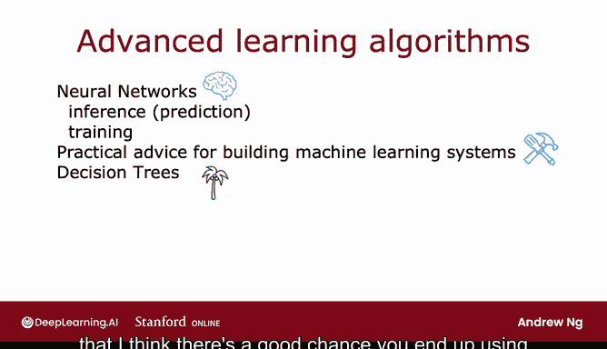

# 吴恩达《机器学习》｜machine-learning（中英字幕-deepseek翻译） - P43：01_01_01_欢迎.zh_en - GPT中英字幕课程资源 - BV1MN4y1S7DE

Welcome to Co2 of this machine learning specialization in this course you learn about neural networks also called deep learning algorithms as well as decision trees。

These are some of the most powerful and widely used machine learning algorithms。

 and you get to implement them and get them to work for yourself。

One of the things you see also in this course is practical advice on how to build machine learning systems This part of the material is quite unique to the course when you're building a practical machine learning system。

 there are a lot of decisions you have to make such as should you spend more time collecting data or should you buy a much bigger GPU to build a much bigger neural network。

Even today， when I visit a leading tech company and talk to the team working there on a machine learning application。

 unfortunately， sometimes I look at what they've been doing for the last six months and go，Ge。

 someone could have told you maybe even six months ago that that approach wasn't going to work that well。

With some of the tips that you learn in this course。

 I hope that you'll be one of the ones to not waste those six monthss。

 but instead be able to make more systematic and better decisions about how to build practical working machine learning applications so that let's dive in in detail this is what you see in the four weeks of this course in week1 we'll go over neural networks and how to carry out inference or prediction so if you were to go to the internet and download the parameters of a neural network that someone else had trained and whose parameters that posted on the internet then to use that neural network to make predictions would be called inference and you learn how neural networks work and how to do inference in week1 in this week next week you learn how to train your own neural network。

In particular， if you have a trading set of labeled examples， X and Y。

 how do you train the parameters of a neural network for yourself？

In the third week we'll then go into practical advice for building machine learning systems and I'll share with you some tips that I think even highly paid engineers building machine learning systems very successfully today don't really always manage to consistently apply and I think that will help you build systems yourself efficiently and quickly and then in the final week of discourse you learn about decision trees while decision trees don't get as much buzz in the media there's a little bit less hype about decision trees compared to neural networks。

 they are also one of the widely used and very powerful learning algorithms that I think there's a good chance you end up using yourself if you end up building an application。

So with that， let's jump into neural networks and we're going to start by taking a quick look at how the human brain that is how the biological brain works。

 let's go on to the next video。😊。