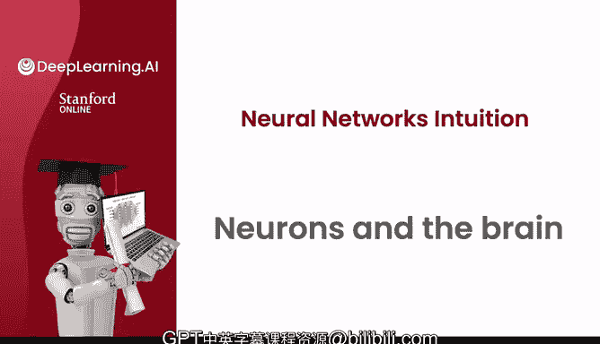
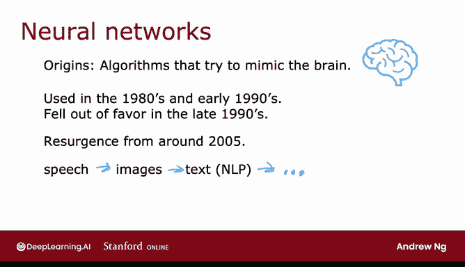
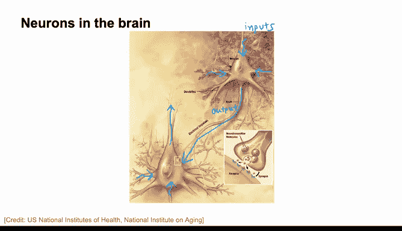
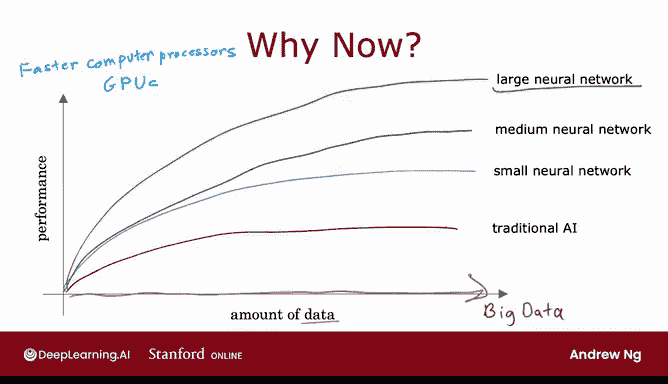

# 吴恩达《机器学习》｜machine-learning（中英字幕-deepseek翻译） - P44：02_01_02_神经元与大脑.zh_en - GPT中英字幕课程资源 - BV1MN4y1S7DE

When neural networks were first invented many decades ago。

 the original motivation was to write software that could mimic how the human brain or how the biological brain learns and things。

 and even though today neural networks， sometimes also called artificial neural networks have become very different than how any of us might think about how the brain actually works and learns。

 some of the biological motivation still remains in the way we think about artificial neural networks or computer neural networks today。

 so let's not by taking a look at how the brain works and how that relates to neural networks。

The human brain， or maybe more generally the biological brain。

 demonstrates a higher level or more capable level of intelligence than anything else we've been able to build so far。

 and so neural networks has started with the motivation of trying to build software to mimic the brain。

Work in neural networks had started back in the 1950s and then it fell out a favor for a while。

 then in the 1980s and early 1990s they gained in popularity again and showed tremendous traction in some applications like handwritten digit recognition。

 which were used even back then to read postal codes for routing mail and for reading dollars figures in handwritten checks。

But then it fell out the favor again in the late 1990s。

 and it was from about 2005 that had enjoyed the resurgence and also became maybe rebranded a little bit with deep learning。

One of the things that surprised me back then was deep learning and neural networks meant very similar things。

 but I maybe underappreciated at the time that the term deep learning just sounds much better because it's deep and it's learning and so that turned out to be the brand that took off in the last decade or decade and a half and since then neural networks have revolutionized application area after application area。

I think the first application area that modern neural networks of deep learning had a huge impact on was probably speech recognition where we started to see much better speech recognition systems due to modern deep learning and authors such as Leang and Jeff Hinton were instrumental to this。

And then it started to make invers into computer vision。

And sometimes people still speak of the INe moment in 2012。

 and that was maybe a biggest splash where then caught draw their imagination and had a big impact on computer vision。

Then in the next few years， it made us inroads into text or into natural language processing and so on and so forth。

 and now neural networks are used in everything from climate change to medical imaging to online advertising to broader recommendations and really lots of application areas of machine learning now use neural networks。

 even though today's neural networks have almost nothing to do with how the brain learns。

There was the early motivation of trying to build software to mimic the brain。

 so how does the brain work？

Here's a diagram illustrating what neurons in a brain looks like。

All of human thought is from neurons like these in your brain and mind。

 sending electrical impulses and sometimes forming new connections with other neurons。

Given a neuron like this one， it has a number of inputs where it receives electrical impulses from other neurons。

 and then this neuron that I've circled carries out some computations and will then send its output。

To other neurons via these electrical impulses， and this upper neuro output in turn becomes the input to this neuron down below。

 which again aggregates inputs from multiple other neurons to then maybe send is own output to yet other neurons and this is the stuff of which human thought is made。

Here's a simplified diagram of a biological neuron。

A neuron comprises a cell body shown here on the left， and if you have taken a class in biology。

 you may recognize this to be the nucleus of the neuron。And as we saw on the previous slide。

 the neuron has different inputs and in a biological neuron。

 the input wires are called the dendrites， and it then occasionally sends electrical impulses to other neurons via the output wire。

 which is called the axon。Don't worry about these biological terms。

 if you saw them in a biology class， you may remember them。

 but you don't really need to memorize any of these terms for the purpose of building artificial neural networks。

But this biological neuron may then send electrical impulses that becomes the input to another neuron。

So the artificial neural network uses a very simplified mathematical model of what a biological neuron does。

 and I'm going to draw a little circle here to denote a single neuron and what a neuron does is it takes some inputs one or more inputs which are just numbers。

And it does some computation and it outputs some other number。

 which then could be an input to a second neuron shown here on the right when you're building an artificial neural network or a deep learning algorithm rather than building one neuron at a time。

 you often want to simulate many such neurons at the same time and so when in this diagram I'm drawing three neurons。

And what these neurons do collectively is input a few numbers。

 carry out some computation and output some other numbers。 Now at this point。

 I'd like to give one big caveat， which is that even though I made a loose analogy between biological neurons and artificial neurons。

 I think that today we have almost no idea how the human brain works， In fact。

 every few years neuroscientists make some fundamental breakthrough about how the brain works and I think will continue to do so for the foreseeable future and that to me is a sign that there are many breakthroughs that are yet to be discovered about how the brain actually works。

 and thus attempts to blindly mimic what we know of the human brain today。

 which is frankly very little probably won't get as that far toward building real intelligence。

 certainly not with our current level of knowledge and neuroscience。Having said that。

 even with these extremely simplified models of a neuron， which we'll talk about。

 we'll be able to build really powerful deep learning algorithms and so as you go deeper into neural networks and into deep learning。

 even though the origins were biologically motivated。

 don't take the biological motivation too seriously， In fact。

 those of us that do research and deep learning have shifted away from looking to biological motivation that much。

 but instead at just using engineering principles to figure out how to build algorithms are more effective but I think it might still be fun to speculate and think about how biological neurons work every now and then。

The ideas of neural networks have been around for many decades， so a few people have asked me， hey。

 Andrew， why now， why is it that only in the last handful of years that neural networks have really taken off？

This is a picture I draw for them when I'm asked that question and that maybe you could draw for others as well if they ask you that question。

Let me plot on the horizontal axis the amount of data you have for a problem and on the vertical axis。

 the performance or the accuracy of a learning algorithm applied to that problem。

Over the last couple decades with the rise of the internet， the rise of mobile phones。

 the digitalization of our society， the amount of data we have for a lot of applications has steadily marched to the right。

 a lot of records that used be on paper such as if you order something rather than it being on a piece of paper there's much more likely to be a digital record。

 your health record if you see a doctor is much more likely to be digital now compared to on pieces of paper。

And so in many application areas， the amount of digital data has exploded。

And what we saw was with traditional machine learning algorithms such as logistic regression and linear regression。

Even as you fed those algorithms more data it was very difficult to get the performance to keep on going up。

 so it was as if the traditional learning algorithms like linear regression and logistic regression。

 they just weren't able to scale with the amount of data we could now feed it and they weren't able to take effective advantage of all this data we had for different applications。

And what AI research is started to observe。Was that if you were to train a small neural network on this data set。

 then the performance maybe looks like this。And if you were to train a medium sized neural network。

 meaning one with more neurons in it， this performance may look like that。

 and if you were to train a very large neural network。

 meaning one with a lot of these artificial neurons， then for some applications。

 the performance would just keep on going up。And so this meant two things it meant that for a certain class of applications where you do have a lot of data sometimes you hear the term big data toss around if you're able to train a very large neural network to take advantage of that huge amount of data you have then you could attain performance on anything ranging from speech recognition to image recognition to national language processing applications and many more that just were not possible with earlier generations of learning algorithms and this caused deep learning algorithms to take off and this too is why faster computer processes including the rise of GPUs or graphics processor units。

 this is hardware originally designed to generate nicelook computer graphics but turned out to be really powerful for deep learning as well that was also a major force in allowing deep learning algorithms to become what it is today。

That's how neural networks got started as well as why they took off so quickly in the last several years。

 let's now dive more deeply into the details of how neural network actually works Please go on to the next video。

