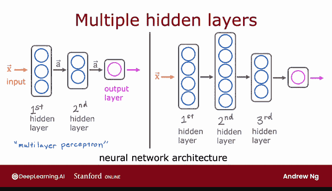

# 吴恩达《机器学习》｜machine-learning（中英字幕-deepseek翻译） - P45：03_01_03_需求预测.zh_en - GPT中英字幕课程资源 - BV1MN4y1S7DE

To illustrate how neural networks work， let's start to an example We'll use an example from demand prediction in which you look at the product and try to predict will this product be a top seller or not Let's take a look in this example you selling t-shirts and you would like to know if a particular t-shirt will be a top seller yes or no and you have collected data of different t-shirts that were sold at different prices as well as which ones became a top seller This type of application is used by retailers today in order to plan better inventory levels as well as marketing campaigns if you know what's likely to be a top seller you would plan for example to just purchase more of that stock in advance So in this example the input feature X is the price of the t-shirt and so that's the input to the learning algorithm and if you apply logistic regression to fit a signal。

M function to the data that might look like that。 Then the output of your prediction might look like this1 over one plus E is a negative W X plus B。

Previously we had written this as F of x as the output of the learning algorithm in order to set us up to build a neural network。

 I'm going to switch the terminology a little bit and use the alphabet a to denote the output of this logistic regression algorithm The term A stands for activation and is actually a term from neuroscience and it refers to how much a neuron is sending a high output to other neurons downstream from it It turns out that this logistic regression unit or this little logistic regression algorithm can be thought of as a very simplified model of a single neuron in the brain。

Where what the neuron does is it takes us input the price X。

 and then it computes this formula on top， and it outputs the number a。

 which is computed via this formula， and it outputs the probability of this t-shirt being a top seller。

Another way to think of a neuron is as a tiny little computer whose only job is to input one number or a few numbers such as a price。

 and then to output one number or maybe a few other numbers。

Which in this case is the probability of the T shirt being a top seller and as I alluded in the previous video。

A logistic regression algorithm is much simpler than what any biological neuron in your brain or mind does。

 which is why the artificial neural network is such a vastly oversimplified model of the human brain。

 even though in practice， as you know， deep learning algorithms do work very well。

Given this description of a single neuron， building a neural network now just requires taking a bunch of these neurons and wiring them together or putting them together。

Let's now look at the more complex example of demand prediction。In this example。

 we're going to have four features to predict whether or not a t-shirt is a top seller。

 the features are the price of the tshirt， the shipping cost。

 the amount of marketing of that particular thir， as well as the material quality。

 this is a high quality thick cotton versus a maybe a lower quality material。

Now you might suspect that whether or not a T-shirt becomes a top seller actually depends on a few factors first what is the affordability of this t-shirt second is what's the degree of awareness of this t-shirt that potential buyers have and third is perceived quality to bias or potential bias think this is a high quality t-shirt？

And so what I'm going to do is create one artificial neuron to try to estimate the probability that this t-shirt is perceived as highly affordable and affordability is mainly a function of price and shipping costs because the total amount you have to pay is some of the price plus the shipping cost。

And so we're going to use a little neuron here， a logistic regression unit to input price and shipping costs and predict do people think this is affordable？

Second， I'm going to create another artificial neuron here to estimate is there high awareness of this and awareness in this case is mainly a function of the marketing of the T-shirt and finally going to create another neuron to estimate to people perceived this to be of high quality。

And that may mainly be a function of the price of the T shirt and of the material quality。

Price is a factor here because fortunate or unfortunately， if there's a very high priced t-shirt。

 people will sometimes perceive that to be of high quality because if it's very expensive。

 then maybe people think it' got to be of high quality given these estimates of affordability awareness and perceived quality we then wire the outputs of these three neurons to another neuron here on the right。

 that then there's another leter Russian unit that finally inputs those three numbers and outputs the probability of this t-shirt being a top seller。

So in the terminology of neural networks， we're going to group。

These three neurons together into what's called a layer and a layer is a grouping of neurons。

 which take us input the same or similar features and that in turn output a few numbers together So these three neurons on the left from one layer。

 which is why I drew them on top of each other and the single neuron on the right is also one layer。

The layer on the left has three neurons， so a layer can have multiple neurons or it can also have a single neuron as in the case of this layer on the right this layer on the right is also called the output layer because the output of this final neuron is the output probability predicted by the neural network in the terminology of neural networks we're also going to call affordability awareness and perceived quality to be activations the term activations comes from biological neurons and it refers to the degree that the biological neuronsn is sending a high output value or sending many electrical impulses to other neurons to the downstream from it and so these numbers on affordability awareness and perceived quality are the activations of these three neurons in this layer。

And also this output probability is the activation of this neuron shown here on the right。

So this particular neural network therefore carries out computations as follows。

 it inputs four numbers， then this layer of the neural network uses those four numbers to compute three neural numbers。

 also called activation values， and then the final layer。

 the output layer of the neural network uses those three numbers to compute。One number。

 And in a neural network， this list of four numbers is also called the input layer。

 and that's just a list of four numbers。Now there's one simplification I'd like to make to this neural network。

 which is the way ofve described it so far， we had to go through the neurons one at a time and decide what inputs it would take from the previous layer。

 so for example， we said affordability is a function of just price and shipping costs and awareness is a function of just marketing and so on。

 but if you're building a large neural network itd be a lot of work to go through and manually decide which neurons should take。

 which features as inputs。The way a neural network is implemented in practice。

 each neuron in a certain layer， say this layer in the middle。

 will have access to every feature to every value from the previous layer from the input layer。

 which is why I'm now drawing arrows from every input feature to every one of these neurons shown here in the middle。

 and you can imagine that if you're trying to predict affordability。

And it knows what the price shipping cost， marketing a material maybe or'll learn to ignore marketing a material and just figure out through setting the parameters appropriately to only focus on the subset of features that are most relevant to affordability。

To further simplify the notation and the description of this neural network。

I'm going to take these four input features and write them as a vector X。

 And we're going to view the neural network as having four features that comprise。

This feature vector x and this feature vector is fed to this layer in the middle。

 which then computes three activation values。That is these three numbers。

And these three activation values。In turn becomes another vector。

 which is fed to this final output layer that finally outputs the probability of this T shirt being a top seller。

So that's all a neural network is， it has a few layers。

Where each layer inputs a vector and outputs another vector of numbers， where， for example。

 this layer in the middle inputs four numbers， x， and outputs three numbers corresponding to affordability。

 awareness and perceived quality。To add a little bit more terminology。

You've seen that this layer is called the output layer。

 and this layer is called the input layer to give the layer in the middle a name as well。

 this layer in the middle is called a hidden layer。

I know that this is maybe not the best of the most intuitive name。

 but that termology comes from that when you have a training set in a training set。

 you get to observe both X and y， your data set tells you what is X and what is y。

 and so you get data that tells you whether the correct inputs and the correct outputs。

 but your data set doesn't tell you whether the correct values for affordability awareness and perceived quality。

 and so the correct values for those are hidden， you don't see them in a trading set。

 which is why this layer in the middle is called a hidden layer。

I'd like to share with you another way of thinking about neural networks that I found useful for building my intuition about it。

 just let me cover up the left half of this diagram and see what we're left with。

What you see here is that there is a logistic regression algorithm or a logistic regression unit that is taking us input affordability。

 awareness and perceived quality of a t-shirt and using these three features to estimate the probability of the T-shirt being a top seller。

 so this is just logistic regression。But the cool thing about this is rather than using the original features。

 price shipping cost marketing and so on， is using a new maybe better seller features。

 affordability awareness and perceived quality that are hopefully more predictive of whether or not this t-shirt will be a top seller。

 so one way to think of this neural network is is just logistic regression。But。

It is a version of logistic regression that can learn its own features that makes it easier to make accurate predictions In fact。

 you might remember from the previous course this housing example where we said that if you want to predict the price of the holesse。

 you might take the frontage or the width of a lot to multiply that by the depth of a lot to construct a more complex feature X1 times x2。

 which was the size of the lot So there we were doing manual feature engineering where we had to look at the features X1 and x2 and decide by hand how to combine them together to come up with better features。

What the neural network does is instead of you needing to manually engineer the features。

 it can learn as you see later， its own features to make the learning problem easier for itself。

So this is what makes neural networks one of the most powerful learning algorithms in the world today。

 so to summarize a neural network does this， the input layer has a vector of features。

 full numbers in this example， it is input to the hidden layer which outputs three numbers and I'm going to use a vector to denote this vector of activations that this hidden layer outputs。

 and then the output layer takes this input deals three numbers and outputs one number。

 which would be the final activation or the final prediction of the neural network。One note。

 even though I previously described this neural network as computing affordability。

 awareness and perceived quality， one of the really nice properties of a neural network is when you train it from data。

 you don't need to go in to explicitly decide what other features such as affordability and so on that the neural network should compute instead it will figure out all by yourself。

 what other the features it wants to use in this hidden layer。

 and that's what makes it such powerful learning algorithm。

So you've seen here one example of a neural network and this neural network has a single layer that is a hidden layer。

 let's take a look at some other examples of neural networks。

 specifically examples with more than one hidden layer。Here's an example。

This neural network has an input feature vector x。That is fed to one hidden layer and I'm going to call this the first hidden layer。

 and so if this hidden layer has three neurons， it would then output a vector of three activation values。

These three numbers can then be input to a second hidden layer。

 and if this second hidden layer has two neurons， two logistic units。

 then this second hidden layer will output another vector of now two activation values that maybe goes to the output layer that then outputs the neural network's final prediction。

Or here's another example， here's a neural network that has this input goes to the first hidden layer。

 that the output to the first in layer goes to the second hidden layer goes to the third hidden layer and then finally to the output layer。

When you're building a neural neural network， one of the decisions you need to make is how many hidden layers do you want and how many neurons do you want each hidden layer to have And this question of how many hidden layers and how many neurons per hidden layer is a question of the architecture of the neural network you learn later in this course some tips for choosing an appropriate architecture for a neural network but choosing the right number of hidden layers and number of hidden units per layer can have an impact on the performance of your learning algorithm as well so later turn thiscourse you learn how to choose a good architecture for your neural network as well but by the way。

 in some of the literature you see this type of neural network with multiple layers like this called a multilayer perceptron。

 So you see that that just refers to a neural network that looks like what you're seeing here on the slide。

So that's a neural network I know we went through a lot in this video。

 so thank you for sticking with me but you now know how a neural network works in the next video。

 let's take a look at how these ideas can be applied to other applications as well in particular we'll take a look at the computer vision application of face recognition Let's go on to the next video。

😊。