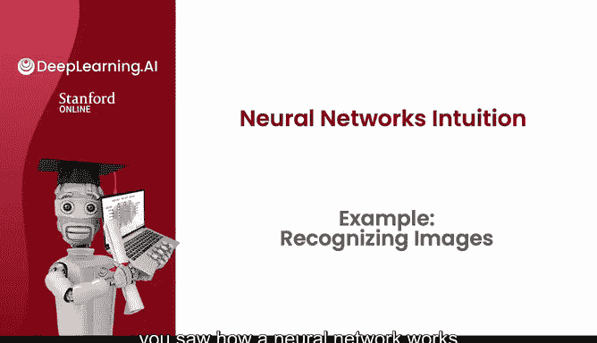
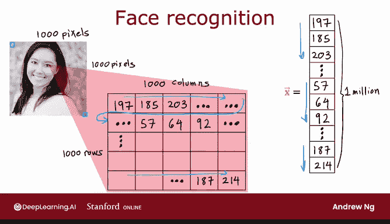
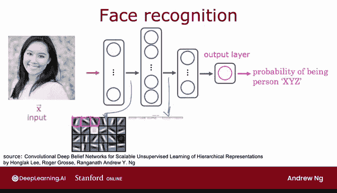
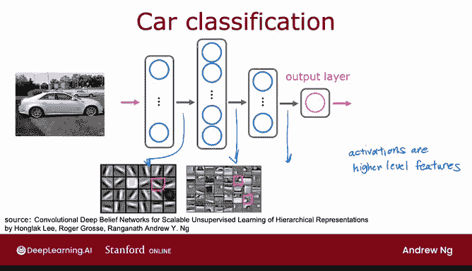

# 吴恩达《机器学习》｜machine-learning（中英字幕-deepseek翻译） - P46：04_01_04_示例：图像识别.zh_en - GPT中英字幕课程资源 - BV1MN4y1S7DE

In the last video you saw how a neural network works in a demand prediction example。

 let's take a look at how you can apply a similar type of idea to computer vision application。

 let's dive in if you're building a face recognition application you might want to train。

 say a neural network that takes inputs a picture like this and outputs the identity of the person in the picture。

This image is  a00 by10 pixels and so it its representation in the computer is actually as a thousand by10 grid。

 or also called a thousand by10 matrix of pixel intensity values。

In this example， my pixel intensity values or pixel brightness values goes from0 to 255。

 and so 197 here would be the brightness of the pixel and the very upper left of the image。

 185 is the brightness of the pixel， one pixel over and so on。

Down to 214 would be the lower right corner of this image。

If you were to take these pixel intensity values and unroll them into a vector。

 you end up with a list or a vector of a million pixel intensity values。

1 million because1000 by100 squared gives you a million numbers。So the face recognition problem is。

 can you train a neural network that takes this input a feature vector with a million pixel brightness values and outputs the identity of the person in the picture？

So this is how you might build a neural network。

To carry out this task。自。Input image X is fed to this layer of neurons。

 This is the first hidden layer， which then extract some features。

 and the outputs of this first hidden layer is fed to a second hidden layer。

And that output is fed to 13 layer， and then finally to the output layer。

 which then estimates say the probability of this being a particular person。

One interesting thing would be if you look at a neural network that's been trained on a lot of images of faces and to try to visualize what are these hidden layerss trying to compute。

It turns out that when you train a system like this on a lot of pictures of faces and you peer at the different neurons in the hidden layers to figure out what they may be computing。

 this is what you might find。In the first hidden layer you might find one neuron that is looking for a little vertical line or a vertical edge like that and a second neuron looking for a oriented line or oriented edge like that and the third neuron looking for a line at that orientation and so on so in the earliest layers of a neural network you might find that the neurons are looking for very short line or very short edges in the image。

If you look at the next hidden layer， you find that these neurons might learn to group together lots of little short lines。

 a little short edge segments in order to look for parts or faces so for example。

 each of these little square boxes is a visualization of what that neuron is trying to detect and so this first neuron looks like is trying to detect the presence or absence of an eye in a certain position of the image and this second neuron looks like trying to detect the horn of a nose and maybe this neuron over here is trying to detect the bottom of an ear。

And then as you look at the next in layer， in this example。

 the neural network is aviating different parts of faces to then try to detect presence or absence of larger。

 coarser face shapes。And then finally， detecting how much the face corresponds to different face shapes。

It creates a rich set of features that then helps the output layer try to determine the identity of the person picture。

And a remarkable thing about the neural network is you can learn these feature detectors at the different hidden layers all by itself in this example。

 no one ever told it to look for short little edges in the first layer。

And eyes and noses and face pointss are second layer。

And then more complete face shapes of the third in layer。

The neural network is able to figure out these things all by itself from data Just one note。

 in this visualization， the neurons in the first hidden layer are shown looking at relatively small windows。

To look for these edges and then the second hidden layer is looking at bigger window and the third hidden layer is looking an even bigger window。

So these little neurons visualizations actually correspond to differently sized regions in the image。

Just for fun， let's see what happens if you were to train this neural network on a different data set。

 say on lots of pictures of cars pictured on the site。

The same learning algorithm is us to detect cars， will then learn edges in the first layer。

 so pretty similar。But then I'll learn to detect parts of cars in the second hidden layer and then more complete car shapes in the third hidden layer。

 so just by feeding at different data， the neural network automatically learns to detect very different features so as to try to make the predictions of car detection or person recognition or whether there iss a particular given task that it is trained on。

So that's how a neural network works for a computer vision application， and in fact。

 later this week you see how you can build a neural network yourself and apply it to a handwritten digit recognition application。

So far we've been going over the description of intuitions of neural networks to give you a feel for how they work in the next video。

 let's look more deeply into the concrete mathematics and the concrete implementational details of how you actually build one or more layers of the neural network and therefore how you can implement one of these things yourself let's go on to the next video。

