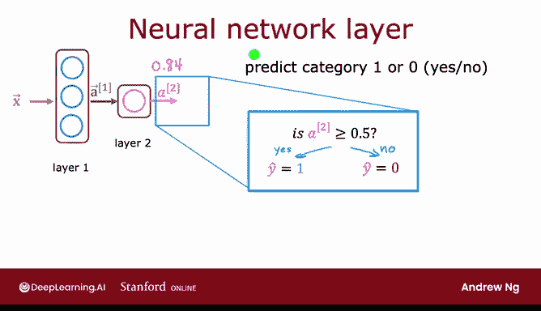

# 吴恩达《机器学习》｜machine-learning（中英字幕-deepseek翻译） - P47：05_01_01_神经网络层.zh_en - GPT中英字幕课程资源 - BV1MN4y1S7DE

The fundamental building block of most modern neural networks is a layer of neurons In this video you learn how to construct a layer of neurons and once you have that down you'd be able to take those building blocks and put them together to form a large neural network Let's take a look at how a layer of neurons works。

Here's the example we had from the demand prediction example where we had four input features that were fed to this layer of three neurons in this hidden layer that then sends its output to this output layer with just one neuron。

Let's zoom in to the hidden layer to look at its computations。This hidden layer inputs four numbers。

 and these four numbers are inputs to each of three neurons。

And each of these three neurons is just implementing a little logistic regression unit or a little logistic regression function。

So take this first neuron， it has two parameters W and B。

 and in fact to denote that this is the first hidden unit I'm going to sub this as W1 B1。

And what it does is output'll put some activation value A， which is G of w1。In a product with X plus。

比 one。Where this is the familiar Z value that you had learned about in logistic regression in the previous course。

 and G of z is the familiar logistic function，1 over 1 plus e to the negative z。

And so maybe this ends up being a number 0。3， and that's the activation value a of the first neuron。

To denote that this is the first neuron， I'm also going to add a subscript a1 over here。

 and so a1 maybe be a number like 0。3， just a 。3。Chance of this being highly affordable based on the input features。

Now let's look at the second neuron， the second neuron has parameters W2 and B2。

 and this WB or W2B2 are the parameters of the second logistic unit。

So compute a2 equals the logistic function G apply to W2 dot product X plus B2， and this may be。

Some other number say 0。7 because in this example， there's a 0。

7 chance that we think the potential bias will be aware of this T shirt。And similarly。

 the third neuron has a third set of parameters W3 B3 and similarly it computes an activation value A3 equals G of W3 dot product x plus B3 and that may be say 0。

2。 So in this example， these three neurons output 03。7 and 02。 and this vector of 3 numbers。

Becomes the vector of activation values。A， that is in pass。

To the final output layer of this neural network。 Now。

 when you build neural networks with multiple layers。

 it will be useful to give the layers different numbers。 So by condenion。

 this layer is called layer 1 of the neural network。

 And this layer is called layer 2 of the neural network。

 And the input layer is also sometimes called layer 0。 And today。

 there are neural networks that can have dozens or even hundreds of layers。

But in order to introduce notation to help us distinguish between the different layers。

 I'm going to use superscript square bracket one。To index into different layers。 So in particular。

 a superscript in square bracketers1， I'm going to use as a notation to denote the output of layer one of this hidden layer of this neural network。

And， similarly。W1 B1 here are the parameters of the first unit in layer1 of the neural network。

 so I'm also going to add a super strip in square brackets1 here。

And this is and W2B2 are the parameters of the second hidden unit or the second hidden neuron in layer1。

 and so those parameters are also denoted here， W superscript square back at one like so。

And similarly， I can add super strip square brackets like so to denote that these are the activation values of the hidden units of layer one of this neural network。

I know maybe this notation is getting a little bit cluttered。

 but the thing to remember is whenever you see this superscript square bracket one。

 that just refers to。A quantity that is associated with layer one of the neural network and。

If you see super strip square bracket2， that refers to the quantity associated with layer 2 of the neural network and similarly for other layers as well。

 including layer 3， layer 4， and so on for neural networks with more layers。

So that's the computation of layer1 of this neural network。This output is this activation vector。

 a super strip square bracket one。And I'm going to copy this over here because this output a1 becomes the input to layer 2。

So now let's zoom into the computation of layer2 of this neural network。

 which is also the output layer。So the input to layer 2 is the output of layer 1。

 So a1 is this vector 0。3，0。70。2 that we just computed on。The previous part of this slide。

And so because the upper layer has just a single neuron。

It all it does is it computes a substrate one that is the output of its first and only neuron as G。

 the sigmoid function applied to W substrate1 in a product with a superscript square bracket one。

 So this is。The input into this layer， and then plus B1。

Here this is the quantity Z that you're familiar with and G as before is the sigmoid function that you apply to this。

And if this results in a number， say 0。84， then that becomes the output of this。

Outllputs layer of the neural network。And in this example。

 because the upper layer has just a single neuron。This output is just a scalar as a single number rather than a vector of numbers。

Sticking with our notational convention from before。

 we're going to use a superscript in square brackets 2 to denote the quantities associated with layer 2 of this neural network。

 So a superscript square bracket 2 is the output of this。Layer。

 and so I'm going to also copy this here as the final output of the neural network and。

To make the notation consistent， you can also add these superscript square bracket twos to denote that these are the parameters and activation values associated with layer2 of the neural network。

Once the neural network has computed a2， there's one final optional step that you can choose to implement or not。

 which is if you want a binary prediction， you know one or zero， is this a top seller， yes or no。

 is you can take the number， a superscript square bracket is two subscript1。And this is the number 0。

84 that we computed。And thresholds at 0。5， so if it's greater than 0。

5 you can predict Y hat equals1 and if it's less 0。5。

 then predict your Y hat equals 0 and we saw this thresholding as well when you learned about logistic regression in the first course of the specialization。

So if you wish， this thing gives you the finalr prediction why hat is either one or zero if you don't want just a probability of it being a top seller。

So that's how a neural network works every layer inputs a vector of numbers and applies a bunch of logistic regression units to it and then computes another vector of numbers that then gets passed from layer to layer until you get the final output layers computation。

 which is a prediction of the neural network that you can either threshold at 0。

5 or not to come up with the final prediction。And with that。

 let's go on to use this foundation withBuildNow to look at some even more complex。

 even larger neural network models， and I hope that by seeing more examples this concept of layerss in how to put them together to build a neural network will become even clearer。

 so let's go on to the next video。