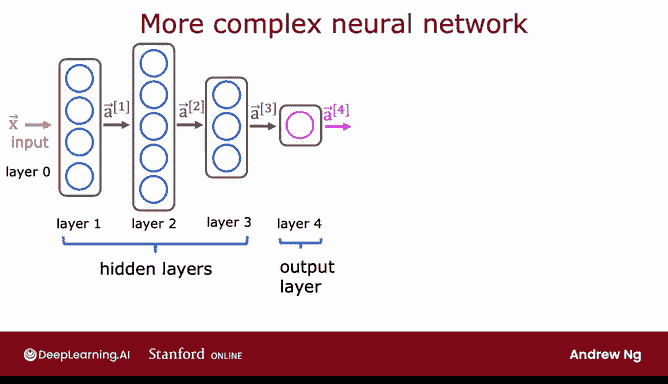
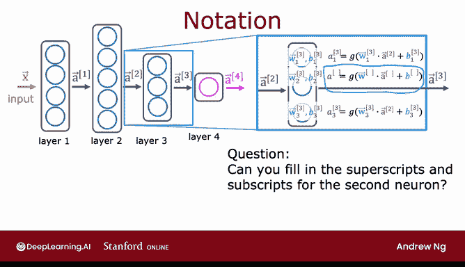
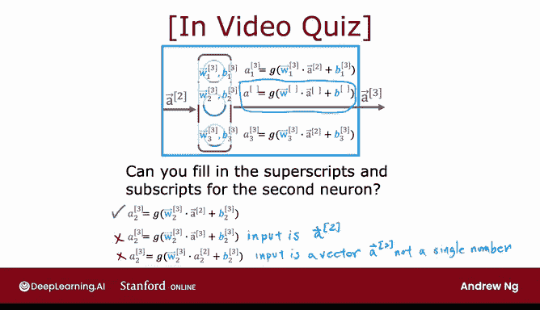
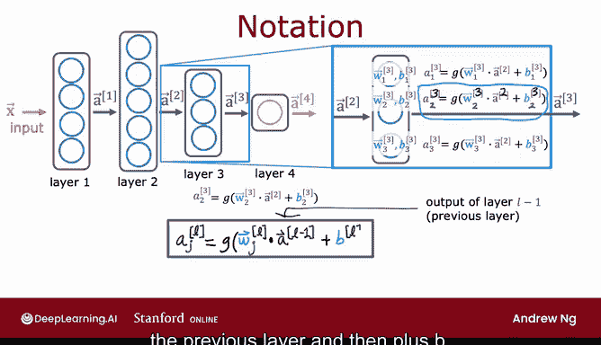

# 吴恩达《机器学习》｜machine-learning（中英字幕-deepseek翻译） - P48：06_01_02_更复杂的神经网络.zh_en - GPT中英字幕课程资源 - BV1MN4y1S7DE

In the last video you learned about the neural network layer and how that takes as input a vector of numbers and in turn outputs another vector of numbers。

In this video， let's use that layer to build a more complex neural network。 And through this。

 I hope that the notation that we're using for neural networks will become clearer and more concrete as well。

 Let's take a look。 This is the running example that I'm going to use throughout this video as an example of a more complex neural network。

 This network has four layers， not counting the input layer， which is also called layer 0。

Where layers1，2， and three are hidden layers， and layer 4 is the output layer。

 and layer 0 as usual is the input layer。By convention。

 when we say that the neural network has four layers。

 that includes all the hidden layers and the output layer， but we don't count the input layer。

 so this is a neural network with four layers in the conventional way of counting layers in the network。

Let's zoom in to layer 3， which is the third and final hidden layer to look at the computations of that layer。

Laier3 inputs a vector。A superscript square bracket2 that was computed by the previous layer。

And it outputs a3。Which is another vector。So what is the computation that layer 3 does in order to go from a2 to a3？

If it has three。Neurons， or we call it three hidden units， then it has parameters W1 B1。

 W2 B2 and W3 B3， and it computes a1 equals soid of w1 dot product with。

This input to the layer plus B1。And it computes a2 equals sigmoid of W2 thoughtt product with， again。

 a2， the input to the layer plus B2 and so on so get A3。

And then the output of this layer is a vector comprising a1， A2。And a3 and again by convention。

 if we want to more explicitly denote that all of these quantities associated with layer 3 that we add in all of these superscript square brackets3 here to denote that these parameters W and B are the parameters associated with neurons in layer 3 and that these activations are activations with layer 3。

Notice that this term here is W1 superscript square bracket3。

 meaning the parameters associatedsociative of layer 3 dot product with。

A superscript square bracket 2， which was the output of layer 2， which became the input to layer 3。

 So that's why there's a three here because there's a parameter associated of layer 3 dot product with。

 and there's a two there because it' the output of layer 2。 Now。

 let's just do a quick double check of our understanding of this。 I'm gonna。

Hide the supersscripts and subscripts associated with the second neuron。

And without rewinding this video， go ahead and rewind if you want， but prefer you not。

 but without rewinding this video， are you able to think through rather than missing supersscripts and subscripts in this equation and fill them in yourself？

Why don't you take a look at the end video quiz and see if you can figure out what are the appropriate superscripts and subscripts for this equation over here。

If you chose the first option， then you got the right the activation of the second neuron at layer 3 is denoted by A32。

To apply the activation function G， let's use the parameters of this same neuron。

So W and B will have the same subscript2 and superscript square bracket 3。

The input features will be the output vector from the previous layer， which is layer 2。

So that will be the vector a superscript2。 The second option is using vector a 3。

 which is not the output vector from the previous layer。 The input to this layer is a2。

And the third option has a2，2 as input， which is just a single number rather than the vector。

Because recall that the correct input is a vector， a2 with the little arrow on top and not just a single number。

So to recap， A3 is activation associated with layer 3 for the second neuron， hence there's a2。

 there's a parameter associated with the third layer for the second neuron， this is a2。

 same as above， and then plus B32， so hopefully that makes sense。

Here's the more general form of this equation for an arbitrary layer L and for an arbitrary unit J。

Which is that a de activationiv output of layer L unit J like a32。

 that's going to be the sigoid function。Applied to this term， which is the wave vector of layer L。

 such as layer 3。For the JV unit， so there's two again in the example above。

 and so that's that producted with。A deactiv value of and notice this is not L。 this is L minus1。

 like the two above here。Because you're dopro with the output from the previous layer。

And then plus B， the parameter for this layer for that unitJ。

And so this gives you the activation of layer L's unit J where the superscript square brackets L denotes layer L and the sub J denotes unit J and when building neural networks unit J refers to the J neuron so we use those terms a little bit interchangeably where each unit is a single neuron in a layer G here is the sigmoid function in the context of a neural network。

 G has another name which is also called the activation function。

 because G outputs this activation value So when I say activation function。

 I mean this function G here and so far the only activation function you've seen is a sigmoid function but next week we'll look at when other functions。

 then the sigmoid function can be plugged in in place of G as well。

 but so the activation function is just that function that outputs these activation values。

And just one last piece of notation in order to make all this notation consistent。

 I'm also doing to give the input vector x another name which is a0 So this way the same equation also works for the first layer where when L is equal to1 the activations of the first layer that is a1 be soid times the weights dot product with a0。

 which is just this input feature vector x。 So with this notation you now know how to compute the activation values of any layer in a neural network as a function of the parameters as well as the activations of the previous layer So you now know how to compute the activations of any layer given the activations of the previous layer let's put this into an inference algorithm for a neural network In other words。

 how to get a neural network to make predictions lets go。See that in the next video。

