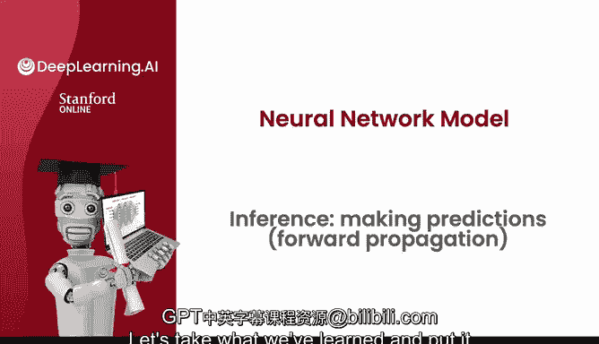
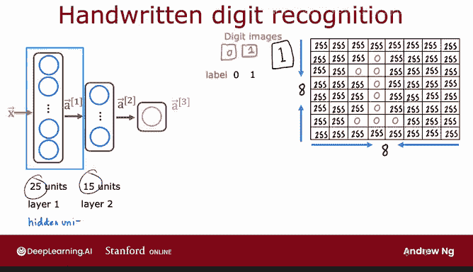
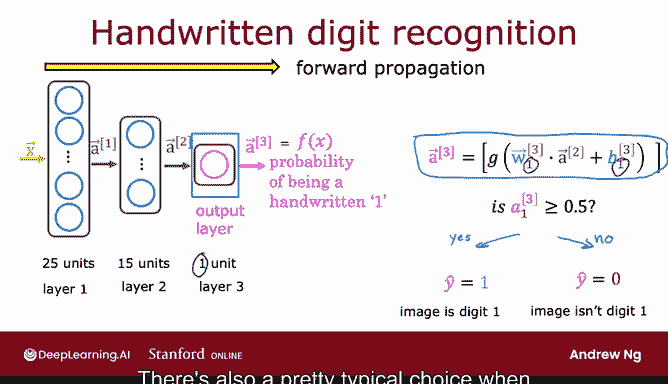

# 吴恩达《机器学习》｜machine-learning（中英字幕-deepseek翻译） - P49：07_01_03_推理：进行预测与正向传播.zh_en - GPT中英字幕课程资源 - BV1MN4y1S7DE

Let's take what we've learned and put it together into an algorithm to let your neural network make inferences or make predictions。

 this would be an algorithm called forward propagation， let's take a look。

I'm going to use as a multiing example， handwritten digit recognition， and for simplicity。

 we're just going to distinguish between the handwritten digits zero and1。

So it's just a binary classification problem where we're going to input an image and classify。

 is this the digit zero or the digit one， and you get to play with this yourself later this week in the practice lab as well。

For the example of this slide， I'm going to use an eight by8 image and so this image of one is this grid or matrix of8 by8 or 64 pixel intensity values where 255 denotes a bright white pixel and0 would denote a black pixel and different numbers are different shades of gray in between。

The shades of black and white Given these 64 input features。

 we're going to use a neural network with two hidden layers where the first hidden layer has 25 neurons or 25 units second hidden layer has 15 neurons of 15 units and then finally the output layer outputs Yeah what's the chance of this being 1 versus0 So let's step through the sequence of computations that the neural network would need to make to go from the input X this8 by 8 or 64 numbers to the predicted probability a3。

The first computation is to go from x to a1 and that's what the first layer or the first hidden layer does。

 it carries out a computation of a supersscript square bracket 1 equals this formula on the right notice that a1 has 25 numbers because this hidden layer has 25 units。

 which is why the parameters go from w1 through W 25 as was B1 through B25 and I've written x here but I will also have written a0 here because by a convention the activation of layer 0 that is a0 is equal to the input feature value x。

So that lets us compute a1。 The next step is to compute A2。Looking at the second hidden layer。

 it then carries out this computation where A2 is a function of A1 and is computed as the Saoid activation function applied to W dot product A1 plus the corresponding value of B。

Notice that layer 2 has 15 neurons of 15 units， which is why the parameters here run from W1 through W15 and B1 through B15。

Now we've computed A2。The final step is then to compute a3 and we do so using a very similar computation only now this third layer。

 the output layer has just one unit， which is why there's just one output here so a3 is just a scalar and finally you can optionally take a3 Sub 1 and threshold at 0。

5 to come up with a binary classification label is this the digit1 yes or no。

So the sequence of computations first takes x and then computes a1 and then computes a2 and then computes A3。

 which is also the output of the neural network， so you can also write that as F of x so remember when we learned about linear regression and logistic regression。

 we use F of x to denote the output of linear regression or logistic regression。

 so we can also use f of x to denote the function computed by the neural network as a function of x。

Because this computation goes from left to right， you start from X then compute A1， then A2 then A3。

 this algorithm is also called forward propagation because you're propagating the activations of the neuronsn so you're making these computations in the forward direction from left to right。

And this is in contrast to a different algorithm called backward propagation or back propagation。

 which is used for learning and that's something you learn about next week。And by the way。

 this type of neural network architecture， where you have more hidden units initially。

 and then the number of hidden units decreases as you get closer to the output layer。

 there's also a pretty typical choice when choosing neural network architectures and you see more examples of this in the practice lab as well so that neural network inference using the four propag algorithm and with this you'd be able to download the parameters of a neural network that someone else had trained and posted on the internet and you'd be able to carry out inference on your neural data using their neural network。

Now that you've seen the map and the algorithm， let's take a look at how you can actually implement this in TensorFpe。

 specifically let's take a look at this in the next video。

