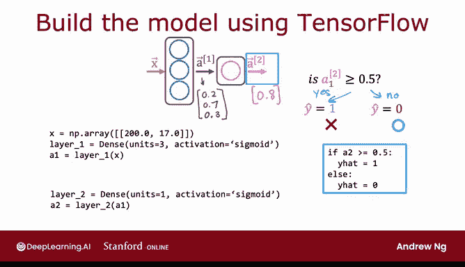
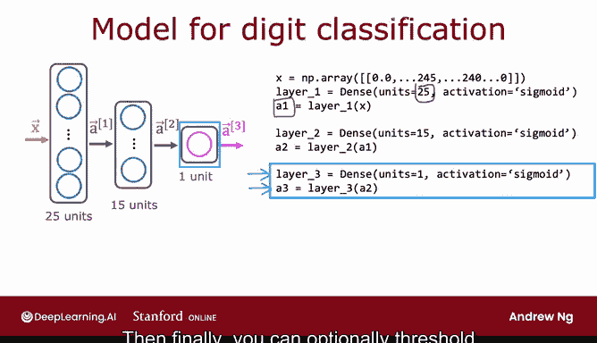

# 吴恩达《机器学习》｜machine-learning（中英字幕-deepseek翻译） - P50：08_01_01_代码中的推理.zh_en - GPT中英字幕课程资源 - BV1MN4y1S7DE

TenssorFlow is one of the leading frameworks for implementing deep learning algorithms when I'm building projects Tensorflowlow is actually the tool that I use the most often and the other popular tool is Ptorch but we're going to focus in this specialization on TensorFlow In this video let's take a look at how you can implement inference in code using Tensorflow let's diveing one of the remarkable things about neural networks is the same algorithm can be applied to so many different applications So in order both of this video and in some of the labs for you to see what the neural network is doing I'm going to use another example to illustrate inference。

So sometimes I do like to roast coffee beans myself at home。

My favorite is Ash kungin coffeeoffee beans。So can the learning algorithm help optimize the quality of the beans you get from a roing process like this？

When you're roasting coffee， two parameters you get to control are the temperature at which are heating up the raw coffee beans to turn them into nicely roasted coffee beans。

 as well as the duration or how long you're going to roast the beans and in this slightly simplified example。

 we've created the data sets of different temperatures and different durations as well as labels showing whether the coffee you roast it is good tasting coffee where cross here。

 the positive class， y equals one corresponds to good coffee and oh。

 the negative class corresponds to bad coffee。So it looks like a reasonable way to think of this data set is if you cook it at too low a temperature。

It doesn't get roasted and it ends up undercooked if you cook it not for long enough。

 the duration is too short， there's also not a nicely roasted set of beans and finally if you were to cook it either for too long or for too high a temperature then you end up with overcooked beans they're a little bit burnt beans and so there's not good coffee either and there's only points within this little triangle here that corresponds to good coffee。

This example is simplified a bit from actual coffee roast steam。

 even though this example is a simplifyimplified one for the purpose of illustration。

There have actually been serious projects using machine learning to optimize coffee roasting as well。

 so the task is given a feature vector X with both temperature and duration。

 say 200 degrees Celsius for 17 minutes how can we do inference in a neural network to get it to tell us whether or not this temperature and duration setting will result in good coffee or not it looks like this。

We're going to set X to B。An array of two numbers。The input features。

200 degrees Celsius and 17 minutes， then you create layer one as this first hidden layer of the neural network as dense open print units 3。

 that means three units or three hidden units in this layer using as the activation function。

 the sigmoid function。And dense is another name for the layers of a neural network that we've learned about so far。

 and as you learn more about neural networks， you learn about other types of layers as well。

 but for now we just use the dense layer， which is the layer type you've learned about in the last few videos for all of our examples。

 So next you compute a1 by taking layer 1， which is actually a function and applying this function layer1 to the values of x。

 So that's how you get a1。Which is going to be a list of three numbers because layer1 had three units。

 and so a1 here may， just for the sake of illustration be 02。7。3。Next， for the second hidden layer。

 layer2 would be dense of now this time has one unit and again the sigmoid activation function。

And you can then compute A2 by applying this layer 2 function to the activation values from layer 1 to A1。

 and that will give you the value of A2， which for the sake of illustration is maybe 0。8。Finally。

 if you wish the threshold is at 0。5， then you can just test if a2 is greater than equal to 0。

5 and set y hat equals to1 or0 possible negative class accordingly。

So that's how you do inference in the neural network using TensorF There are some additional details that I didn't go over here。

 such as how to load the TensorFlow library and how to also load the parameters W and B of the neural network but we'll go over that in the lab so please be sure to take a look at the lab。

 but these are the key steps for propagation and how you compute A1 and A2 and optionally threshold A2。

Let's look at one more example and we're going to go back to the handwrittenton digit classification problem。

So in this example， x is a list of the pixel intensity values。

 So x is equal to a non array of this list of pixel intensity values。

 and then to initialize and carry out one step propagation， layer1 is。

A dense layer with 25 units and a Sig point activation function。

 and you then compute a1 equals the layer 1 function applied to x。

To build and carry inference through the second layer， similarly， you set up layer2 as follows。

And then compute A2 as Leot 2 apply to A1。And then finally。

 layer 3 is the third and final dense layer， and then finally you can optionally threshold A3 to come up with a binary prediction for Y hat。

So that's the syntax for carrying out inference in Tensorflow。

One thing I briefly alluded to is the structure of the nupy arrays。

 Tensorflow treats data in a certain way that is important to get right。 So in the next video。

 let's take a look at how Tensorflow handles data。