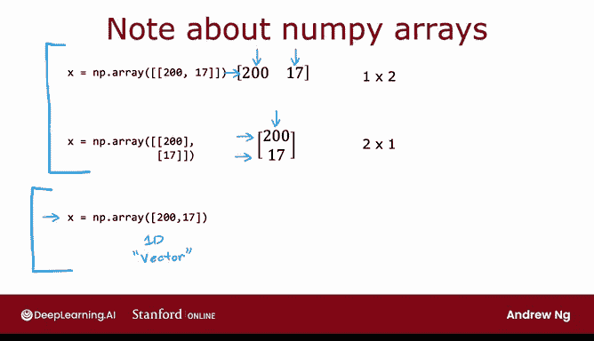
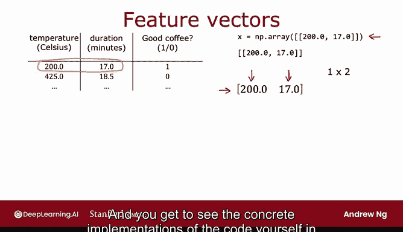
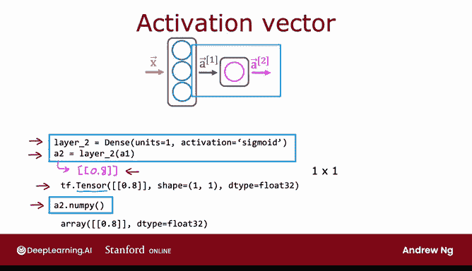

# 吴恩达《机器学习》｜machine-learning（中英字幕-deepseek翻译） - P51：09_01_02_TensorFlow中的数据.zh_en - GPT中英字幕课程资源 - BV1MN4y1S7DE

In this video I want to step through with you how data is represented in NumpI and In TensorF so that as you're implementing new neural networks。

 you can have a consistent framework to think about how to represent your data。

One of the unfortunate things about the way things are done in code today is that many。

 many years ago， NumpPI was first created and became a standard library for linear algebra Python and then much later the Google Bra team。

 the team that I had started and once led， created TensorF and so unfortunately there are some inconsistencies between how data is represented in Numpy and In TensorF So it's good to be aware of these conventions so that you can implement correct code and hopefully get things running in your neural networks。

 let's start by taking a look at how Tensorflow represents data。

Let's say you have a data set like this from the coffee example。

I mentioned that you would write X as follows， so why do you have this double square bracket here？

Let's take a look at how NumpI stores vectors and matrices。

In case you think matrices and vectors are complicated mathematical concepts， don't worry about it。

 we'll go through a few concrete examples and you be able to do everything you need to do with matrices and vectors in order to implement your networks let's start with an example of a matrix。

Here is a matrix with two rows and three columns。 notice that there are one，2 rows and one，2。

3 columns。 So we call this a two by three。Matrix。And so the convention is the dimension of the matrix is。

Written as the number of rows by the number of columns， so encode to store this matrix。

 this two by3 matrix， you just write x equals NP dot array of these numbers like these。

Where you notice that the square bracket tells you that one，2，3 is the first row of this matrix。

And 4，5，6 is the second row of this matrix。And then this outputpost square bracket。

Groups the first and the second row together。So this says x to be this to the array of numbers。

So a matrix is just a 2D array of numbers。Let's look at one more example。

Here I've written out another matrix。How many rows and how many columns does it have？Well。

 we can count， this has one，2，3，4 rows， and it has one，2 columns。

 So this is a number of rows by number of columns matrix。 So it's a 4 by2 matrix。

And so to store this in code， you would write x equals NP dot array and then distant text over here to store these four rows of a matrix in the variable x。

 so this creates a 2 d array of these eight numbers。Matrices can have different dimensions。

 you saw an example of a 2 by3 matrix and a4 by2 matrix。

A matrix can also be other dimensions like one by two or two by one。

And we'll see examples of these on the next slide。So what we did previously when setting x to be input feature vectors was set x to be equal to NPR array with two square bracketers。

 200 comma 17。And what that does is this creates a one by。Two matrix that is just one row。

And two columns。 Let's look at a different example。 If you were to define x to be NP。

 but now written like this， this creates a two by one matrix that has。Two rows。And one column。

Because the first row is just the number 200 and the second row is just the number 17。

 and so this has the same numbers， but in a two by one instead of a one by two matrix。In NAv。

 this example on top is also called a row vector， is a vector that is just a single row。

 and this example is also called a column vector because' a vector that just has a single column。

And the difference between using double square bracket like this versus a single square bracket like this。

Is that whereas the two examples on top are of 2D arrays where one of the dimensions happens to be one。

This example。Results in a 1D vector， so this is just a 1D array。That has no rows or columns。

Although by convention we may write X as a column like this。

 so on to contrast this with what we had previously done in the first course。

 which was to write x like this with a single square bracket and that resulted in what's called in Python a 1D vector instead of 2D matrix and this technically is not one by two or two by1 is just a linear array with no rows or no columns。

But it's just a list of numbers。So whereas in coursese 1。

 when we're working with linear regression and regression。

 we use these 1D vectors to represent the input features X with Tensorflow。

 the convention is to use matrixrices to represent the data and why is there this switch in conventions well it turns out that Tensorflow was designed to handle very large datasets and by representing the data in matrices instead of one D arrays it lets Tensorflow be a bit more computationally efficient internally So going back to our original example for the first training example in this dataset with features 200 degrees Celsius in 17 minutes we were represented like this and so this is actually a one by two matrix that happens to have one row and two columns to store the numbers 217？

And in case this seems like a lot of details and really complicated conventions。

 don't worry about it， all this will become clearer and you get to see the concrete implementations of the code yourself in the optional labs and in the practice labs。

 going back to the code for carrying out for propagation or inference in the neural network。

When you compute a1 equals layer 1 applied to x， what is a1？Well。

 a1 is actually going to be because the three numbers is actually going to be a one by three matrix。

And if you print out a1 you will get something like this is Tf。 Tenza。2。7。3 is a shape of 1 by 3。

13 refers to that this is a 1 by3 matrix， and this is Tensor flows way of saying that this is a floatinging point number。

 meaning that it's a number that can have a decimal point represented using 32 bits of memory in your computer。

 that's what the float 32 is。And what is a tensor， a tensor here is a data type that the Tensorflow team had created in order to store and carry out computations on matrices efficientlyly。

So whenever you see Tenza， just think over this。Mattrix on these few slides。

Technically a tensor is a little bit more general than the matrix。

 but for the purposes of this course think of Tenser as just a way of representing matrices so remember I said at the start of this video that theres the tensorflow way of representing a matrix and a nuy way of representing a matrix this is an artifact of the history of how nuy and Tensorflow were created and unfortunately there are two ways of representing a matrix that have been baked into these systems。

And in fact， if you want to take a1， which is a tensor and want to convert it back to a nuy array。

 you can do so with this A1。 nupy and it will take the same data and return it in the form of a nuy array rather than in the form of a tensorflow array or tensorflow matrix Now let's take a look at what the activations output by the second layer would look like。

Here's the code that we had from before layer2 is a dense layer with one unit in sigoid activation and A2 is computed by taking layer 2 and applying it to a1 so what is A2 A2 maybe be a number like 0。

8 and technically this is a1 by one matrix is a 2D array with one row and one column。

And so is equal to。This number0。8。 And if you print out a2。

 you see that it is a tensorflow tensor with just one element， one number 0。8。

 and it is a one by one matrix。 and again， it is a。Flolow 32， decimal points number。

 taking up 32 bits in compute memory。Once again， you can convert from a Tensorflow Tensor to a nuy matrix using A2 dot nuy。

 and that will turn this back into a nuy array that looks like this。

 so that hopefully gives you a sense of how data is represented in Tensorflowlow and in Numpy。

I'm used to loading data and manipulating data in Ny。

 but when you pass a Ny array into Tensorflowlow， Tensorflowlow lets to convert it to its own internal format。

 the tensor and then operate efficiently using tensors， and when you read the data back out。

 you can keep it as a tensor or convert it back to a nuy array。

I think it's a bit unfortunate that the history of how these libraries evolve has let us have us do this extra conversion work when actually the two libraries can work quite well together。

But when you convert back and forth， whether you're using a nu array or a tensor is just something to be aware of when you're writing code。

Next， let's take what we've learned and put it together to actually build a neural network。

 let's go see that in the next video。